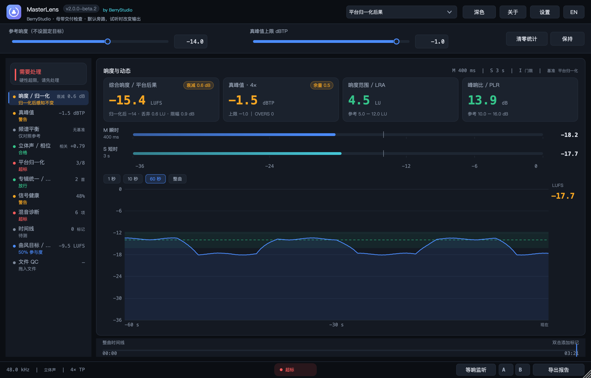
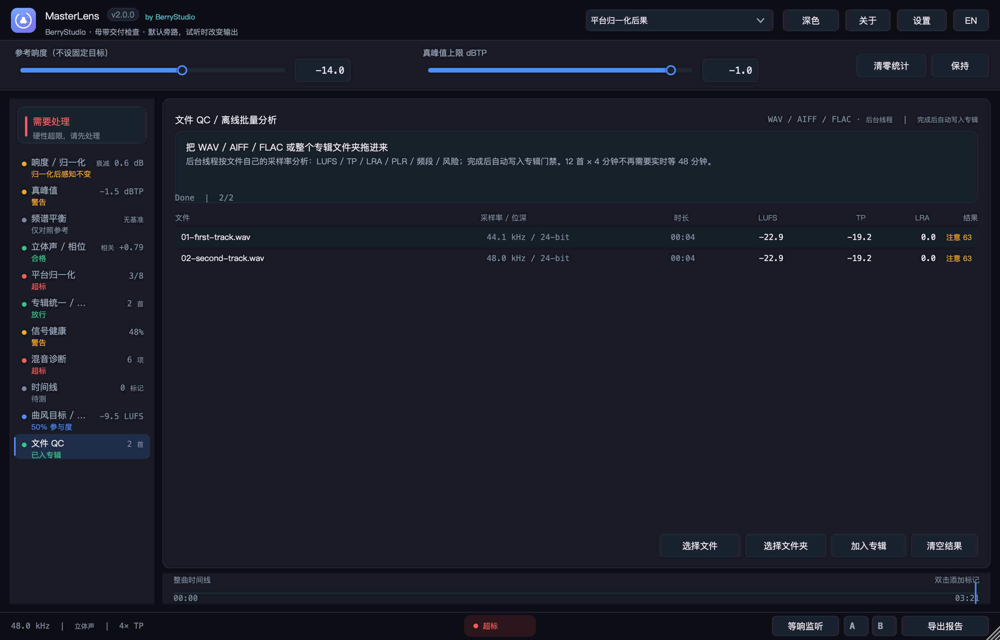
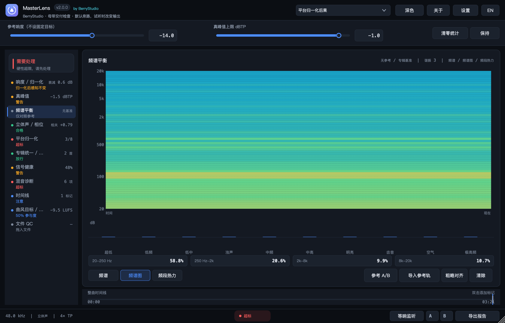
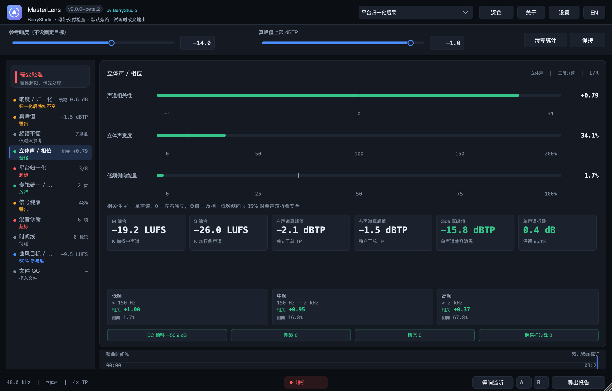

# MasterLens


**母带响度 / 文件 QC / 频谱图 / 选区 / M/S / CLI**<br>
by **BerryStudio** · developer **KNGTNPT**<br>
macOS / Windows 音频总线插件（VST3 / AU / 独立版），C++17 + JUCE 8。<br>
当前版本：**2.0.0**（正式版）

MasterLens 是插在总线或母带链最后一级的检查器。它默认零延迟、逐位旁路，不碰你的音频；只有你主动点试听、开等响监听或切到参考 A/B 时，输出才会临时改变。

它不负责把歌变好听，这件事还是得你来。它负责在你觉得“应该差不多了”的时候，把响度、平台会怎么处理、信号有没有受伤、整张专辑是否一致摊开给你看。

2.0 之前，它更像一块实时表。2.0 把几件真正影响交付的事接上了：整张专辑可以离线跑完、参考轨可以按宿主位置播放、时间戳跟宿主走、报告能直接交给客户或存档。








---

## 它检查什么

**响度和动态**：综合响度、瞬时、短时、LRA、PLR、4× 过采样真峰值，按 ITU-R BS.1770-4 / EBU R128 计算。M 和 S 也有各自独立的响度。

**平台归一化后果**：Spotify、Apple Music、YouTube、Tidal、Amazon、SoundCloud、播客和俱乐部，各自会加多少、砍多少、限掉多少、浪费多少响度，都列出来。它不会把某个固定 LUFS 当成所有人的合格线。

**信号健康**：失真 / 互调、混叠、超低堆积、瞬态、单声道折叠、中频掩蔽，六层风险会合并归因。点卡片可以实时 solo 当前总线，点时间戳可以回听问题片段。

**专辑和交付门禁**：把每首歌的 LUFS、LRA、PLR、真峰值、频段和相关性放到同一张表里，和专辑中位比较，按风险排序。规则可以开关，门禁结果和证据哈希可以导出。

**文件 QC**：不用实时播放整张专辑。拖入 WAV / AIFF / FLAC 或整个文件夹，后台按每个文件自己的采样率分析，结果自动进入专辑表。12 首 × 4 分钟不再需要等 48 分钟。

**参考和试听**：等响监听按参考或目标 LUFS 自动 trim；导入参考轨后可以在插件里按宿主播放头做 A/B，并做一次粗略的包络对齐。

**频谱和定位**：实时频谱、频谱图、10 段频段热力，三种看法各有用途。时间线可以拖选区，快速看某一段的响度、动态和声场。

**报告和自动化**：TXT / JSON / CSV / PDF，外加 100 ms 原始序列；`MasterLensCli` 可以直接对文件或文件夹做批量 QC。

---

## 五分钟上手

教程随版本更新，当前对应 **2.0.0**。

### 装好并插到总线

macOS 打开 DMG，双击「安装 Install.command」，然后重启 DAW。Windows 运行 `MasterLens-2.0.0-Windows-*.exe`，同样重启 DAW。

把 MasterLens 插在 **Master / Stereo Out** 最后一级，确认没有被宿主 bypass 或 mute。播放音频，它就会开始测量。

### 先看一首歌

从头播放 20–30 秒，等综合响度稳定。首页四张卡分别看综合响度、真峰值、LRA 和 PLR：

- 真峰值有没有超过顶部的「真峰值上限」；
- LRA 是不是被压得太扁；
- PLR 还剩多少瞬态；
- 平台归一化会带来多少衰减或浪费。

如果读数是上一版留下的，点「清零统计」或按 R，再重新播放当前版本。想比较修改前后，点底部 A / B 存快照，再点一次切换，右键清空。

信号健康里的六张卡可以点。卡片是当前总线的实时 solo；下面的时间戳会循环那 2 秒的问题区域。Esc 停止。

### 频谱页的三种看法

按 3 打开频谱页，左下角切换：

- **频谱**：当下这一刻，20 Hz–20 kHz 的曲线和峰值保持；
- **频谱图**：最近约 12.8 秒的时间 × 频率能量，适合找“什么时候开始刺、低频什么时候堆起来”；
- **频段热力**：把 10 个 QC 频段压成横向色带，适合看整段副歌的平衡变化。

频谱图的历史列是界面层按 20 Hz 采集的，不占音频线程。

### 整张专辑：用文件 QC

按 F 打开「文件 QC」，把 WAV / AIFF / FLAC 或整个专辑文件夹拖进来。也可以点「选择文件」或「选择文件夹」。

等右上角从 Analysing 变成 Done。每个文件会显示采样率、位深、时长、LUFS、TP、LRA 和风险。成功的结果会自动写入当前专辑，并重算中位和门禁。

然后按 5 看「专辑统一 / 交付门禁」：确认专辑名和曲目名，看右侧风险排序。文件 QC 的覆盖度是 100%，不需要填总长。点「导出证明」会得到 JSON + TXT，里面有每首快照、中位、规则、diff 和哈希。

文件 QC 是加到**当前专辑**里的。如果上一张专辑还没清空，新结果会和旧曲目并列；先清空，或者换一个专辑名。

### 实时采集一首歌

如果不走文件 QC，就在专辑页填「曲目名」和「总长 s」。总长按秒填，3:42 就是 222。

从曲目开头播放，让覆盖度到 95% 以上，再点「采集本曲」。每首重复一次。覆盖度不够时门禁会阻断，不会假装通过。


### 参考轨和等响 A/B

按 3 打开频谱页，点「导入参考轨」，选 1–4 条，第一条会用于内部 A/B。等载入完成。

点「参考 A/B」，插件会按宿主播放头播放参考文件；再点一次回到本曲。先播放本曲 10 秒以上，可以点「粗略对齐」，它会用最近 30 秒的短时响度包络找参考里最像的段落，给出偏移。这个对齐是段落级的，不是采样级同步。

底栏「等响监听」会按目标 LUFS 自动 trim，让 A/B 尽量在同一电平。两个功能默认关闭，关闭时逐位旁路。

### 选区和报告

拖动底部整曲时间线里的蓝色时间条，可以选一段。切到「时间线」页，会看到这一段的 LUFS、M、S、TP、PLR、相关性和宽度。选区数据也会写进报告。

选区是 **100 ms 包络估算**，适合快速定位；要精确逐段结果，请用文件 QC 或完整播放。

底部「导出报告」或 Cmd+E 会生成：

- `.txt`：完整中文报告；
- `.json`：结构化测量和专辑门禁；
- `.csv`：便于表格 / 脚本；
- `.pdf`：英文 ASCII 摘要；
- `-timeseries.csv`：100 ms 原始序列，含 M / S / TP 和 10 段频段。

### 命令行

DMG 根目录和 Windows 安装目录里都有 `MasterLensCli`：

```bash
MasterLensCli analyze /path/to/album --json report.json
MasterLensCli analyze track.wav --csv
```

支持 WAV / AIFF / FLAC，文件夹会递归展开。适合批量 QC、CI，或者把结果接进自己的脚本。

### 常见问题

| 现象 | 先看什么 |
| --- | --- |
| 没有读数、一直等待信号 | 插件是否在 Master 最后一级；宿主是否在播放；是否 bypass / mute |
| 文件 QC 没结果 | 只支持 WAV / AIFF / FLAC；文件夹是否有读取权限；是否等到 Done |
| 参考 A/B 没声音 | 宿主是否播放；参考轨是否载入完成；是不是已经切回本曲 |
| 覆盖度低于 95% | 专辑页填「总长 s」，从开头重播；文件 QC 不受影响 |
| 门禁阻断 | 看专辑页右侧风险排序，先处理红色前几项 |
| macOS 提示无法打开 | 右键 → 打开，或按 DMG 里的说明处理 Gatekeeper |
| 窗口太大或字太小 | 设置里选 100 / 125 / 150%；2.0 的 100% 已经比 1.x 紧 |

### 快捷键

空格按住保持，R 清零，1–9 切换模块，0 曲风目标，F 文件 QC，Esc 停止或关闭，Cmd+E 导出。

---

## ARA 与总线

MasterLens 不会做总线 ARA。原因不复杂：ARA 在大多数宿主里只开放给音频轨，而且常常要求插在第一个槽；主总线或编组一般拿不到 ARA。MasterLens 是总线分析器，ARA 解决不了“整张混音离线分析”，那件事用文件 QC 更快、更直接。

如果以后做一个“按轨分析”的变体，ARA 才有意义：它能直接拿到 clip / track 名、完整音频和时间范围，省掉手动改名和对时间。2.0 不做，是因为它不该硬塞进总线插件里。

---

## English summary

MasterLens 2.0 is a mastering bus inspector for macOS and Windows (VST3, AU, Standalone). It is bit-transparent by default and only changes the output when you explicitly audition, enable loudness matching, or switch to the reference player.

It measures integrated / momentary / short-term loudness, LRA, PLR, 4× true peak, independent Mid / Side loudness, per-channel and Side true peak. It models eight platform-normalisation destinations, checks signal integrity, compares against reference tracks or an album median, and keeps a versioned album gate with JSON / TXT proof.

The 2.0 release adds offline file and folder QC at native sample rates, host-playhead timestamps with coverage checks, equal-loudness monitoring, an in-plugin reference A/B player, spectrogram and band-heat views, timeline region estimates, 100 ms series export, PDF summaries, and a headless `MasterLensCli`.

There is no bus ARA. Most hosts expose ARA only on audio tracks, usually as the first insert; a bus analyser cannot rely on it. A per-track ARA variant is a possible future product, not part of 2.0.

**Verified:** 73 offline DSP assertions, `auval`, and CI on macOS, Windows x64 and Windows ARM64.

---

## 2.0 正式版：把实时检查和交付接起来

2.0 是从 1.5 的实时表长出来的。最明显的变化是文件 QC：以前检查一张专辑要按顺序播放，现在可以把整个文件夹拖进来，后台按每个文件自己的采样率跑完，结果直接进专辑表。它不替代试听，但能在你开始听之前，先把明显的问题排掉。

参考轨的采样率也修了。以前 96 kHz 的参考会被当成工程采样率读，频谱和响度都会偏；现在先重采样到工程采样率再分析，44.1 / 48 / 88.2 / 96 kHz 都有回归测试。

等响监听和参考 A/B 是另一个空洞。导入参考后，插件可以按宿主播放头播放参考文件，和本曲同一位置切换；等响监听负责把两边拉到接近的电平。参考播放器只载入第一条参考轨，自动对齐是包络级的粗略对齐，不是采样级同步。

时间戳现在跟宿主 playhead 走。专辑页填了总长之后，覆盖度低于 95% 会阻断门禁。宿主没有统一的曲目长度 API，这个字段只能手动填；没填时按已测时长记录。专辑快照会写进 APVTS，同时保留 album.json 和 Album_<name>.json。

2.0 还补了频谱图、频段热力、M/S 独立响度、时间线选区、100 ms 原始序列、PDF 和 CLI。选区和自动对齐都标了“估算 / 粗略”，没有把近似结果说成离线重算。

界面也重排过。100% 下字号比 1.x 大一点，行高、卡片和边距收紧，统计页填满高度，立体声页不再把固定高度块垂直居中。默认 1120×700，最小 880×560。

### 2.0 没有做的部分

- **AAX / AudioSuite**：需要 Avid SDK，当前仓库没有，不能编译或测试。
- **ARA2**：原因见上面的「ARA 与总线」，总线插件不做。
- **DDP / PQ 检查**：需要 DDP / cue 解析和实体发行规格，尚未实现。
- **编码预演**：需要外部编码器或内置 libopus；不把“能调 ffmpeg”算成已完成。
- **macOS 公证 / Windows 代码签名**：需要证书和 notary 凭据；当前仍是 ad-hoc 签名，Windows 由 CI 编译验证。
- **Windows 实机验证**：目前只有 CI 编译和安装包生成，没有在实体机器上的 DAW 回归。

这些没做，是因为手里没有 Avid / ARA SDK、DDP 规格和签名证书。没有条件就不冒充完成；以后拿到了再补。

---

## 1.5.1 更新：实时 Solo、时间戳问题区域、小屏友好、曲风目标回归

这一版主要是来“修上一版那个循环听感”的。1.5.0 的试听会反复播放历史片段，像在听一段卡住的录音；1.5.1 改成真正跟着 DAW 走，顺便把窗口、曲风参照和平台交付要求补齐。

- **信号健康卡片改成实时跟随 DAW（修复 1.5.0 的循环回放）**：点击六张卡片时，直接对当前总线输入做 HP/LP 滤波，跟随播放头实时输出；DAW 暂停 / 停止时立即静音，不再随机回放历史片段。5 ms 淡入、RMS 响度匹配、峰值保护都在；Esc 或再次点击停止。
- **时间戳问题区域循环（新增）**：失真、混叠、超低堆积、瞬态、单声道折叠、中频掩蔽任一越线时，自动生成带时间戳的 **2 s 问题区域**并写入时间线。点卡片 = 实时跟随；点时间戳 = 循环该段。两种监听不再混在一起。
- **窗口适配 MacBook Air 默认 DPI**：最小布局 **880×560**（原 900×620），默认 **1120×700**（原 1180×760）；首次启动按屏幕可用区域自动选缩放，旧工程保存的过大 150% / 200% 会自动降到可显示档位，并预留标题栏 / Dock 的空间。
- **曲风响度目标模块（独立页，快捷键 0）**：恢复 36 组曲风 / 平台参照；滑块 0–100% 控制“响度战争参与度”：**50% = 曲风标准**，0% = 该曲风最安静的发行观测值，100% = 最响的发行观测值。目标 LUFS、建议 LRA、真峰值上限实时计算；「应用为目标」写入手动参考，不会偷偷改平台模式。
- **平台交付要求表**：Spotify / Apple Music / YouTube / Tidal / Amazon / SoundCloud / 播客 / 俱乐部并列，含 LUFS、dBTP、编解码器、归一化行为、真峰值与尾部静音状态。
- **Apple 曲尾检查**：分析线程新增 trailing digital silence（−60 dBFS 阈值）计数；测到尾部静音才判定，没测到显示“尾部待测”，避免播放中途误报。Apple Digital Masters 参考要求：24-bit 源、TP ≤ −1 dBTP、无削波、曲尾 ≥1 s 无波形 / 数字静音（以发行商最终规范为准）。
- **报告扩展**：TXT / JSON / CSV 增加曲风目标、参与度、建议 LRA、平台编解码器与尾部静音字段。
- **验证**：**50** 项离线 DSP 断言通过（新增实时跟随、停止即静音、尾部静音测量）；`auval` 通过。

---

## 1.5.0 更新：双基准、专辑门禁、60 fps 频谱

- **判定基准重构**：固定曲风响度不再是合格线。顶部改为四种主基准：**平台归一化后果 / 参考轨 / 专辑中位 / 手动参考**。
  - 平台模式直接显示归一化衰减、服务端限幅、被丢弃响度；−4 LUFS 这种超高响度会明确说“归一化后感知响度不变，损失的是动态余量”。
  - 参考轨 / 专辑中位显示 LUFS、LRA、PLR 与基线差，只作差异提示，不自动判不合格。
  - 频谱平衡只对照参考轨 / 专辑中位；没参考就老实显示“无基准”，不套粉噪绝对曲线。
- **频谱 60 fps**：频谱页 60 Hz 分析与重绘（8192 FFT、分数倍频程平滑、峰值保持）；其他页面 30 Hz，HOLD 停止 FFT。
- **专辑统一 / 交付门禁**：逐首采集、专辑中位、偏离标记、风险排序、五个阻断规则开关、上一版 diff。
- **可复现交付证明**：JSON + TXT，schema / 版本 / 修订号、每首快照、中位、规则、门禁、风险、diff、SHA-256 快照哈希与证据哈希（证据哈希不含生成时间，可复算）。
- **问题联动试听（1.5.0 初版）**：信号卡片与专辑风险行可点击；当时采用历史片段循环，1.5.1 已把信号卡片改为实时跟随。
- **DAW 标记 / 自动化**：标记 CSV 导入 / 导出；自动化参数提供 transport start 重置、stop 采集、stop 导出证明、命令选择。
- **厂商名**：`COMPANY_NAME` / VST3 vendor / AU 名称 / Bundle ID 统一为 **BerryStudio**；AU manufacturer code 仍为 `OrcA` 以兼容已有工程。
- **验证**：46 项离线断言通过；`auval` 通过；专辑证明 JSON 可生成并带哈希。


---

## 1.4.3 更新：把性能按在地上省电

这一版不整花活，只干一件事：**让插件别把 CPU 当零食吃**。测量和界面功能保持不变，离屏基准下：

- 主界面（响度页）UI 线程：约 **6.5% → 1.2%** 单核（约 5× 降低）。
- 频谱页：约 **1.7%** 单核（当时 20 fps 频谱）。
- 信号健康页：约 **1.15%** 单核。
- DSP / 音频线程：约 **0.4%** 单核（0.30–0.50% 随负载波动）。

具体做了这些“抠门”优化：

- 倍频程平滑窗口（1/3、1/6、1/12 oct）在 `prepare()` 预计算，不再每帧跑 4097 次 `pow()` / `floor()`。
- 直接用 FFT 线性功率做前缀和，去掉 4097 次 dB→power 的 `pow(10, …)`。
- 用误差 <0.001 dB 的快速 `log10` 代替逐 bin `log10f`。
- 峰值保持改为 3 点局部最大值，删掉宽窗扫描和重复遍历。
- 不再每帧清零 2×8192 个 FFT 浮点；FFT 输出会覆盖整个缓冲。
- 页面感知分析：频谱页 20 fps，其他页 5 fps 取频段数据；HOLD 完全跳过 FFT。
- UI 分层刷新：Advisor / 模块灯 / 问题列表 5 Hz，信号缺陷 2 Hz，时间线标记复制 2 Hz。
- `UiState` 改为 move；参考轨只在变化时重绘；频段偏差单遍扫描。
- 频谱环形缓冲改按块写入，每块一次 acquire/release；单声道输入复用左声道滤波结果。
- 新增 `MasterLensUiShot bench pageN` 离屏 5 秒基准，输出 `UI_BENCH load=…%`，方便以后回归。

详见 `docs/performance-1.4.3.md`。

---

## 1.4.2 更新：缩放、品牌、频谱平滑、信号健康

- **界面缩放 / 字号**：设置里提供 **100 / 125 / 150 / 175 / 200%** 五档。字号、行高、卡片、窗口一起等比放大，布局不重排，所以不会因为放大而截字；⌘ + / ⌘ − 可快速调整，档位随工程保存。
- **BerryStudio 品牌标识**：矢量「镜头光圈 × 三颗浆果」，用于标题栏、关于、设置、报告、DMG / NSIS、插件图标与 README；`docs/logo.svg` 与 `packaging/icon.png` 由同一份几何生成。
- **频谱低频平滑**：功率域分数倍频程平均（≤250 Hz 1/3 oct、≤4 kHz 1/6、更高 1/12），再做 3 tap 平滑，三次 Hermite 插值 + 三次贝塞尔绘制。低频不再有 FFT 台阶，同时保留真实音调峰值。
- **平台归一化后果模拟**：平台页从“是否合格”改为“归一化后会发生什么”——8 个平台分别给出服务增益、限幅前真峰值、服务端限幅量、被丢弃响度与最终状态；俱乐部不归一化，只查峰值。
- **参考作品量化对比**：导入 1–4 条参考轨，按综合响度 / LRA / PLR / 真峰值 / 低频侧向 / 超低占比六项显示「你的 / 参考 / 差值」，并给出“响度换来了什么、丢失了什么”的结论。
- **信号健康页（第 6 个模块）**：谐波 / 互调、混叠 / 高频完整性、超低堆积、瞬态完整性、单声道折叠、中频掩蔽，加联动归因层。
- **诊断与报告**：Advisor 增加 7 条信号完整性规则与 1 条联动规则；TXT / JSON / CSV 增加信号完整性、平台限幅量、被丢弃响度、参考差值。
- **其它修复**：设置 / 关于 / 曲风面板互斥；Esc 优先关闭最上层面板；状态栏与页头不再用物理像素宽度；频谱峰值读数改用平滑曲线并保留音调峰值。

---

## 1.4.1 更新：曲风科普与响度战争滑块

- **每个曲风的「?」科普面板**：下拉菜单左侧出现 `?`，点开显示当前曲风已发行作品的实际响度区间（如摇滚 −11 ~ −8 LUFS、古典 −24 ~ −18 LUFS）、为什么会被压到那个程度，以及归一化时代还有没有收益。平台条目显示规范本身。
- **响度战争目标滑块**：目标响度 −30 ~ −5 LUFS；LRA 1 ~ 20 LU；允许削波 0 ~ 3 dB。三项随工程保存（`lraTarget` / `clipAllowance`）；削波 ≥1.5 dB 时提示“瞬态上会听出来”。
- **具体插件调整建议**：按所选目标实时生成链路建议（总线 EQ → 慢压缩 → 饱和 → 削波 → 限幅器）、压缩比例 / attack、限幅器 ceiling / 目标增益衰减 / release，以及 0.5 dB 步进流程。
- 例：目标 −9.5 LUFS → 比例 2:1、约 4 dB GR、release 120 ms、ceiling −1.0 dBTP；目标 −16 LUFS → 比例 1.5:1、1 dB GR、release 400 ms。
- **修复**：等宽字体缺中文字形导致乱码；多行文本行距重叠。

---

## 1.4.0 更新：36 组曲风 / 平台目标

- **曲风参考目标**：预设从 8 项平台预设扩展到 **36 个可选目标 + 自定义**，分「平台 / 规范」「曲风参考」「手动设定」。
  - 平台 / 规范（8）：流媒体通用、Spotify、Apple Music、YouTube、Tidal、播客、有声书、EBU R128 −23 LUFS。
  - 曲风参考（28）：俱乐部 / 舞曲 −8、EDM −8、浩室 / 科技舞曲 −8.5、DnB −7.5、Dubstep −7.5、合成器流行 −9、Lo-fi −14、环境 −18、流行 −9.5、嘻哈 / Trap −9、R&B / Soul −11、K-Pop −9、拉丁 −10、雷鬼 −12、摇滚 −10、现代摇滚 −9、金属 −9、朋克 −9.5、独立 / 另类 −11、布鲁斯 −14、乡村 −12、民谣 −14、爵士 −16、原声 / 器乐 −16、古典 −20、影视配乐 −20、游戏音频 −16、短视频 −14。
- 每条目标自带目标 LUFS、真峰值上限、建议 LRA 区间；选中即写入目标响度与 TP 上限，悬停显示完整参考值。
- 参考表写死在 `Source/Presets.h`，运行时不联网、不学习；加曲风只需加一行。
- **修复**：`·` / `±` 在部分字体下显示为 `·` / `±` 的乱码（改为 ASCII 输出）；预设改由 ComboBox ID 驱动，插入分组标题后不会错位。
- **打包链修复**：`make_dmg.sh` 构建全部目标，版本号从 `Source/Version.h` 自动读取。

---

## 1.3.0 更新：深色专业界面成型

- **深色主题 + 浅色主题**：令牌化设计系统——三层背景、1 px 描边、10 px 卡片 / 6 px 控件圆角、六档字号（32 / 26 / 13 / 12 / 11 / 10）；头部可切深浅，偏好随工程保存。
- **排版统一**：读数走等宽字体（自然 tabular），统一 1 位小数；负号统一 U+2212；区间用 en dash；数值、单位与轴标签分层配色，正文对比度 ≥4.5:1。
- **栅格重构**：Header 56 / 参数条 72（12 列栅格）/ 左导航 200 / 底部状态栏 40 / 时间线 44；当时窗口 900×620 – 1900×1400，默认 1180×760。
- **指标卡**：固定 104 px 三行网格，含「与目标差值 / 余量」胶囊、真峰值 4× 与 OVERS 计数、空态「等待信号」。
- **M/S 电平**：6 px 轨道、−36 / −24 / −12 / −6 / 0 刻度与 −14 目标线，数值右对齐等宽。
- **历史曲线**：1 s / 10 s / 60 s / 整曲切换、目标虚线 + LRA 8% 容许带、hover 十字线与时间 / 数值提示。
- **平台交付**：逐平台表格（目标 / 上限 / 需增益 / 预测 TP / 状态），超限行 6% 红底 + 2 px 红条。
- **诊断闭环**：9 项固定阈值检查清单，Advisor 增加「归一化后真峰值」规则。
- **交互**：Hold / 清零 / A/B 快照 / 标记、Space / R / 1–7 / Esc / ⌘E、TXT + JSON + CSV 导出、全部控件 tooltip 与焦点环。

> 小声说：当时的窗口还是 1180×760，后来 1.5.1 才学会在 MacBook Air 上收腹坐下。

---

## 1.2.0 更新：功能菜单化与频谱修复

- **左侧模块导航**：响度 / 真峰值 / 频谱 / 立体声 / 平台交付 / 混音诊断 / 时间线，每项带状态灯与 1–2 个关键读数；右侧只显示当前模块，底部统一时间线。
- **字号 / DPI**：全局字号上调，文字随窗口缩放；布局按比例 + 最小尺寸计算，任意纵横比不再错位。
- **频谱“方波”修复**：FFT 4096 → 8192，绘制改为按 bin 对数插值（不再取最大值阶梯），低频曲线平滑。
- **新增检查**：PSR（含最低点时间戳）、真峰值超限事件列表、三段分频相关性 / 侧向能量、四段能量占比、谐振检测（局部中值 +6 dB）、平台交付预测、参考轨导入（1–4 条，Welch 平均）、TXT + JSON 报告。

---

## 1.1.0 更新：界面更清爽、诊断可展开

- **界面**：全局字号 +12%；头部两行——第一行预设 / 关于 / 中英切换，第二行目标响度 / TP 上限 / 重置 / 冻结 / 导出；最小宽度 1120，卡片留白更均匀。
- **诊断可展开列表**：默认一行（标题 + 严重度 + 时间），点箭头或整行展开建议，再次点击收起；实时结论仍随音频更新。
- **性能大修**：定位到 `monoFont()` 每帧调用 `Font::findAllTypefaceNames()`（CoreText 字体枚举 + XPC）是卡顿主因；修复后同窗口 CPU **54% → ~11%**。同时缓存网格 / 坐标轴为离屏位图、动态视图 opaque、频谱 30 fps / 历史 10 fps 分层刷新。
- **关于面板**：显示版本、开发者 KNGTNPT、机构 BerryStudio、测量标准与构建信息；版本号同步出现在标题栏与报告尾部。

---

## 1.0.0 更新：初见版

这是 MasterLens 最早能拿出来见人的版本，轮廓大概是这样：

- 基础响度 / 真峰值 / 平台预设测量；
- 总线分析、TXT / JSON 报告；
- 深色界面与最初的模块化布局；
- 先解决“能看见问题”，再慢慢长出后面的频谱、信号健康、专辑门禁和曲风目标。

更细的 1.0.0 行为以 tag `v1.0.0` 的源码为准；这里保留一个不打肿脸的版本脉络，方便回头看它是怎么一步步长成现在这样的。


---

## 功能细节

### 母带响度

| 指标 | 说明 |
| --- | --- |
| 综合响度 I | ITU-R BS.1770-4 K 加权 + 门限积分（400 ms 块、75% 重叠、−70 LUFS 绝对门限、−10 LU 相对门限） |
| 瞬时 / 短时 M / S | 400 ms / 3 s 窗口，100 ms 更新 |
| 响度范围 LRA | EBU Tech 3342：3 s 短时、1 s 步进、−70 / −20 门限、10 / 95 百分位 |
| 峰响比 PLR | 真峰值 − 综合响度 |
| 真峰值 TP | 4× 过采样多相插值（96 tap、Blackman-Harris 窗），捕捉跨采样峰值 |
| 目标对齐 | 预设：流媒体 −14 / Apple Music −16 / YouTube −14 / 播客 −16 / 广播 EBU R128 −23 / 俱乐部 −8 LUFS |

### 双基准 / 平台归一化后果

- 主基准四种：**平台归一化后果 / 参考轨 / 专辑中位 / 手动参考**。
- 平台模式输出：服务增益、限幅前预测真峰值、最终预测真峰值、服务端必须做的限幅量、被归一化丢弃的响度、状态。俱乐部不归一化，只检查峰值。
- 参考轨 / 专辑中位模式输出：综合响度 / LRA / PLR / 真峰值 / 低频侧向 / 超低占比六项「你的 / 参考 / 差值」，并给出“响度换来了什么、丢失了什么”的结论。
- **固定曲风响度不是全局合格线**；曲风目标只存在独立模块里，不会偷偷套用。

### 混音质量诊断

- **失真**：采样级削波计数、跨采样过载区间计数、瞬态跳变（爆音 / 剪辑点）计数。
- **声场**：声道相关性、立体声宽度（侧 / 中能量比）、120 Hz 以下侧向能量（低频单声道检查）。
- **电平**：直流偏移（4 秒真均值）、动态过量压缩（LRA / PLR）。
- **频段平衡**：10 段（超低 20–60 Hz … 极高频 16–20 kHz）相对参考的偏差，指出 **浑浊（250–500 Hz 堆积）、刺耳（2–5 kHz 过硬）、齿音过重（5–9 kHz）、空气感不足（9–16 kHz）、超低频过重、低中频塌陷、整体偏亮 / 偏暗、频段空缺**。
- 每条结论带中文说明、数值与处理建议；事件类问题记录首次检出时间戳；通过项也会列出。

### 信号健康

- **谐波 / 互调**：50 Hz–2 kHz 强音的 2–5 次谐波相对局部谱底超出量；互调取低频峰与中频峰的 `f2±f1` 边带；平顶样本比例直接来自波形。
- **混叠**：16–20 kHz 相对 10–16 kHz 的密度斜率 + 顶级频谱平坦度；只有“更亮且更噪”才判混叠，避免把空气感当失真。
- **超低堆积**：40 Hz 以下真实能量占比（LR4 支路）+ 20–40 Hz 与 40–80 Hz 密度差。
- **瞬态完整性**：PLR / PSR / 峰响损失 / 平顶共同评分（0–100）。
- **单声道折叠**：直接计算 M=(L+R)/2 前后能量，输出损失 dB、整体与低频保留率。
- **中频掩蔽**：200–800 Hz 相对 1–4 kHz 的密度差，提示人声 / 军鼓被低中能量盖住。
- **联动归因层**：同一根因下同时越线的层合并成结论（限幅链、低频侧向、掩蔽叠加、混叠 + 失真）。

### 实时 Solo / 问题区域（1.5.1 重点）

- **卡片点击 = 实时跟随**：六张信号卡直接对当前输入做 HP/LP，跟随 DAW 播放头；停止 / 暂停时清零滤波器并静音，不读历史循环。
- **时间戳点击 = 定向循环**：层越线时记录 2 s 问题区域（开始 / 结束时间），点击后循环该段，按对应频段滤波并做 RMS 响度匹配。
- **5 ms 淡入淡出 + 峰值保护**；默认旁路时输出逐位不变；Esc 停止。
- 问题区域同时写入时间线，导出报告 / CSV 时也能看到时间戳。

### 曲风目标 / 平台交付要求（1.5.1 新增）

- 36 组静态参照：平台 / 规范 8 组 + 曲风 28 组 + 自定义。
- **响度战争参与度**：
  - 0% = 该曲风最安静的发行观测值；
  - 50% = 曲风标准；
  - 100% = 该曲风最响的发行观测值。
- 目标 LUFS、建议 LRA、TP 上限随滑块实时插值；点「应用为目标」写入手动参考与 LRA 目标，不偷偷改主基准。
- 平台表包含 LUFS / dBTP / 编解码器 / 归一化行为 / TP / 尾部静音状态。Apple Digital Masters 曲尾要求按 **≥1 s 无波形 / 数字静音** 检查（以发行商最终规范为准）。
- 尾部静音测量阈值 −60 dBFS；没测到尾部时显示“待测”，不冤枉正在播放的歌。

### 专辑统一 / 交付门禁

- 逐首「采集本曲」写入共享、带修订号的专辑快照；并列 LUFS / LRA / PLR / TP / Δ中位 / 状态。
- 标记偏离专辑中位阈值（LUFS、LRA、PLR、TP、频段、相关性）的曲目与段落。
- 按严重度排序平台归一化、编码 / TP、信号缺陷、单声道折叠、曲目间不一致；五个规则开关控制阻断。
- 保存上一版快照并自动 diff，只高亮新增或恶化项。
- 「导出证明」输出 JSON + TXT：schema / 版本 / 修订号、每首快照、中位、规则、门禁、风险、diff、SHA-256 快照哈希与证据哈希（证据哈希不含生成时间，可复算）。

### 文件 QC / 离线批量分析（2.0）

- 文件页接受 **WAV / AIFF / FLAC** 单文件或多个文件；拖入文件夹会递归展开并按文件名自然排序。
- 每个文件在后台线程用自己的采样率跑 `AnalysisEngine`（K 加权、门限、LRA、TP、相关 / 宽度 / DC / 削波 / 单声道 / 超低）与 8192 FFT 长期谱，输出 10 段频段密度与信号缺陷。
- 结果表显示采样率 / 位深、时长、LUFS、TP、LRA、最高风险；成功结果自动写入当前专辑快照，自动重算中位与门禁。
- 文件分析是离线、非实时的：不会占用音频线程，也不会改变当前监听。

### 宿主时间 / 覆盖度 / 专辑持久化（2.0）

- 事件时间戳 = `timeOrigin + 已播时长`，`timeOrigin` 在 reset / 首次处理时从宿主 playhead 读取；时间线、问题区域、CSV / JSON / TXT 统一使用宿主时间。
- 专辑页「总长 s」写入曲目总长后，`coveragePct = 已测时长 / 总长`；低于 95% 生成阻断项。宿主没有统一的曲目长度 API，所以这个字段必须手动填才能做严格门禁。
- 专辑快照同时写入 APVTS state、`album.json`（最近一次缓存）和 `Album_<name>.json`（命名 sidecar）；TrackRecord 含源文件名、时长、采样率、位深、覆盖度与插件版本。
- 时间戳试听超出 12 s 历史环时直接拒绝并提示，不再静默替换为最近 1.5 s。

### 等响监听 / 参考 A/B（2.0）

- 「等响监听」按 `目标 LUFS − 当前综合响度` 计算 trim，范围 −24 到 +12 dB；关闭时输出逐位不变。
- 「参考 A/B」把第一条参考文件解码到内存，按宿主 playhead 在插件输出端播放，按文件 / 工程采样率做线性插值；与等响监听共用同一 trim。
- 参考载入仍在后台线程；参考文件缺失或越界时输出静音而不是播放错误片段。

### 可视化

- 实时频谱：8192 点 FFT、频谱页 **60 fps**（其他页低负载刷新）、对数频率轴、功率域分数倍频程平滑（≤250 Hz 1/3 oct、≤4 kHz 1/6、更高 1/12）、峰值保持、三次曲线绘制。
- 短时响度历史：最近 3 分钟，带基准区间与基准线。
- M/S 电平条、相关性 / 宽度 / 低频单声道仪表、失真事件计数。
- 一键导出 TXT / JSON / CSV（全部测量值、信号完整性、归一化后果、曲风目标、专辑门禁与诊断结论）。

### 界面

- 深色专业主题（可切浅色）；界面缩放 100–200%，字号、行高、卡片与窗口一起等比放大且不截字。
- 2.0 基准布局：**880×560 – 1900×1400**，默认 **1120×700**；100% 采用更紧的字号 / 行高 / 卡片令牌，统计页纵向填满。
- **中英双语**：右上角 `EN / 中文` 一键切换；界面、诊断、报告同步；语言保存在插件状态。
- 11 个模块：响度、真峰值、频谱、立体声、平台归一化、专辑、信号健康、诊断、时间线、曲风目标、文件 QC；快捷键 1–9 + 0 + F。
- **等响监听 / 参考 A/B**：底栏「等响监听」按目标 LUFS 自动 trim；频谱页「参考 A/B」在插件内按宿主 playhead 播放参考文件。

| 中文 | English |
| --- | --- |
|  |  |

| 展开的诊断建议 | 关于面板 |
| --- | --- |
|  |  |

| 信号健康 / Signal health | 平台归一化 / Normalisation |
| --- | --- |
|  |  |

| 界面缩放设置 / Interface scale | 曲风目标 / Genre target |
| --- | --- |
|  |  |

| 联动事件（同一时间点合并归因） / Linked events | 立体声 / L·R·Side 真峰值 |
| --- | --- |
|  |  |


---

## 判定阈值（硬规则，不撒娇）

| 检查项 | 触发条件 | 严重度 |
| --- | --- | --- |
| 响度高于目标 | I > 目标 + 2 LU | 建议检查 |
| 响度低于目标 | I < 目标 − 2.5 LU | 可优化 |
| 真峰值过载 | TP > 上限 | 需要处理 |
| 贴近上限 | TP > 上限 − 0.1 dB | 可优化 |
| 动态过度压缩 | LRA < 3 LU | 建议检查 |
| 响度范围过大 | LRA > 16 LU | 可优化 |
| 瞬态被压扁 | PLR < 8 dB | 建议检查 |
| 相位冲突 | 相关性 < 0 | 需要处理 |
| 单声道兼容性偏低 | 相关性 < 0.15 | 建议检查 |
| 立体声过窄 | 宽度 < 15% | 可优化 |
| 立体声过宽 | 宽度 > 150% | 建议检查 |
| 低频非单声道 | 120 Hz 以下侧向 > 35% | 建议检查 |
| 削波 / 跨采样过载 / 爆音 | 计数 > 0 | 需要处理 / 建议检查 / 可优化 |
| 直流偏移 | 4 s 均值 > −46 dBFS | 建议检查 |
| 浑浊 / 刺耳 / 齿音 | 对应频段偏差 > +4.5 dB | 建议检查 |
| 空气感不足 | 9–16 kHz 偏差 < −5 dB | 可优化 |
| 超低频过重 | 20–60 Hz 偏差 > +5.5 dB | 可优化 |
| 低中频塌陷 | 120–250 Hz 偏差 < −5 dB | 可优化 |
| 整体偏亮 / 偏暗 | 高频段均值 − 中低频段均值 > ±6 dB | 建议检查 |
| 频段空缺 | 任一频段偏差 < −8 dB | 可优化 |
| 谐波 / 互调失真 | 2–5 次谐波相对局部谱底 > +5 dB 或互调边带 > +5 dB | 建议检查 |
| 平顶（硬削波） | 平顶样本 > 0.05%（>0.5% 需要处理） | 建议检查 / 需要处理 |
| 混叠风险 | 高频斜率 + 顶级平坦度综合风险 ≥55 | 建议检查 |
| 超低频堆积 | 40 Hz 以下占比 + 20–40 / 40–80 斜率综合风险 ≥55 | 可优化 |
| 瞬态完整性 | 评分 <45 / 100 | 建议检查 |
| 单声道折叠损失 | 损失 >1.5 dB（>4 dB 需要处理） | 建议检查 / 需要处理 |
| 中频掩蔽 | 200–800 Hz 相对 1–4 kHz 超出参考 6 dB 以上 | 可优化 |
| 多层联动 | 同时有 2 层以上信号异常 | 需要处理 |
| Apple 曲尾静音 | 测到尾部静音且 <1.0 s | 建议检查（交付前处理） |

频段偏差的计算：对长期平均功率谱按倍频程宽度归一化（粉噪参考），再与 20 Hz–16 kHz 各段密度的均值比较，因此衡量的是**相对平衡**；绝对值请结合素材类型判断。

---

## 构建（想自己搓一份的话）

依赖：macOS 11+、Xcode Command Line Tools、CMake ≥3.22。JUCE 8.0.15 已放在 `.tools/JUCE`；没有的话：

```bash
git clone --depth 1 --branch 8.0.15 https://github.com/juce-framework/JUCE.git .tools/JUCE
```

```bash
.tools/cmake-4.4.5-macos-universal/CMake.app/Contents/bin/cmake \
    -S . -B build -DCMAKE_BUILD_TYPE=Release -G "Unix Makefiles" \
    -DCMAKE_OSX_ARCHITECTURES=arm64
.tools/cmake-4.4.5-macos-universal/CMake.app/Contents/bin/cmake \
    --build build --config Release --target MasterLens MasterLensCli -j 10
```

产物：

```
build/MasterLens_artefacts/Release/VST3/MasterLens.vst3
build/MasterLens_artefacts/Release/AU/MasterLens.component
build/MasterLens_artefacts/Release/Standalone/MasterLens.app
build/MasterLensCli_artefacts/Release/MasterLensCli
```

### 打包 DMG（通用二进制）

```bash
./scripts/make_dmg.sh
```

输出 `dist/MasterLens-2.0.0-macOS.dmg`，并复制一份到桌面；内含 VST3、AU、独立版、`MasterLensCli`、安装 / 卸载脚本与说明。

### Windows

Windows x64 / ARM64 安装包由 GitHub Actions 的 MSVC + NSIS 矩阵生成；推送 `v*` 标签即可产出 `MasterLens-2.0.0-Windows-x64.exe` 与 `-ARM64.exe`，安装目录内包含 `MasterLensCli.exe`。

---

## 安装（macOS DMG）

1. 打开 DMG，双击「安装 Install.command」；如果 Gatekeeper 闹脾气，右键 → 打开。
2. 脚本会复制：
   - `~/Library/Audio/Plug-Ins/VST3/MasterLens.vst3`
   - `~/Library/Audio/Plug-Ins/Components/MasterLens.component`
   - `~/Applications/MasterLens.app`（独立版，方便不开 DAW 试听）
   - DMG 根目录的 `MasterLensCli`（可手动复制到 `~/bin` 或 `/usr/local/bin`）
3. 重启 DAW → 音频效果 / Analyzer 分类 → MasterLens。

卸载：双击 DMG 里的「卸载 Uninstall.command」。

---

## 验证（数字不会陪撒娇）

### DSP 自检

```bash
./build/MasterLensDspTest_artefacts/Release/MasterLensDspTest
```

覆盖：

- 997 Hz 单声道 −20 dBFS 正弦 → **−23.00 LUFS**（R128 标定点）。
- 立体声双声道相同信号 → −20.00 LUFS（BS.1770 声道能量求和，+3 LU 属标准行为）。
- 真峰值 / 采样峰值标定、稳态 LRA=0、相关性 ±1、反相宽度。
- 静音门限：20 s 静音后综合响度不变、短时归零。
- 直流偏移：+0.01 偏移 → −40.00 dBFS；55 Hz 低音 → −81 dBFS（无误报）。
- 频谱标定：满幅 1 kHz 正弦 → 峰值 0 dBFS ±1.5 dB、频点误差 <15 Hz。
- 单声道折叠、超低占比、平顶密度、失真 / 混叠检测器、试听旁路 / 实时跟随 / 停止静音、尾部静音测量。
- 文件分析：44.1 / 48 / 88.2 / 96 kHz 的 997 Hz 正弦都回到 −23.00 LUFS，源采样率与 100% 覆盖度正确。
- M/S 独立响度：dual-mono 的 M ≈ −23 LUFS、S 静音；CLI 与插件输出一致。
- 参考重采样：96 kHz 参考载入 48 kHz 工程后仍是 −23.00 LUFS；参考 A/B 播放器能按宿主位置出声。
- 宿主时间：time origin 83.25 s 后事件时间戳落在宿主时间；越界试听被拒绝且不静默播最近片段。
- CPU 基准：60 s 立体声 48 kHz 处理耗时。

当前：**73 项断言全部通过**（含 44.1 / 48 / 88.2 / 96 kHz 文件分析、参考重采样、宿主时间戳、越界拒绝、M/S 独立响度与参考播放器）；`auval -v aufx Maln OrcA` 通过。

### 插件格式

```bash
auval -v aufx Maln OrcA
```

VST3 moduleinfo：Version **2.0.0**，Vendor **BerryStudio**；显示版本 **2.0.0**，AU Bundle ID `com.berrystudio.masterlens`。

---

## 工程结构（想改代码的宝看这里）

```
CMakeLists.txt              JUCE 插件 / DSP 自检 / 离屏截图三个目标
Source/
  PluginProcessor.*         参数、总线、分析引擎、试听 / 参考播放、状态
  PluginEditor.*            布局、60 fps 定时器、文件拖放、报告导出
  EditorFiles.cpp           离线文件 QC 的 UI / 后台结果轮询
  Basis.h                   四种基准 / 平台摘要
  Delivery.h                8 个平台后果模型 + 交付要求
  Presets.h / GenreWar.h    36 组曲风参照 + 响度战争插值
  album/AlbumSession.*      专辑快照、门禁、风险、diff、证据哈希、工程持久化
  audio/AuditionEngine.*    实时 live solo + 历史片段循环
  audio/ReferencePlayer.*   参考 A/B 内部播放器（宿主位置同步）
  file/FileAnalyzer.*       离线文件 / 文件夹批量分析（原生采样率）
  cli/main.cpp              MasterLensCli 无 GUI 批量 QC
  EditorPdf.cpp             ASCII PDF 摘要报告
  EditorSeries.cpp          100 ms 原始序列 + 时间线选区估算
  dsp/
    AnalysisEngine.*        K 加权、门限、LRA、TP、相关性、宽度、DC、爆音、平顶、单声道、超低
    SpectrumAnalyzer.*      8192 FFT、分数倍频程平滑、峰值保持、长期平均谱
    DefectAnalyzer.*        六层信号缺陷与风险评分
    ReferenceSpectrum.*     参考轨频谱 + 响度统计
  ui/
    Theme.*                调色板、字体、缩放令牌
    Logo.*                 BerryStudio × MasterLens 矢量标识
    Panels.cpp             指标卡、M/S 条、声场仪表
    Spectra.cpp            频谱、频谱图、频段热力、频段平衡
    History.cpp            历史曲线
    DetailSignal.cpp       信号健康 + 问题区域
    DetailTarget.cpp       曲风目标 / 平台交付要求
    DetailFiles.cpp        文件 QC 拖放区 / 结果表
    DetailAlbum.cpp        专辑门禁
    Settings.cpp           界面缩放
    Advisor.*              阈值 + 迟滞 + 联动规则
Tests/DspTest.cpp           73 项离线断言 + CPU 基准
Tools/UiShot.cpp            离屏截图 / bench 基准
packaging/                  DMG 安装 / 卸载脚本、图标、说明
scripts/                    DMG / 发布 / logo 工具
```

---

## 已知限制（不藏，认真说）

- ad-hoc 签名，未做 Apple 公证；首次安装可能需要「右键 → 打开」或 `xattr -dr com.apple.quarantine`。
- 仅支持单声道 / 立体声总线（不做 5.1 / 7.1 声道权重）。
- 频谱为 8192 点 FFT，48 kHz 下分辨率 5.86 Hz，250 Hz 以下做 1/3 倍频程功率平均；极低频仍受房间与监听限制，细微差异请结合参考曲目。
- 频段平衡基于长期平均谱，需要数秒素材才稳定；静音时会保持上一状态。
- 通用二进制已构建（arm64 + x86_64），但只在 Apple Silicon 实机验证过；Windows 由 CI 编译验证。
- Apple 尾部静音需要宿主把尾部静音送入插件；如果 DAW 在最后一个样本处直接停处理，插件测不到。请在 DAW 播完尾部或检查导出文件。
- 平台要求是静态交付参照，不是 Apple / Spotify 认证；最终以发行商当前规范为准。插件无法从实时总线验证 24-bit 源文件。
- VST3 / AU 没有跨宿主标记写回 API，DAW 标记仍使用 CSV 交换。
- 曲风目标是参照，不是自动合格线；平台归一化模式仍是默认。
- 2.0：宿主长度需手动填「总长 s」才能做严格覆盖度门禁；参考 A/B 只载入第一条参考轨，自动对齐是包络级近似。
- 时间线选区是 100 ms 包络估算，不是重新离线分析；需要精确逐段结果时请用文件 QC 或完整播放。
- AAX / ARA2 / DDP / 编码预演需要外部 SDK / 编码器；macOS 公证与 Windows 代码签名需要证书。2.0 没有假装完成这些外部依赖项。
- 2.0：文件 QC 自动写入当前专辑快照；如果上一张专辑还没清空，会与原曲目并列，请先清空专辑或换一个专辑名。

---

## 发布 / 仓库

- 仓库：<https://github.com/KNGTNPT/MasterLens>
- 最新 Release：<https://github.com/KNGTNPT/MasterLens/releases/tag/v2.0.0>
- 安装包：macOS DMG、Windows x64 / ARM64 EXE
- 历史版本：`v1.5.0` … `v1.0.0`，每个 tag 都可以单独 checkout；本 README 的版本段落保留了它们的功能脉络。

```bash
git remote -v
# origin  git@github.com:KNGTNPT/MasterLens.git (fetch/push)
```

---

## 许可

JUCE 8.0.15 采用 AGPLv3 / 商业双许可；本项目源码按 AGPLv3 使用 JUCE。

---

> 最后小声一句：MasterLens 会尽量把问题说清楚，但不会替你决定“这样够不够响”。母带是审美 + 判断 + 一点点勇气的混合物；插件只是把灯打开。呜，去听歌吧。🎧
