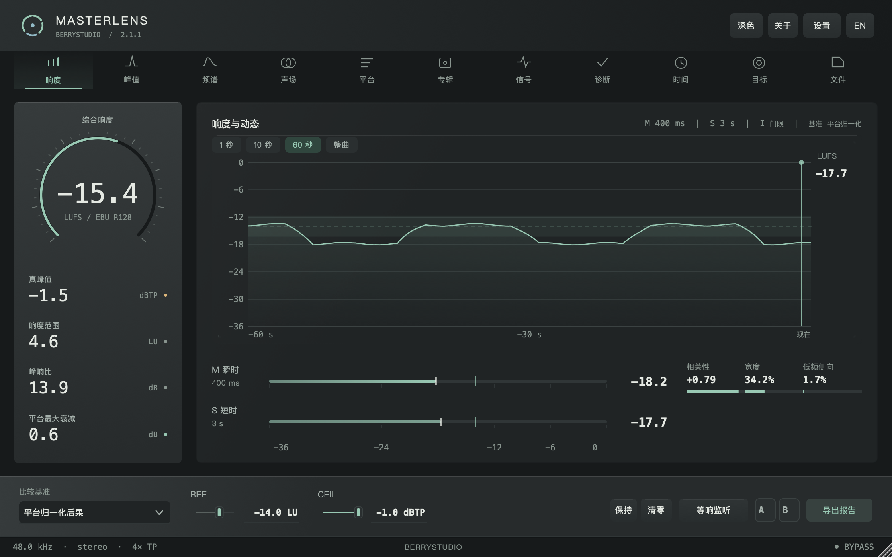
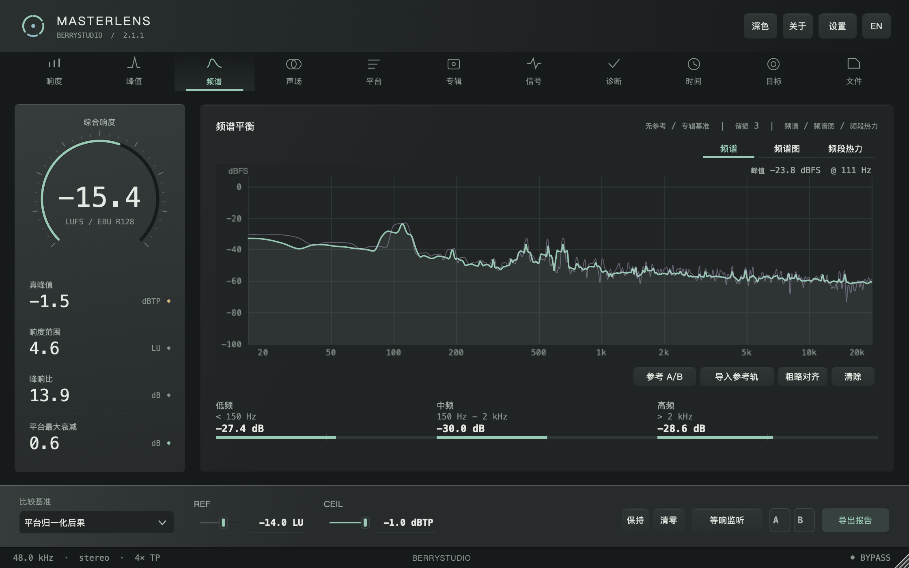
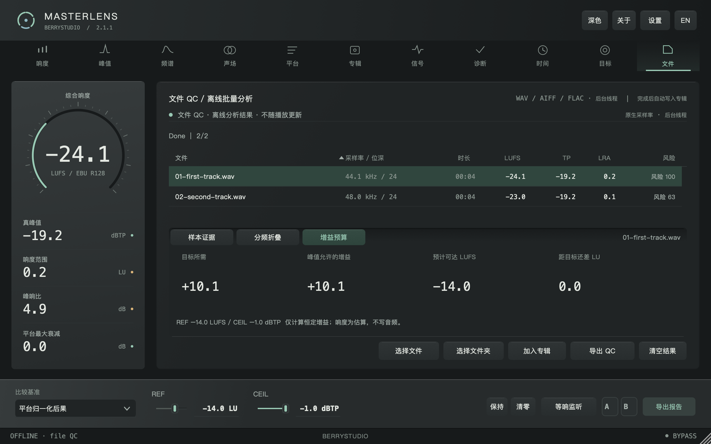
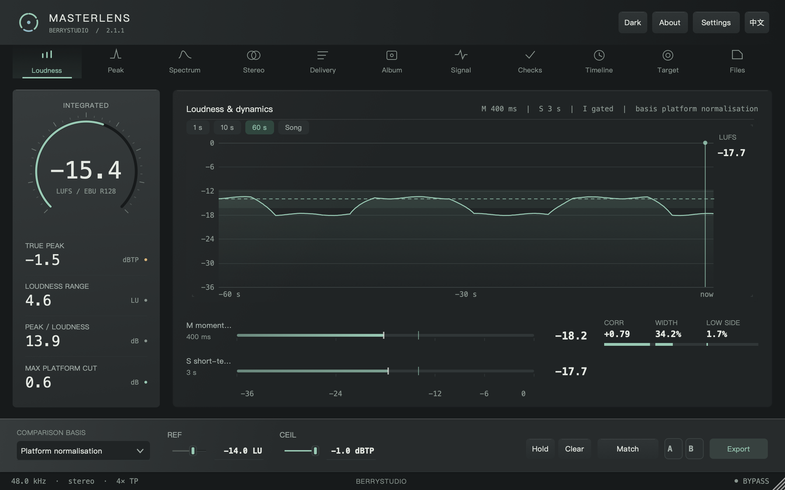
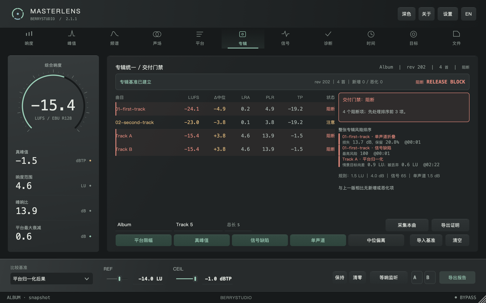
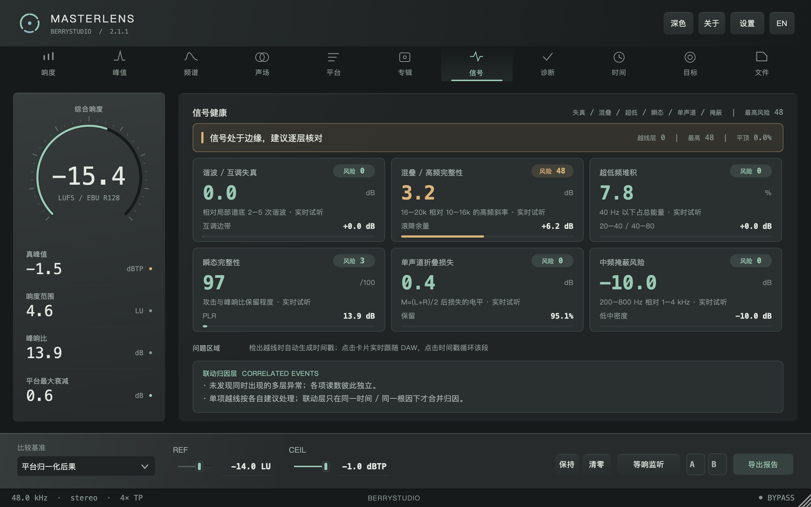
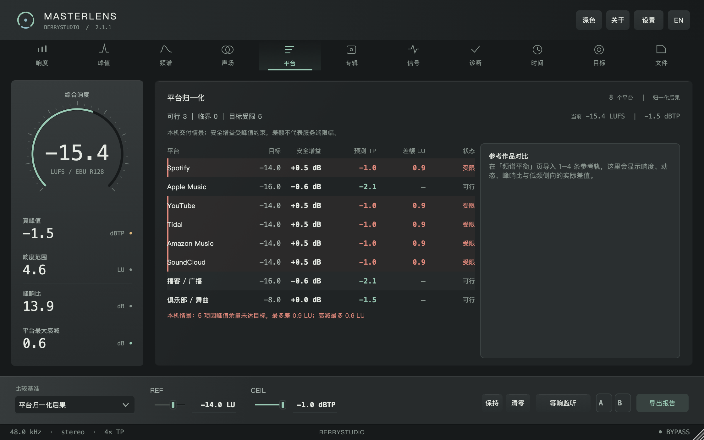
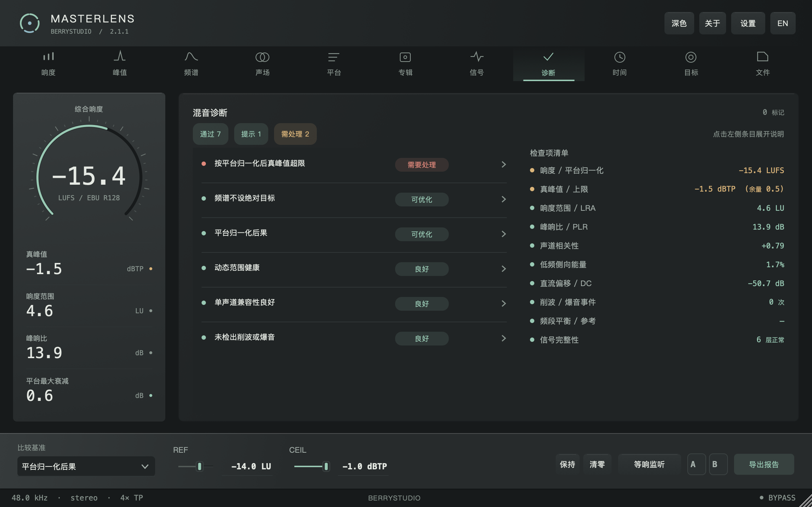
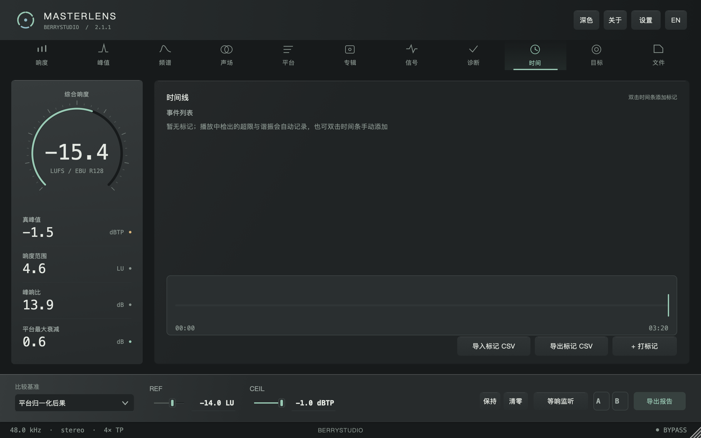
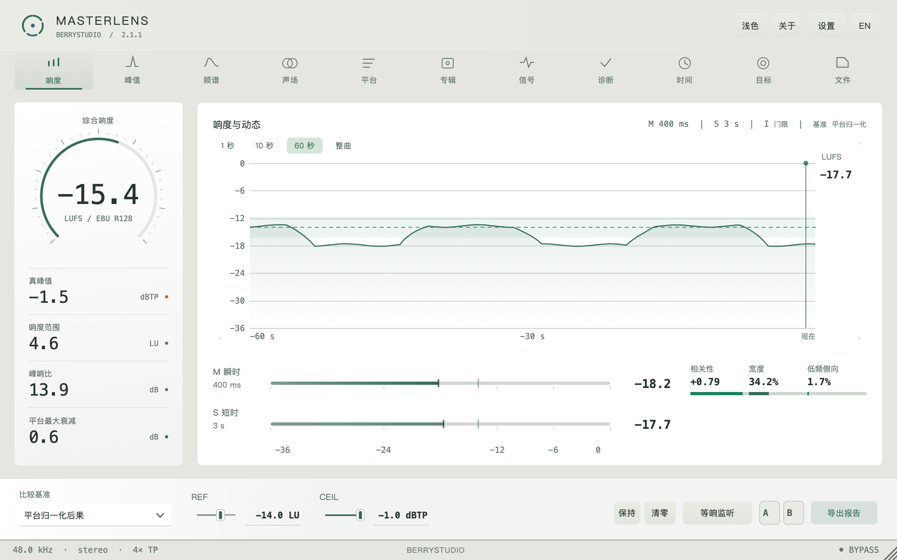

# MasterLens


**母带响度 / 文件 QC / 频谱 / 声场 / 专辑交付 / CLI**<br>
by **BerryStudio** · developer **KNGTNPT 兰**<br>
macOS / Windows · VST3 / AU / 独立版 · C++17 + JUCE 8<br>
当前版本：**2.1.1**

MasterLens 是放在母带链末尾的小检查员：这首歌有多响、峰值会不会顶过头、立体声合成单声道后会不会变薄、交出去之前还有哪里值得听一遍，它都帮你留意着。把它插在 Master / Stereo Out 的最后一级就好。

默认零延迟、逐位旁路，也就是只看、不动你的声音。点试听、开等响监听或切参考 A/B 时，才会临时改变输出。辛苦做好的声音，会好好留在原地。

歌该做成什么样，还是你的耳朵说了算。数字有点多也没关系，我们一项项看；它负责把容易漏掉的小细节摊开，陪你把交付前的最后一遍检查做完。

## 2.1.1：先把尺子摆正，再让界面伸个懒腰

2.1 已经会把“哪里可能有问题”说到秒、声道和样本地址。2.1.1 是个补丁版，不换新的声音魔法，先把几件会影响信任感的小事捋直：读数窗口、覆盖度，还有那排总让人想伸手扶一下的顶栏。

- **顶栏和左栏重新对中**：响度到文件那 11 个标签的图标、文字和选中条现在按同一条中线排；真峰值、响度范围、峰响比、平台最大衰减的数字也不再贴着上沿，整组读数在行高里坐正。先量过，再放下。
- **菜单和窗口有过渡了**：切页时标签底下那根青绿短线会滑过去，内容用 140 ms 淡入；关于、设置这类小窗打开时也会轻轻淡入，不再“啪”地跳出来。没有弹簧、没有弹跳，也不拿动画遮住数据。
- **100 ms 窗口修正**：宿主块大小不再把响度分析窗撑成 101/106 ms，M/S 和离线文件分析回到同一把尺子上。实时读数更像离线读数，这是 2.1.1 最该做的事。
- **覆盖度按真实时间区间算**：循环同一段八小节，不会再假装整首歌都测过了。覆盖度统计的是宿主时间轴上真正经过的区间并集，进度不会替你虚报。
- **参考轨重采样升级**：44.1 / 48 / 88.2 / 96 kHz 参考 A/B 从线性插值换成 4 点 Catmull-Rom，比较时高频不再先被插值磨钝。等响监听的增益仍然只作用于试听输出，不碰测量。

2.1 的文件 QC 三个详情页还在：**样本证据**（秒、声道、样本地址）、**分频折叠**（10 段单声道损失与 Side 比例）、**增益预算**（目标所需、峰值允许、预计可达、还差多少）。导出仍是 CSV + JSON，源文件 SHA256 会进入专辑证明。SHA256 是“这份文件”的指纹，不是签名，也不替你做试听判断。

这些检查都在本地跑，不用上传音频、不用数据集、不用模型。平台页继续把“想变响”和“峰值有没有地方放”分开说；Apple 曲尾固定一秒的旧门禁不会被重新塞回来。算法来源、阈值和边界见 [2.1.1 调研与算法说明](docs/research-2.1.1.md)。

**这次不做的事**：自定义交付规格、文件夹监控、编码后试听、多参考曲与局部精确重算属于 P1/P2，不会在 2.1.1 里假装完成。先把 P0 的读数坐稳，剩下的再一项项来。

验证方法与实际耗时见 [2.1.1 验证记录](docs/performance-2.1.1.md)。






## 它会帮你留意这些

不用先背熟所有缩写，先找你关心的那一项就好。

| 检查 | 能帮你看什么 |
| --- | --- |
| 响度与动态 | 整首有多响、短时间内怎么变化、强弱起伏有多大。按 ITU-R BS.1770-4 / EBU R128 测量 I / M / S / LRA，保留 PLR 与独立 Mid / Side 响度 |
| 峰值与信号 | 有没有顶过头，哪些地方可能需要回听。包含 4× 真峰值、L / R / Side 峰值，以及削波、直流、爆音、瞬态、混叠、超低堆积和中频掩蔽检查 |
| 频谱与声场 | 低中高频怎么分布，左右有多宽，合成单声道后会不会变薄。提供 8192 FFT、频谱图、10 段频段热力、相关性、宽度与三段侧向能量 |
| 平台后果 | 按不同平台参照，看看可能需要调多少电平、峰值会到哪里。包含 Spotify、Apple Music、YouTube、Tidal、Amazon、SoundCloud、播客和俱乐部的本机情景与目标差额 |
| 专辑门禁 | 哪首和整张专辑差得有点远，哪些检查还没过。包含专辑中位比较、测量覆盖度、可开关规则、风险排序、JSON / TXT 证明与证据哈希 |
| 文件 QC | 不用在 DAW 里从头播完，直接检查导出的音频。按原生采样率分析，保留样本证据、头尾静音、分频折叠、增益预算与源文件 SHA256；导出 CSV + JSON，成功结果写入当前专辑 |
| 参考与试听 | 和参考曲比一比，也能单独回听可疑片段。支持参考轨 A/B、宿主播放头同步、等响监听、包络粗略对齐和信号区域试听 |
| 报告与自动化 | 把检查结果留档，或交给脚本批量处理。提供 TXT / JSON / CSV / PDF、100 ms 原始序列、时间线选区估算和无界面的 CLI |

## 五分钟上手

### 先装好，再播一首

[下载 2.1.1](https://github.com/KNGTNPT/MasterLens/releases/tag/v2.1.1)。macOS 打开 DMG，运行「安装 Install.command」；Windows 运行对应 x64 / ARM64 的 EXE，然后重启 DAW。

把 MasterLens 插在母带链最后，先播 20–30 秒，跟它打个招呼。左侧的综合响度看整体有多响，真峰值看最高处有没有越线；LRA 看强弱变化的范围，PLR 看峰值与平均响度之间还留了多少空间。中央曲线会把变化过程画出来。

底部「比较基准」决定拿谁来对照：平台参照、参考曲、专辑中位，或者你自己设定的目标。想手动填目标，就选「手动参考值」再改 REF；CEIL 是你设定的真峰值上限。先用默认值熟悉界面也完全可以呀。

要重新测一次，点「清零」或按 R。按住空格可保持显示；A / B 存放读数快照，右键清空。

### 整张专辑，拖进来一起看看

按 F，拖入文件或整个文件夹，也可以点「选择文件 / 文件夹」。等它跑完，表格就会列出每首歌的采样率、位深、时长、响度（LUFS）、真峰值（TP）、响度范围（LRA）与风险。点表头可以排序，点一行就能看这首歌的详情，左侧读数也会一起切过去。

- **样本证据**：先帮你找到值得回听的位置。头尾按 −80 dBFS 定位；内部至少 10 ms 的数字静音会提醒试听；连续满刻度、直流和非零剪辑边界会留下样本地址。鼠标放在证据区滚动，可以看后面的条目。停顿也可能是编曲的小心思，所以不会只凭静音就当作掉音阻断。
- **分频折叠**：看左右合起来之后，哪些声音变小了。同相约 0 dB，无关声道约 3 dB；高于 6 dB 的频段值得回听。灰色表示能量占比不足 0.1%，不拿几乎没有声音的频段吓你一跳。
- **增益预算**：回答“在不超过峰值上限的前提下，还能整体推高多少”。使用底部 REF / CEIL；要改 REF，先切到「手动参考值」。它只算整体加减电平的结果，预计 LUFS 是估算，不会替你压限或改写音频。

「导出 QC」一次得到 CSV 摘要和同名 JSON 完整证据，包含每个事件、频段与源文件 SHA256。默认最多保留 128 条事件，完整计数与省略数量另存。

成功的结果会写进**当前专辑**。小提醒：做下一张专辑前，记得先换专辑名或清空上一张，别让两张专辑挤进同一个小本子。按 5 可以看每首歌与专辑中位的差别、风险排序和交付门禁，再导出证明。

也可以边播放边采集：填写曲目名和总长秒数，从头播放，覆盖度达到 95% 后点「采集本曲」。覆盖度就是这首歌有多少部分已经测过；直接跑文件 QC，则会检查完整文件。

### 参考、声场和问题区域

按 3 打开频谱，三种视图分别看当前频率分布、最近一段时间的变化和频段热力。导入参考曲后，「参考 A/B」会跟着 DAW 的播放位置播放参考；底部「等响监听」把比较时的响度拉近一点，免得更响的那边轻易把耳朵拐走。粗略对齐会根据响度变化寻找相近段落，不是逐个采样点的精确对齐。

按 4 看声场。相关性指针帮助你观察左右声道有多一致，旁边还可以看宽度、低频里有多少侧向能量、左右真峰值和单声道折叠结果。这里显示的是统计量，适合找线索；最后还是要切回单声道亲耳听听。

信号页可以单独监听当前输入里的对应部分，点时间戳还能循环回听问题片段，按 Esc 就停。也可以在响度历史上拖出一段区域，先看看局部情况；这里用的是每 100 ms 的包络估算，想拿到完整文件的精确测量，还是交给文件 QC。

### 报告与命令行

只想点点按钮的话，用界面就好；习惯脚本的朋友，也留了一条批量处理的小路。

「导出报告」或 Cmd+E 会生成 TXT / JSON / CSV / PDF，以及 `-timeseries.csv` 原始序列。CLI 随安装包提供：

```bash
MasterLensCli analyze /path/to/album --json report.json
MasterLensCli analyze track.wav --csv
MasterLensCli analyze /path/to/album --target -14 --ceiling -1 --fail-on error --json qc.json
```

支持多个路径与递归文件夹。`--fail-on error` 对样本阻断或超过自选 TP 上限返回 2；`--fail-on warning` 连需要试听的提示与明显分频抵消也一起拦下。0 是分析完成，1 是输入、解码或写报告失败，2 是 QC 未通过。默认不开门禁，适合先拿报告再判断。

多于两声道、坏文件、NaN / Inf、拼错的路径或写不出的报告都会明确失败。CSV 的文件名有逗号或引号也能正确读回。

### 快捷键

空格保持，R 清零，1–9 切模块，0 曲风目标，F 文件 QC，Esc 停止试听或关闭面板，Cmd+E 导出。

| 分频单声道折叠 | 增益预算 |
| --- | --- |
|  |  |

## 其它页面

| English | 专辑门禁 |
| --- | --- |
|  |  |

| 信号健康 | 平台归一化 |
| --- | --- |
|  |  |

| 混音诊断 | 曲风目标 |
| --- | --- |
|  |  |

| 时间线 | 设置 |
| --- | --- |
|  |  |

| 关于 | 浅色 |
| --- | --- |
|  |  |

## 构建与验证

想自己编译或看看检查过程，可以从这里开始。只想使用插件的话，下载上面的安装包就好，不用陪编译器熬夜。

需要 C++17 编译器、CMake ≥3.22，以及固定版本 JUCE：

```bash
git clone --depth 1 --branch 8.0.15 https://github.com/juce-framework/JUCE.git .tools/JUCE
cmake -S . -B build -DCMAKE_BUILD_TYPE=Release
cmake --build build --config Release --target MasterLensCli MasterLensDspTest -j 4
./build/MasterLensDspTest_artefacts/Release/MasterLensDspTest
python3 Tests/test_cli.py ./build/MasterLensCli_artefacts/Release/MasterLensCli
```

macOS 使用 Xcode Command Line Tools；通用二进制配置增加 `-DCMAKE_OSX_ARCHITECTURES="arm64;x86_64"`，插件目标为 `MasterLens_AU`、`MasterLens_VST3` 和 `MasterLens_Standalone`。Windows 使用 MSVC，插件目标为 VST3 / Standalone；DSP 测试的文件名带 `.exe`。

Linux 可用于开发与离屏回归，需要 ALSA、X11 / Xext / Xinerama / Xrandr / Xcursor / Xrender / Xcomposite、FreeType、Fontconfig 和 OpenGL 开发库。仓库已关闭 WebKit 和 CURL。截图使用 `MasterLensUiShot`，例如：

```bash
cmake --build build --config Release --target MasterLensUiShot -j 4
./build/MasterLensUiShot_artefacts/Release/MasterLensUiShot page0 size1120
./build/MasterLensUiShot_artefacts/Release/MasterLensUiShot page3 size1120 bench
```

无显示服务的 Linux 需要 Xvfb 和中文字体。同一个构建目录请串行执行 CMake / Ninja。

本次本地验证包含 **108 项 DSP / 证据断言**、**41 项 CLI 集成检查**、默认旁路 / 零延迟检查、各页面布局、五档缩放及离屏性能。原生 macOS / Windows 安装包由 [GitHub Actions](https://github.com/KNGTNPT/MasterLens/actions) 构建；三个发布目标全部成功后才上传 Release，附带 `SHA256SUMS.txt`。离屏检查和构建不能代替真实 DAW 与音频硬件回归。

## 工程结构

- `Source/PluginProcessor.*`：音频回调、参数、宿主状态、参考与试听。
- `Source/Editor*.cpp`：窗口布局、控制、调度和报告。
- `Source/ui/`：自绘界面、图表、页面与诊断规则。
- `Source/dsp/`：响度、真峰值、频谱与信号分析。
- `Source/audio/`、`Source/file/`、`Source/album/`：试听、文件 QC 与专辑门禁。
- `Tests/DspTest.cpp`：测量、试听、参考、文件分析回归与 CPU 基准。
- `Tools/UiShot.cpp`：实际编辑器截图、布局检查、刷新计数与性能采样。

## 有些事情，还是要说清楚

目前只支持单声道 / 立体声。8192 FFT 的低频分辨率有限，靠得很近的低频细节不一定能分开；选区结果是包络估算，宿主里的整曲长度需要手动填写。平台数字是本地比较用的参照，不能保证真实播放端的设置或处理；曲风目标也不是必须照着做的作业。

出现提示时，先回听，再决定要不要改。MasterLens 会认真报数，但不会替你判断一首歌好不好听。

MasterLens 不做总线 ARA：多数宿主只向音频轨开放 ARA，总线整张混音的离线分析由文件 QC 处理。AAX、DDP、编码预演、Apple 公证和商业代码签名需要另外的 SDK、编码器或证书。

首次打开未公证的 macOS 版本，可能需要通过系统的「右键 → 打开」。本次离屏截图与基准使用 Apple Silicon macOS；原生安装包的构建结果以对应 CI 记录为准，DAW 实机体验还需要继续回归。

## English summary

MasterLens 2.1.1 is a little extra pair of eyes at the end of your mastering chain. It helps you check loudness, peaks, stereo balance and delivery risks on macOS and Windows, with VST3, AU, Standalone and a file-QC CLI. By default, it adds no latency and leaves your audio untouched. Auditioning, loudness matching and reference A/B only change the output when you turn them on.

Version 2.1 helps you find the spot worth another listen, see which frequency bands lose energy in mono, and work out how much gain fits below your peak ceiling. Reports keep sample addresses, a SHA256 file fingerprint, ten-band mono-fold results and gain estimates in CSV + JSON; album evidence is saved too. The CLI adds target / ceiling controls and optional QC failure policies, with explicit errors for invalid inputs, unsupported channel layouts and failed report writes. Every new check runs locally: no datasets, models or external encoders needed.

2.1.1 is a small-patch release with a cat-ear bow on top: the loudness rail and left readout are vertically centred, menu switches and overlay windows get a restrained 140 ms transition, the live M/S window is cut on exact 100 ms sample boundaries, coverage is measured as the union of host-time intervals (looping eight bars no longer counts as the whole song), and reference A/B resampling uses four-point Catmull-Rom instead of linear interpolation. No new measurement magic was smuggled in; P1/P2 features stay out of this patch.

The graphite / celadon editor gains shallow lighting and scale-relative type spacing, checked from 100% through 200%. All README screenshots come from the 2.1.1 renderer. See the [research and algorithm notes](docs/research-2.1.1.md) and [validation record](docs/performance-2.1.1.md) for scope and limits.

JUCE 8.0.15 使用 AGPLv3 / 商业双许可；本项目按 AGPLv3 使用 JUCE。

---

最后还是那句：数字帮你查漏，耳朵负责决定。

检查完就让眼睛歇一会儿，给自己倒点喜欢喝的，再好好听一遍这首歌吧。做音乐已经很费心了，最后这一小段，让 MasterLens 陪你慢慢收好。🎧 🍵
