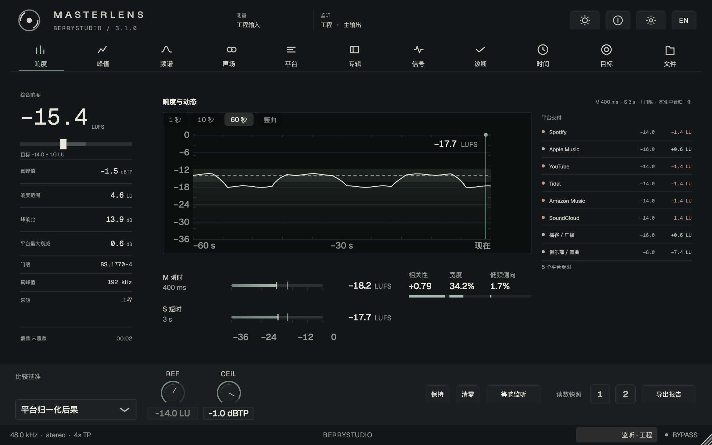
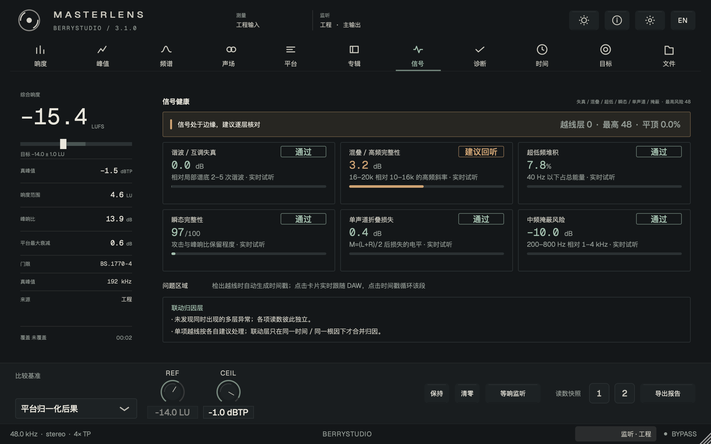
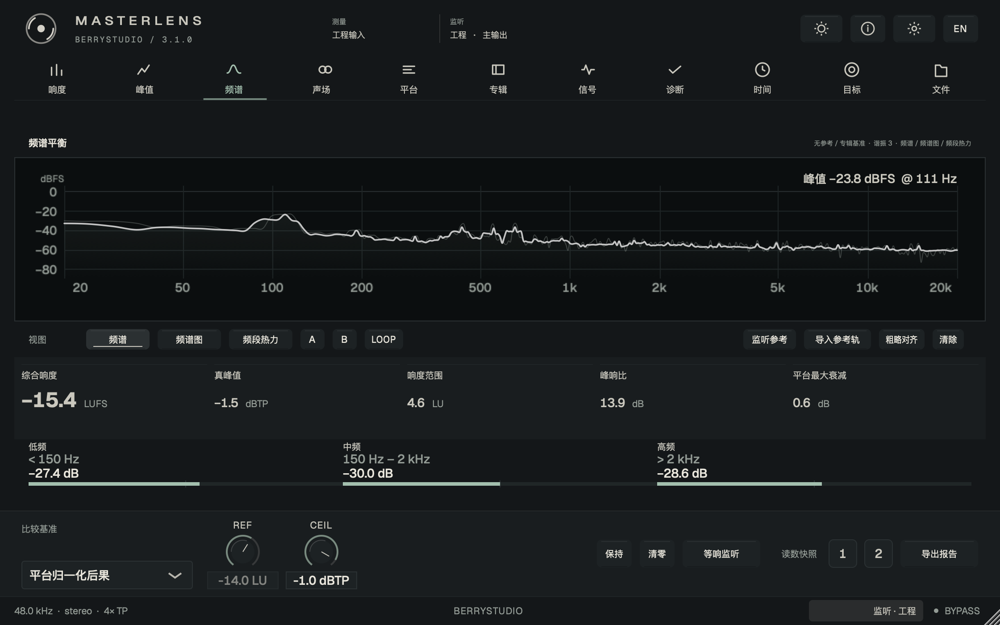
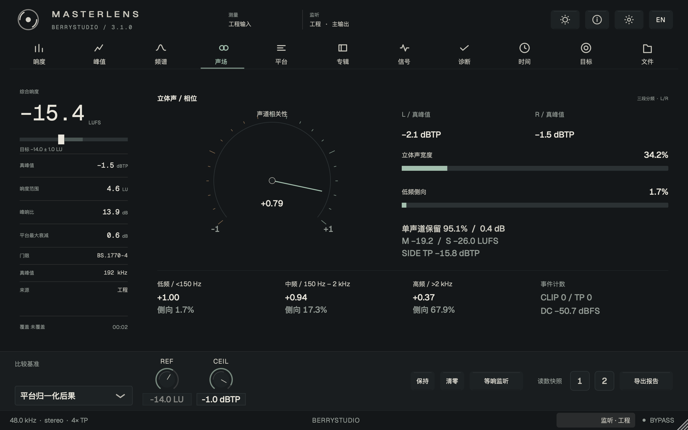
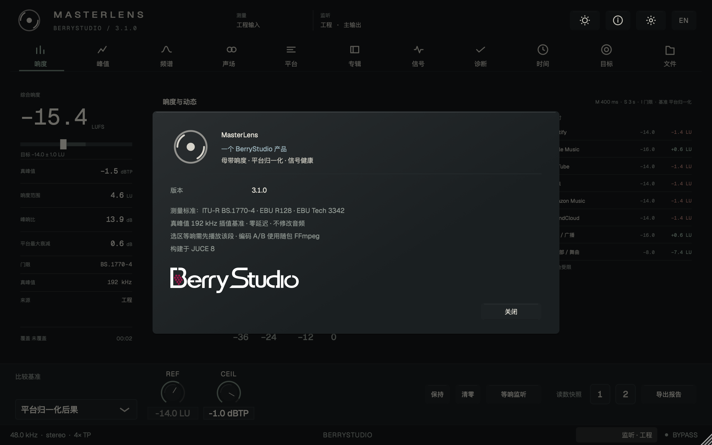
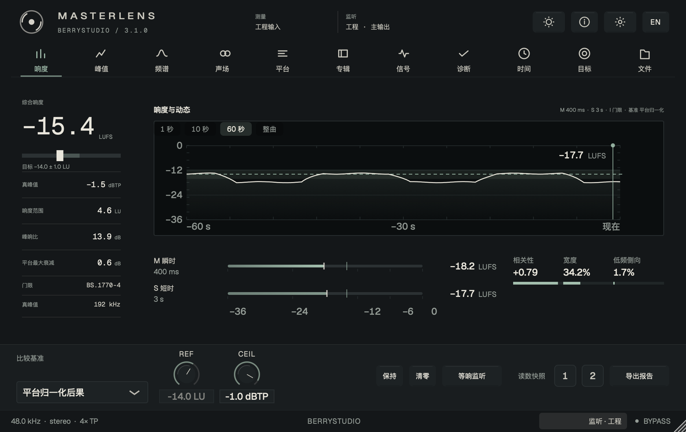
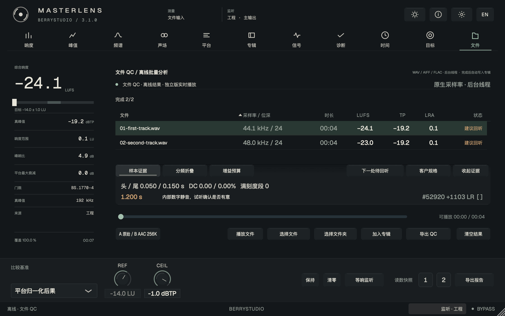
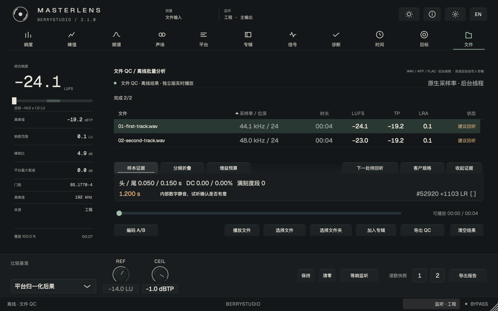

# MasterLens


**母带响度 / 文件 QC / 频谱 / 声场 / 专辑交付 / CLI**<br>
by **BerryStudio** · developer **KNGTNPT 兰**<br>
macOS / Windows · VST3 / AU / 独立版 · C++17 + JUCE 8<br>
当前版本：**3.1.0**（Calibrated Plate 与交付工作流）

MasterLens 是放在母带链末尾的小检查员：这首歌有多响、峰值会不会顶过头、立体声合成单声道后会不会变薄、交出去之前还有哪里值得听一遍，它都帮你留意着。把它插在 Master / Stereo Out 的最后一级就好。

默认零延迟、逐位旁路，也就是只看、不动你的声音。点试听、开等响监听或切参考 A/B 时，才会临时改变输出。辛苦做好的声音，会好好留在原地。

歌该做成什么样，还是你的耳朵说了算。数字有点多也没关系，我们一项项看；它负责把容易漏掉的小细节摊开，陪你把交付前的最后一遍检查做完。

## 3.1.0：Calibrated Plate 与交付工作流

3.1 把 3.0.4–3.4 的能力和 Calibrated Plate 界面并入同一版本。测量口径、随包 FFmpeg 与默认旁路不变；改变的是界面组织，以及从文件 QC 到交付的那条工作流。

- **Calibrated Plate**：去掉一叠带边框的卡片，改成一块校准面板 + 一扇深石墨测量窗。深浅主题都保留，但浅色的历史图 / 频谱图仍是深窗——这是整套设计的签名。响度页用 46px 等宽主读数、目标窗口、指标行、覆盖率与平台交付账本。
- **紧凑档**：窗口下限 1000×630；这一区间用 1:1 字号、收窄左栏并隐藏交付账本，不缩小中文。1120 及以上恢复右侧账本与常规布局（实拍 [compact-3.1.0.png](docs/compact-3.1.0.png)）。
- **可信交付（3.0.4）**：`effectiveDelivery` 统一 GUI / CLI / CSV / JSON 的有效目标，客户规格优先；独立版文件播放按**唯一覆盖时间段**统计，部分播放不再报 100%。
- **文件 QC 工作流**：跨文件「下一处待回听」；证据行单击试听、`[ ] / [x]` 确认、双击添加备注或忽略；`ignored / note` 随证据 JSON 导出；「客户规格」浮层实时预览通过与阻断。
- **参考试听（3.2 首批）**：参考 A/B 片段、命名与 LOOP（64 样本等功率交叉淡化）；超过 64 MB 的参考改走有界流式读取（8 s 预读，约 3 MB），≤30 s 的 Cue 可循环，无 Cue 时用前 60 s 有界前缀测响度并支持等响监听。
- **编码对听（3.3 首批）**：前 8k 样本互相关测编码延迟并按延迟对齐 A/B；A−B 等响差分（+6 dB）听伪影；4× sinc 插值定位编码后真峰值；JSON 公开 `delaySamples / tailSamples / residual`。
- **批量交付（3.4 首批）**：CLI `--state / --summary / --retry / --watch` 做增量队列与连续监视；GUI 监控按 mtime/size 只复检变更文件；导出 QC 的 JSON 带 `summary` 计数块。
- **范围说明**：3.1 先完成响度、频谱、信号三页与紧凑档；文件表与其余页面的细线化仍沿用 3.0.3 形态，留给后续版本。

### 3.1.0 验证

- 构建：Universal（arm64 + x86_64）的 AU / VST3 / Standalone / CLI / UiShot / DspTest 全部通过。
- DSP / 可靠性：**214 passed / 0 failed / 0 skipped**（`MASTERLENS_REQUIRE_RUNTIME=1`）。
- CLI：**86 passed / 0 skipped**（随包运行时）；UI 布局：**46/46 场景**，`docs/layout-3.1.0.json` 92 条记录 0 失败。
- `auval -v aufx Maln OrcA`：**PASS**，`Cocoa Views Available: 1`。
- 截图：9 张 `docs/*-3.1.0.png`（含紧凑档），`docs/screenshots-3.1.0.json` 记录参数、尺寸与 SHA-256。
- 已发布：[v3.1.0](https://github.com/KNGTNPT/MasterLens/releases/tag/v3.1.0)，含 macOS DMG 与 Windows x64 / ARM64 安装包、`SHA256SUMS.txt`（CI run `43164010215` 全绿）。

详细记录见 [3.1.0 验证记录](docs/performance-3.1.md) 与 [交付说明](docs/release-3.1.0.md)。


















## 3.0.3：排印与层级整理（历史）

3.0.3 只动界面：四档排印、浅色状态色、频谱 +6…−90 dB 轴、数字与分隔符、中英混排、浮层构图与最小缩放。完整记录见 [3.0.3 验证记录](docs/performance-3.0.3.md)。

## 界面规范（Calibrated Plate）

3.1 把 3.0.3 的四档语义字体继续用于标签与常规读数，同时在测量页引入更大的显示层级与共用测量窗。完整规则见 [DESIGN.md](DESIGN.md)、[FRONTEND-DESIGN.md](FRONTEND-DESIGN.md) 与 [design-3.1.md](docs/design-3.1.md)。

| 角色 | 3.1 取值 | 用途 |
| --- | --- | --- |
| Display | 46 px Mono | 综合响度主读数，同屏只此一处 |
| Title / Value | 15 px | 页标题、面板标题、指标与表格数值 |
| Label | 12 px | 标签、导航、按钮；全大写拉丁 +0.10em |
| Micro | 10–11 px | 元信息、单位旁注、页脚 |

- **材质分层**：深色是石墨仪器，浅色是暖纸面板；测量窗口两种主题都保持深石墨，不随主题反相。
- **只靠细线分区**：1px hairline + 内凹窗口 + 留白，不用圆角卡片、投影和彩色底；一屏最多一个实心强调按钮。
- **数字与分隔符**：所有数值走等宽数字；U+2212 负号、en dash 范围、负零归零；元信息统一 `·`，`/` 只留在名称与单位内部。
- **语言安全**：中文标签不缩、不加字距；全大写拉丁才加字距；固定标签列 / 数值列，切换语言不推挤行。
- **缩放**：100%–200%，默认优先 125%；1000×630 紧凑档按 1:1 布局，不缩小中文字号。

## 3.0.2：安装包自带 FFmpeg（历史）

3.0.2 把 3.0.1 准备好的运行时结构真正填满：安装后直接可用 AAC 256k / MP3 320k 编码 A/B，不需要 Homebrew、PATH 或手动安装 FFmpeg。

- **随包运行时**：macOS Universal（arm64 + x86_64）与 Windows x64 / ARM64 各带一份精简 LGPL **FFmpeg 9.0.2**（含 **LAME 3.100**）。只保留 PCM / FLAC / MP3 / AAC / ALAC / Vorbis / Opus 解码，AAC / LAME 编码，以及 WAV / M4A / MP3 封装。
- **体积**：macOS Universal 约 6.6 MB，Windows x64 约 3.4 MB、ARM64 约 2.8 MB；DMG 约 37 MB（运行时随三份插件包与安装根目录各放一份）。
- **来源可复现**：`scripts/build-ffmpeg-runtime.sh` 固定源码 URL、SHA-256、LAME 补丁与 configure 参数；产物旁附 `build-info.txt` 与 LGPL 许可证。
- **路径**：macOS 插件包内 `Contents/Resources/ffmpeg`；DMG 根目录 `ffmpeg` 与 `MasterLensCli` 同级；Windows 为安装目录 `ffmpeg\ffmpeg.exe` 与 VST3 `Contents\Resources\ffmpeg`。
- **门禁**：CI 直接校验仓库内运行时并设置 `MASTERLENS_REQUIRE_RUNTIME=1`；稳定版缺少运行时仍会拒绝发布。

详细结果见 [3.0.2 验证记录](docs/performance-3.0.2.md)。

## 3.0.1 与 3.0.0：编码后端、四种比较（历史）

3.0.1 不改测量与监听，只把编码链路和发布流程做实：GUI、文件 QC 与 CLI 共用 `FFmpegRuntime`，失败分类、Unicode 路径、`REQUIRE_RUNTIME` 门禁与打包结构都在这一版完成。该 prerelease 未携带二进制，记录见 [3.0.1 验证记录](docs/performance-3.0.1.md)。

3.0.0 补齐了四项监听能力，它们今天仍然可用：

- **频段独听**：频谱页「频段热力」的 10 段与低 / 中 / 高三段都可单击独听；4 阶 Butterworth（24 dB/oct），不做等响补偿，只改监听输出，`Esc` 停止。
- **选区等响**：时间页拖选后点「选区等响」，按 BS.1770-4 门限积分测工程选区与当前参考槽位 `OFS + 选区` 的响度，把差值写进参考 GAIN；工程声音不动。
- **长文件流式播放**：独立版文件传输改为固定环形缓冲（约 8 MB），读取线程预读 3 s；两小时以上的文件也能播放、拖动、循环，欠载时显示「缓冲中」，音频回调不阻塞、不分配。
- **编码 A/B**：文件 QC 生成 AAC 256k / MP3 320k，解码回 float WAV 后按同一时间码切换「A 原始 / B 编码后」，显示 ΔLUFS / ΔTP。3.0.2 起使用随包 FFmpeg，不再要求本机安装。

「选区」指 MasterLens 时间线拖选，不是宿主 loop；长选区循环交给宿主，≤ 10 s 可用 12 s 历史环试听。选区响度来自已经播过的 100 ms 读数，没播过的区段没有数据，界面会提示「请先播放该段」。完整记录见 [3.0.0 验证记录](docs/performance-3.0.0.md)。

## 它会帮你留意这些

不用先背熟所有缩写，先找你关心的那一项就好。

| 检查 | 能帮你看什么 |
| --- | --- |
| 响度与动态 | 整首有多响、短时间内怎么变化、强弱起伏有多大。按 ITU-R BS.1770-4 / EBU R128 测量 I / M / S / LRA，保留 PLR 与独立 Mid / Side 响度 |
| 峰值与信号 | 有没有顶过头，哪些地方可能需要回听。包含 4× 真峰值、L / R / Side 峰值，以及削波、直流、爆音、瞬态、混叠、超低堆积和中频掩蔽检查 |
| 频谱与声场 | 低中高频怎么分布，左右有多宽，合成单声道后会不会变薄。提供 8192 FFT、频谱图、10 段频段热力、相关性、宽度与三段侧向能量 |
| 平台后果 | 按不同平台参照，看看可能需要调多少电平、峰值会到哪里。包含 Spotify、Apple Music、YouTube、Tidal、Amazon、SoundCloud、播客和俱乐部的本机情景与目标差额 |
| 专辑门禁 | 哪首和整张专辑差得有点远，哪些检查还没过。包含专辑中位比较、测量覆盖度、可开关规则、风险排序、JSON / TXT 证明与证据哈希 |
| 文件 QC | 不用在 DAW 里从头播完，直接检查导出的音频。按原生采样率分析，保留样本证据、头尾静音、分频折叠、增益预算与源文件 SHA256；可跨文件「下一处待回听」、确认 / 忽略证据并写备注；「客户规格」实时预览通过或阻断；导出 CSV + JSON 并写入当前专辑 |
| 参考与试听 | 和参考曲比一比，也能单独回听可疑片段。支持参考 A/B 片段、命名与 LOOP、宿主播放头同步、等响监听和粗略对齐；超过 64 MB 的参考走有界流式读取，≤30 s 的 Cue 可循环 |
| 编码 A/B | 随包 FFmpeg 生成 AAC 256k / MP3 320k；按互相关测出的编码延迟对齐 A/B，比较 ΔLUFS / ΔTP，可听等响 A−B 差分并跳到编码后最高峰；失败会明确说明原因 |
| 报告与自动化 | 把检查结果留档，或交给脚本批量处理。提供 TXT / JSON / CSV / PDF、100 ms 原始序列与无界面 CLI；`--state / --summary / --retry / --watch` 支持增量队列、失败重试和连续监视 |

## 五分钟上手

### 先装好，再播一首

[下载最新发布版](https://github.com/KNGTNPT/MasterLens/releases/tag/v3.1.0)（当前 3.1.0）。macOS 打开 DMG，运行「安装 Install.command」；Windows 运行对应 x64 / ARM64 的 EXE，然后重启 DAW。把窗口拖窄到 1000×630 会进入紧凑档：字号不缩，左栏收窄，交付账本先让位给读数。

把 MasterLens 插在母带链最后，先播 20–30 秒，跟它打个招呼。左侧的综合响度看整体有多响，真峰值看最高处有没有越线；LRA 看强弱变化的范围，PLR 看峰值与平均响度之间还留了多少空间。中央曲线会把变化过程画出来。

底部「比较基准」决定拿谁来对照：平台参照、参考曲、专辑中位，或者你自己设定的目标。想手动填目标，就选「手动参考值」再改 REF；CEIL 是你设定的真峰值上限。先用默认值熟悉界面也完全可以呀。

要重新测一次，点「清零」或按 R。按住 Shift+空格可保持显示；底部按钮上的 1 / 2 存放读数快照，右键清空。

### 整张专辑，拖进来一起看看

按 F，拖入文件或整个文件夹，也可以点「选择文件 / 文件夹」。等它跑完，表格就会列出每首歌的采样率、位深、时长、响度（LUFS）、真峰值（TP）、响度范围（LRA）与风险。点表头可以排序，点一行就能看这首歌的详情，左侧读数也会一起切过去。

- **样本证据**：先帮你找到值得回听的位置。头尾按 −80 dBFS 定位；内部至少 10 ms 的数字静音会提醒试听；连续满刻度、直流和非零剪辑边界会留下样本地址。
- **分频折叠**：看左右合起来之后，哪些声音变小了。同相约 0 dB，无关声道约 3 dB；高于 6 dB 的频段值得回听。灰色表示能量占比不足 0.1%。
- **增益预算**：回答“在不超过峰值上限的前提下，还能整体推高多少”。使用底部 REF / CEIL；要改 REF，先切到「手动参考值」。它只算整体加减电平的结果，不会替你压限或改写音频。

「导出 QC」一次得到 CSV 摘要和同名 JSON 完整证据，包含每个事件、频段与源文件 SHA256。成功的结果会写进**当前专辑**；做下一张专辑前，记得先换专辑名或清空上一张。

### 参考、声场和问题区域

按 3 打开频谱，三种视图分别看当前频率分布、最近一段时间的变化和频段热力。导入参考曲后，「参考 A/B」会跟着 DAW 的播放位置播放参考；底部「等响监听」把比较时的响度拉近一点。粗略对齐会根据响度变化寻找相近段落，不是逐个采样点的精确对齐。

按 4 看声场。相关性指针帮助你观察左右声道有多一致，旁边还可以看宽度、低频里有多少侧向能量、左右真峰值和单声道折叠结果。这里显示的是统计量，适合找线索；最后还是要切回单声道亲耳听听。

信号页可以单独监听当前输入里的对应部分，点时间戳还能循环回听问题片段，按 Esc 就停。也可以在响度历史上拖出一段区域，先看看局部情况；这里用的是每 100 ms 的包络估算，想拿到完整文件的精确测量，还是交给文件 QC。

### 报告与命令行

只想点点按钮的话，用界面就好；习惯脚本的朋友，也留了一条批量处理的小路。

「导出报告」或 Cmd+E 会生成 TXT / JSON / CSV / PDF，以及 `-timeseries.csv` 原始序列。CLI 随安装包提供，编码 A/B 使用随包 FFmpeg：

```bash
MasterLensCli analyze /path/to/album --json report.json
MasterLensCli analyze track.wav --csv
MasterLensCli analyze /path/to/album --target -14 --ceiling -1 --fail-on error --json qc.json
MasterLensCli analyze track.wav --spec delivery-spec.json --json spec-qc.json
MasterLensCli analyze track.wav --codec mp3 --json codec-qc.json
MasterLensCli analyze /path/to/album --state qc-state.json --summary qc-summary.json --retry 2
MasterLensCli analyze /path/to/album --state qc-state.json --watch 2 --watch-iterations 10
```

支持多个路径与递归文件夹。`--fail-on error` 对样本阻断或超过自选 TP 上限返回 2；`--fail-on warning` 连需要试听的提示与明显分频抵消也一起拦下。0 是分析完成，1 是输入、解码或写报告失败，2 是 QC 未通过。默认不开门禁，适合先拿报告再判断。

多于两声道、坏文件、NaN / Inf、拼错的路径或写不出的报告都会明确失败。CSV 的文件名有逗号或引号也能正确读回。

### 快捷键

Shift+空格保持，R 清零，1–9 切模块，0 曲风目标，F 文件 QC，Esc 停止试听或关闭面板，Cmd+E 导出。

## 构建与验证

想自己编译或看看检查过程，可以从这里开始。只想使用插件的话，下载安装包就好，不用陪编译器熬夜。

需要 C++17 编译器、CMake ≥3.22，以及固定版本 JUCE：

```bash
git clone --depth 1 --branch 8.0.15 https://github.com/juce-framework/JUCE.git .tools/JUCE
cmake -S . -B build -DCMAKE_BUILD_TYPE=Release
cmake --build build --config Release --target MasterLensCli MasterLensDspTest -j 4
```

测试会读取仓库内的随包运行时；也可以显式指定。发布门禁要求运行时存在：

```bash
export MASTERLENS_FFMPEG=$PWD/third_party/ffmpeg/macos-universal/ffmpeg
export MASTERLENS_REQUIRE_RUNTIME=1

./build/MasterLensDspTest_artefacts/Release/MasterLensDspTest
python3 Tests/test_cli.py ./build/MasterLensCli_artefacts/Release/MasterLensCli
python3 scripts/check_ui.py --build-dir build
```

macOS 使用 Xcode Command Line Tools；通用二进制配置增加 `-DCMAKE_OSX_ARCHITECTURES="arm64;x86_64"`，插件目标为 `MasterLens_AU`、`MasterLens_VST3` 和 `MasterLens_Standalone`。Windows 使用 MSVC，插件目标为 VST3 / Standalone；DSP 测试的文件名带 `.exe`。

Linux 可用于开发与离屏回归，需要 ALSA、X11 / Xext / Xinerama / Xrandr / Xcursor / Xrender / Xcomposite、FreeType、Fontconfig 和 OpenGL 开发库。仓库已关闭 WebKit 和 CURL。截图使用 `MasterLensUiShot`，例如：

```bash
cmake --build build --config Release --target MasterLensUiShot -j 4
./build/MasterLensUiShot_artefacts/Release/MasterLensUiShot page0 size1120
./build/MasterLensUiShot_artefacts/Release/MasterLensUiShot page3 size1120 bench
```

无显示服务的 Linux 需要 Xvfb 和中文字体。同一个构建目录请串行执行 CMake / Ninja。

需要重建随包运行时（固定源码与 SHA-256）：

```bash
scripts/build-ffmpeg-runtime.sh macos-universal
scripts/verify-runtime.sh third_party/ffmpeg/macos-universal/ffmpeg macos-universal
```

发布流程遵循 [`docs/ffmpeg-release-readiness-guide.md`](docs/ffmpeg-release-readiness-guide.md)：先准备随包 FFmpeg，再跑 DSP / CLI / 布局 / 安装产物门禁。开发环境没有随包运行时，可用 `MASTERLENS_ALLOW_SYSTEM_FFMPEG=1` 显式使用系统 ffmpeg；缺失运行时在 `MASTERLENS_REQUIRE_RUNTIME=1` 下直接失败。

本地验证（3.1.0 Universal 构建）：**214 项 DSP / 可靠性断言**、**86 项 CLI 集成检查**、**46/46 布局场景**（92 条记录），`auval` PASS。本机 DMG 已打包并复核运行时与 CLI。原生 macOS / Windows 安装包由 [GitHub Actions](https://github.com/KNGTNPT/MasterLens/actions) 构建；三个目标全部成功后上传 Release，并附带 `SHA256SUMS.txt`。离屏检查和构建不能代替真实 DAW 与音频硬件回归。

## 工程结构

- `Source/PluginProcessor.*`：音频回调、参数、宿主状态、参考与试听。
- `Source/Editor*.cpp`：窗口布局、控制、调度和报告。
- `Source/ui/`：自绘界面、图表、页面与诊断规则；四档字体、明暗 token 与数字格式化集中在 `Theme.h` / `Theme.cpp`。
- `Source/file/FFmpegRuntime.*`：随包 FFmpeg 的解析、能力探测与进程管理；GUI、文件 QC 与 CLI 共用。
- [`DESIGN.md`](DESIGN.md)：MasterLens 的界面硬性约束；[`FRONTEND-DESIGN.md`](FRONTEND-DESIGN.md)：团队可迁移的审美与 token 参考；[`docs/design-3.1.md`](docs/design-3.1.md)：3.1 的 Calibrated Plate 方向与迁移清单。
- `Source/dsp/`：响度、真峰值、频谱与信号分析。
- `Source/audio/`、`Source/file/`、`Source/album/`：试听、文件 QC 与专辑门禁。
- `third_party/ffmpeg/`：三个平台的运行时、许可证与 `build-info.txt`。
- `Tests/DspTest.cpp`：测量、试听、参考、文件分析回归与 CPU 基准。
- `Tools/UiShot.cpp`：实际编辑器截图、布局检查、刷新计数与性能采样。

## 有些事情，还是要说清楚

目前只支持单声道 / 立体声。8192 FFT 的低频分辨率有限，靠得很近的低频细节不一定能分开；选区结果是包络估算，宿主里的整曲长度需要手动填写。平台数字是本地比较用的参照，不能保证真实播放端的设置或处理；曲风目标也不是必须照着做的作业。

出现提示时，先回听，再决定要不要改。MasterLens 会认真报数，但不会替你判断一首歌好不好听。

MasterLens 不做总线 ARA：多数宿主只向音频轨开放 ARA，总线整张混音的离线分析由文件 QC 处理。AAX、DDP、Apple 公证和商业代码签名需要另外的 SDK、编码器或证书。

真实宿主（Logic / REAPER / Cubase）与 ≥2 小时真实文件持续播放尚未完成验收；Windows ARM64 为交叉构建，未在 ARM64 实机运行。3.2 的流式参考用前缀响度近似，不等同整段精确测量；3.4 的监视轮询间隔 2 s，只保证变更文件会被复检，不保证亚秒级响应。macOS 版本为 ad-hoc 签名、未公证，首次打开可能需要「右键 → 打开」。

## 版本历史

| 版本 | 内容 | 记录 |
| --- | --- | --- |
| 3.1.0 | Calibrated Plate 界面、紧凑档、可信交付、QC 工作流、参考流式、编码对齐、批量交付 | [验证记录](docs/performance-3.1.md) |
| 3.0.3 | 排印、层级、对比度与构图的界面整理；设计规范重写 | [验证记录](docs/performance-3.0.3.md) |
| 3.0.2 | 安装包自带 LGPL FFmpeg 9.0.2 + LAME 3.100，稳定发布 | [验证记录](docs/performance-3.0.2.md) |
| 3.0.1 | 统一 `FFmpegRuntime`、失败分类、打包与发布门禁 | [验证记录](docs/performance-3.0.1.md) |
| 3.0.0 | 频段独听、选区等响、长文件流式、编码 A/B | [验证记录](docs/performance-3.0.0.md) |
| 3.0.0-beta / alpha | 参考槽位与排印切片 | [beta](docs/performance-3.0.0-beta.md) · [alpha](docs/performance-3.0.0-alpha.md) |
| 2.5.0 | 文件 QC 先看曲目，再听问题 | [验证记录](docs/performance-2.5.0.md) |
| 2.4.x | Windows 安装路径修复；导入文件进入测量链路 | [2.4.1](docs/performance-2.4.1.md) · [2.4.0](docs/performance-2.4.0.md) |
| 2.3.x | Precision Instrument 界面、项目与交付规格、证据复核 | [2.3.3](docs/performance-2.3.3.md) · [2.3.2](docs/performance-2.3.2.md) |
| 2.1.1 | 读数基线与 100 ms 窗口修正 | [验证记录](docs/performance-2.1.1.md) |

旧版本的细节与限制保留在各自的验证记录里，不再把旧截图混进当前说明。

## English summary

MasterLens 3.1.0 is a small extra pair of eyes at the end of your mastering chain. It checks loudness, peaks, stereo balance, spectra and delivery risks on macOS and Windows, with VST3, AU, Standalone and a file-QC CLI. By default it adds no latency and never alters your audio; auditioning, loudness matching and reference A/B only change the output when you turn them on.

3.1 brings the Calibrated Plate editor and the 3.0.4–3.4 delivery workflow into one release. Cards give way to a calibrated plate and a shared graphite measurement window, with a 46 px mono readout, target band, metric rows, coverage and a platform delivery ledger. A compact tier at 1000×630 keeps 1:1 type and hides the ledger instead of shrinking Chinese labels. Client delivery specs now drive one effective target across GUI, CLI, CSV and JSON; File QC can walk to the next unreviewed finding, confirm or ignore evidence with notes, and preview a client spec before export. Reference A/B gains named cues and looping, with bounded streaming for references over 64 MB. Codec A/B aligns by the measured encoder delay, offers an equal-loudness A−B difference and locates the encoded true peak with 4× sinc interpolation. Batch delivery adds incremental state, summaries, retries and a watch mode.

Since 3.0.2 the installers carry a trimmed LGPL FFmpeg 9.0.2 with LAME 3.100, so AAC 256k / MP3 320k codec A/B and the CLI `--codec` round-trip work without Homebrew or a PATH setup. The runtime is resolved from the package first, with an explicit `MASTERLENS_FFMPEG` override and a development-only PATH fallback. FFmpeg and LAME are LGPL-2.1-or-later; licence texts, pinned source URLs, checksums and the exact configure line ship with the runtime.

Multi-reference files (1–4), region markers and problem-loop audition remain part of the workflow. Multi-reference spectra are energy aggregates, not a synthetic “reference master”; live region figures remain 100 ms envelope estimates, while file QC stays the exact offline path. No dataset, model or cloud inference is used. See the [validation record](docs/performance-3.1.md) for scope and limits.

JUCE 8.0.15 使用 AGPLv3 / 商业双许可；本项目按 AGPLv3 使用 JUCE。随包 FFmpeg / LAME 的许可见 [`packaging/THIRD-PARTY-NOTICES.md`](packaging/THIRD-PARTY-NOTICES.md)；Geist 字体按 SIL Open Font License 分发。

---

最后还是那句：数字帮你查漏，耳朵负责决定。

检查完就让眼睛歇一会儿，给自己倒点喜欢喝的，再好好听一遍这首歌吧。做音乐已经很费心了，最后这一小段，让 MasterLens 陪你慢慢收好。🎧 🍵
