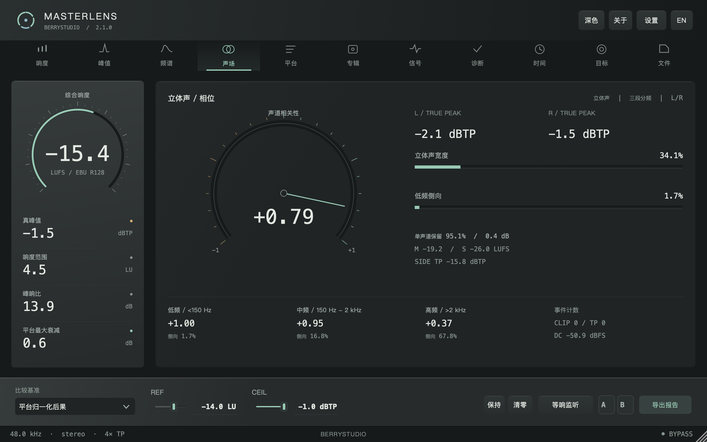
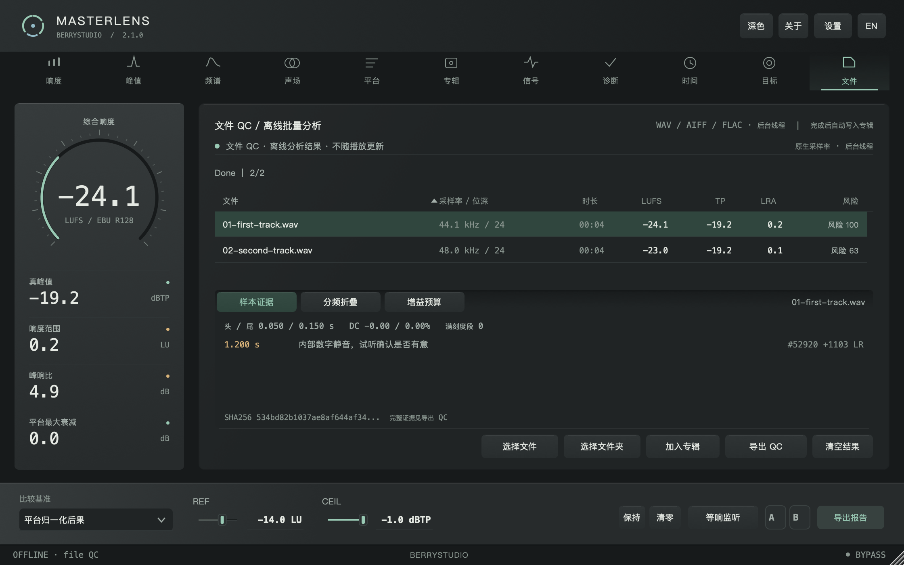
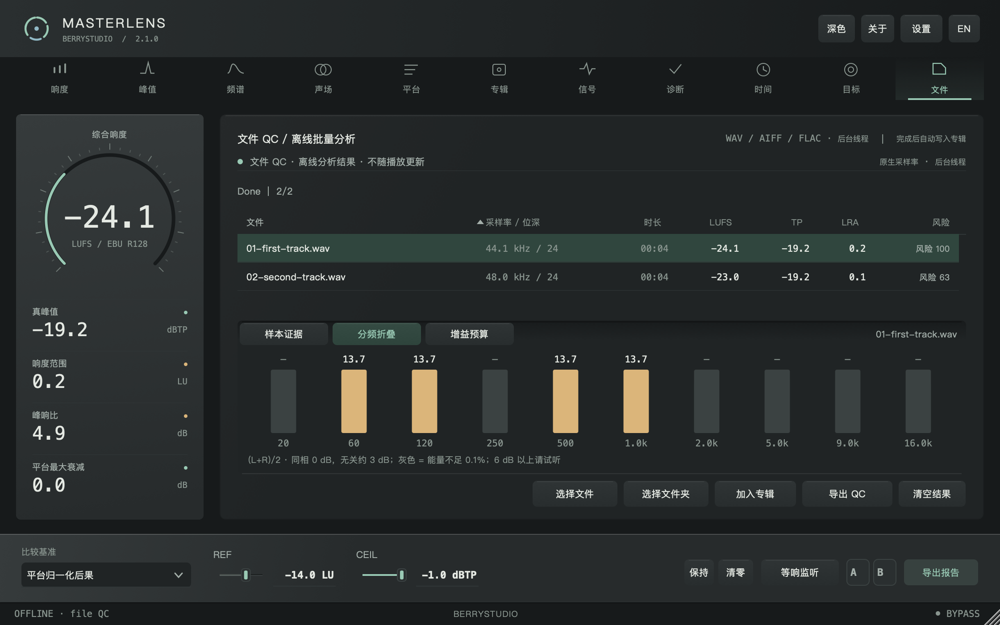
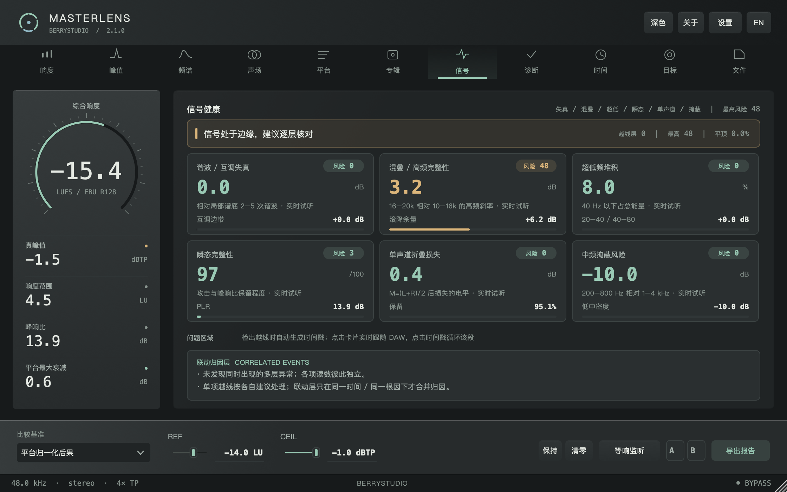
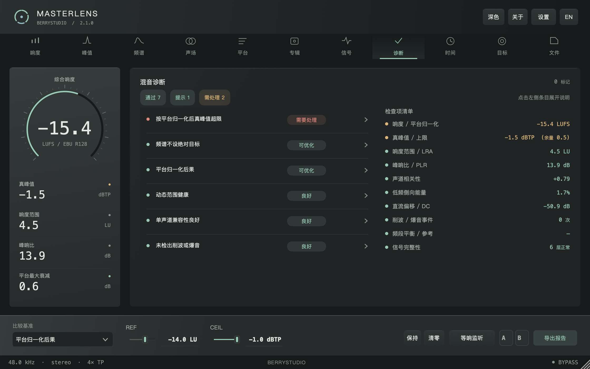
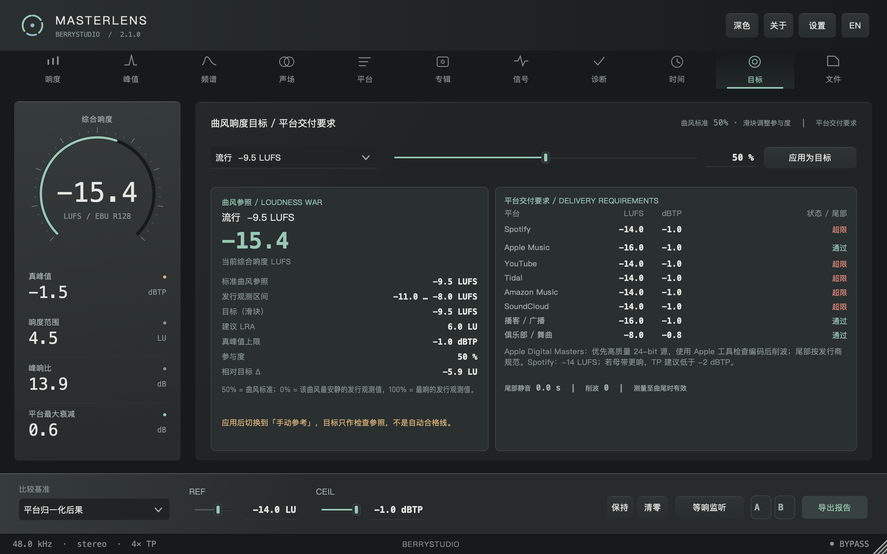
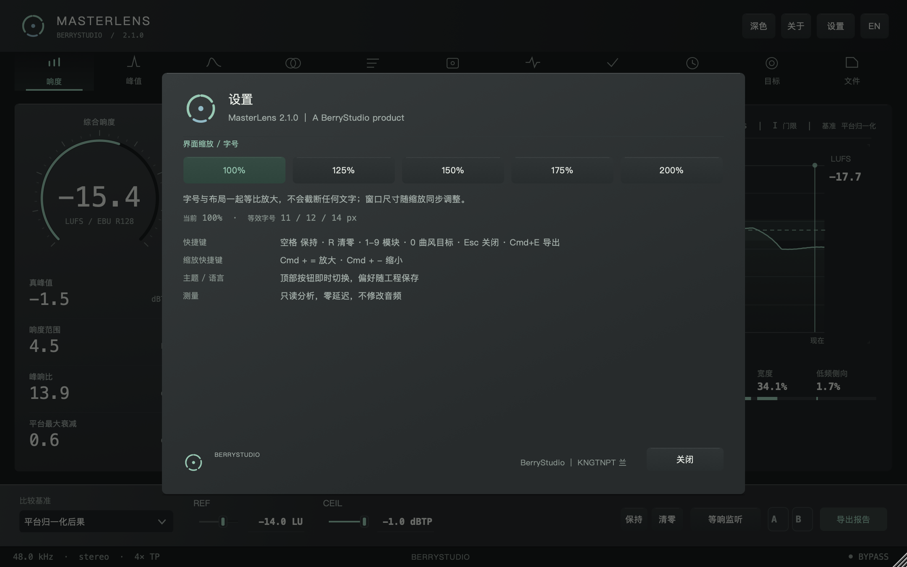
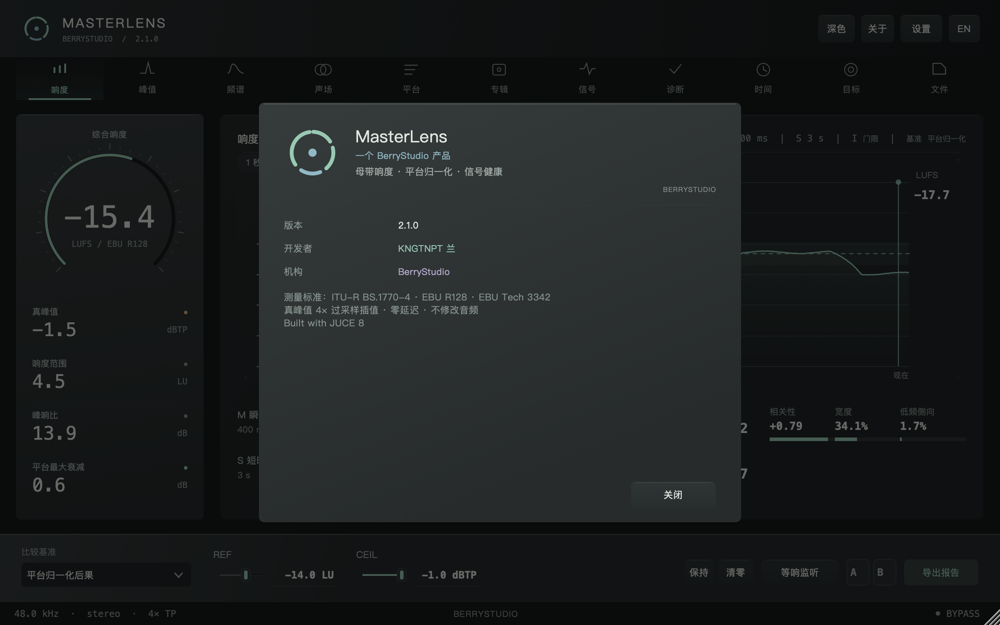
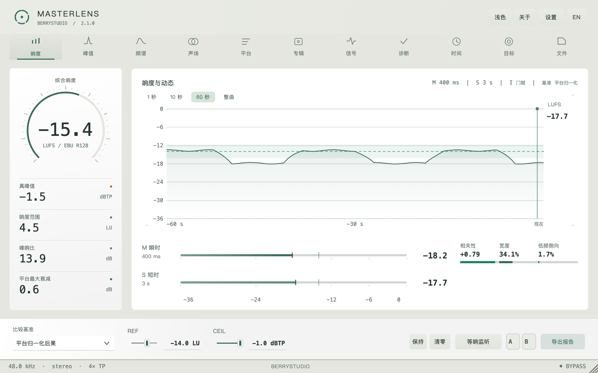

# MasterLens


**母带响度 / 文件 QC / 频谱 / 声场 / 专辑交付 / CLI**<br>
by **BerryStudio** · developer **KNGTNPT 兰**<br>
macOS / Windows · VST3 / AU / 独立版 · C++17 + JUCE 8<br>
当前版本：**2.1.0**

MasterLens 放在 Master / Stereo Out 的最后一级，帮你检查响度、真峰值、声场和交付风险。默认零延迟、逐位旁路；点试听、开等响监听或切参考 A/B 时，才会临时改变输出。

歌该做成什么样，还是你的耳朵说了算。它负责把那些容易漏看的数字摊开，让交付前的最后一遍检查省点力。

## 2.1：把检查变成能交付的证据

2.0 把实时表和文件分析接起来了。2.1 再往前走一步：哪一段是数字静音、哪里有连续满刻度、单声道折叠究竟丢在哪个频段、想达到目标还缺多少峰值余量，都有具体的数和位置。

文件 QC 多了三个详情页。**样本证据**保留时间、声道与样本地址；**分频折叠**看 10 个频段分别损失多少；**增益预算**把目标所需、峰值允许、预计可达和差额摆在一起。导出得到 CSV + JSON，源文件 SHA256 也会进入专辑证明。它不能代替试听，但至少不用拿着一个“风险 70”猜发生了什么。

这些检查全在本地完成，不用训练集、模型或外部编码器。设计前看过 MasterCheck、Metric AB、Youlean 和 TDR Prism 的公开工作流；这次把重点放在证据、交付可行性与自动化。来源、公式和阈值写在 [2.1 调研与算法说明](docs/research-2.1.0.md)。

平台页也改得更诚实：安全增益受真峰值余量约束，距目标的差额不等于平台一定会帮你限幅。Apple 曲尾固定一秒的旧要求去掉了，按发行商规格来。反相信号的离线频谱现在分别统计左右能量，不会在求和时把内容消掉。

界面保留 2.0.3 的石墨灰与青绿。面板是宽浅的上方光源、细高光和轻接触阴影，凹槽有自己的层次；小字在字体单位里加一点字距，随窗口一起缩放。文件页左侧表头显示所选文件，和实时输入分清。

验证方法与实际耗时见 [2.1 验证记录](docs/performance-2.1.0.md)。







## 它检查什么

| 检查 | 内容 |
| --- | --- |
| 响度与动态 | ITU-R BS.1770-4 / EBU R128 的 I / M / S / LRA，PLR，独立 Mid / Side 响度 |
| 峰值与信号 | 4× 真峰值、L / R / Side 峰值、削波、直流、爆音、瞬态、混叠、超低堆积和中频掩蔽 |
| 频谱与声场 | 8192 FFT、频谱图、10 段频段热力、相关性、宽度、三段侧向能量、单声道折叠 |
| 平台后果 | Spotify、Apple Music、YouTube、Tidal、Amazon、SoundCloud、播客和俱乐部的本机增益情景、预测峰值与目标差额 |
| 专辑门禁 | 曲目与专辑中位比较、覆盖度、可开关规则、风险排序、JSON / TXT 证明与证据哈希 |
| 文件 QC | 原生采样率、样本证据、头尾静音、分频折叠、增益预算、源文件 SHA256、CSV + JSON；成功结果写入当前专辑 |
| 参考与试听 | 参考轨 A/B、宿主播放头同步、等响监听、包络粗略对齐、信号区域试听 |
| 报告与自动化 | TXT / JSON / CSV / PDF、100 ms 原始序列、时间线选区估算和无 GUI CLI |

## 五分钟上手

### 先装好，再播一首

[下载 2.1.0](https://github.com/KNGTNPT/MasterLens/releases/tag/v2.1.0)。macOS 打开 DMG，运行「安装 Install.command」；Windows 运行对应 x64 / ARM64 的 EXE，然后重启 DAW。

把 MasterLens 插在母带链最后，播 20–30 秒。先看左侧综合响度、真峰值、LRA 和 PLR，再看中央的历史曲线。底部「比较基准」可切平台归一化后果、参考轨、专辑中位或手动参考。手动模式下才能编辑 REF；CEIL 是你自己的真峰值上限。

要重新测一次，点「清零」或按 R。按住空格可保持显示；A / B 存放读数快照，右键清空。

### 一张专辑直接跑文件 QC

按 F，拖入文件或整个文件夹，也可以点「选择文件 / 文件夹」。分析完成后，表格会列出采样率、位深、时长、LUFS、TP、LRA 与风险。点表头排序，点一行看详情，左侧表头也会切到这首文件。

- **样本证据**：头尾按 −80 dBFS 定位；内部至少 10 ms 的数字静音提醒你试听；连续满刻度、直流和非零剪辑边界留下样本地址。鼠标放在证据区滚动，可以查看后面的条目。停顿可能是编曲，不会自动当掉音阻断。
- **分频折叠**：同相约 0 dB，无关声道约 3 dB；高于 6 dB 的频段值得回听。灰色表示能量占比不足 0.1%，不拿几乎没有声音的频段吓人。
- **增益预算**：使用底部 REF / CEIL。要改 REF，先把比较基准切到「手动参考值」。它只计算恒定增益，预计 LUFS 标作估算，不写音频。

「导出 QC」一次得到 CSV 摘要和同名 JSON 完整证据，包含每个事件、频段与源文件 SHA256。默认最多保留 128 条事件，完整计数与省略数量另存。

成功的结果会写进**当前专辑**。做下一张专辑前，先换专辑名或清空上一张。按 5 查看专辑中位、风险排序与交付门禁，再导出证明。

实时采集也保留：填写曲目名和总长秒数，从头播放，覆盖度达到 95% 后点「采集本曲」。文件 QC 则直接得到完整文件的覆盖度。

### 参考、声场和问题区域

按 3 打开频谱。三种视图分别看当前频谱、最近的频谱图和频段热力。导入参考轨后，「参考 A/B」按宿主播放头播放参考；底部「等响监听」帮助你在接近的响度下比较。粗略对齐用的是响度包络，适合找段落。

按 4 看声场。自绘指针显示相关性，旁边保留宽度、低频侧向、左右真峰值和折叠结果；它显示的是统计量，不是假装成示波器的动画。

信号页的卡片可以实时 solo 当前输入，时间戳可以循环回听问题片段。Esc 停止。响度历史上拖动可选择区域；区域结果由 100 ms 包络估算，精确测量请跑完整文件。

### 报告与命令行

「导出报告」或 Cmd+E 会生成 TXT / JSON / CSV / PDF，以及 `-timeseries.csv` 原始序列。CLI 随安装包提供：

```bash
MasterLensCli analyze /path/to/album --json report.json
MasterLensCli analyze track.wav --csv
MasterLensCli analyze /path/to/album --target -14 --ceiling -1 --fail-on error --json qc.json
```

支持多个路径与递归文件夹。`--fail-on error` 对样本阻断或超过自选 TP 上限返回 2；`--fail-on warning` 连需要试听的提示与明显分频抵消也一起拦下。0 是分析完成，1 是输入、解码或写报告失败，2 是 QC 未通过。默认不开门禁，适合先拿报告再判断。

多于两声道、坏文件、NaN / Inf、拼错的路径或写不出的报告都会明确失败。CSV 的文件名有逗号或引号也能正确读回。

### 快捷键

空格保持，R 清零，1–9 切模块，0 曲风目标，F 文件 QC，Esc 停止试听或关闭面板，Cmd+E 导出。

| 分频单声道折叠 | 增益预算 |
| --- | --- |
|  |  |

## 其它页面

| English | 专辑门禁 |
| --- | --- |
|  |  |

| 信号健康 | 平台归一化 |
| --- | --- |
|  |  |

| 混音诊断 | 曲风目标 |
| --- | --- |
|  |  |

| 时间线 | 设置 |
| --- | --- |
|  |  |

| 关于 | 浅色 |
| --- | --- |
|  |  |

## 构建与验证

需要 C++17 编译器、CMake ≥3.22，以及固定版本 JUCE：

```bash
git clone --depth 1 --branch 8.0.15 https://github.com/juce-framework/JUCE.git .tools/JUCE
cmake -S . -B build -DCMAKE_BUILD_TYPE=Release
cmake --build build --config Release --target MasterLensCli MasterLensDspTest -j 4
./build/MasterLensDspTest_artefacts/Release/MasterLensDspTest
python3 Tests/test_cli.py ./build/MasterLensCli_artefacts/Release/MasterLensCli
```

macOS 使用 Xcode Command Line Tools；通用二进制配置增加 `-DCMAKE_OSX_ARCHITECTURES="arm64;x86_64"`，插件目标为 `MasterLens_AU`、`MasterLens_VST3` 和 `MasterLens_Standalone`。Windows 使用 MSVC，插件目标为 VST3 / Standalone；DSP 测试的文件名带 `.exe`。

Linux 可用于开发与离屏回归，需要 ALSA、X11 / Xext / Xinerama / Xrandr / Xcursor / Xrender / Xcomposite、FreeType、Fontconfig 和 OpenGL 开发库。仓库已关闭 WebKit 和 CURL。截图使用 `MasterLensUiShot`，例如：

```bash
cmake --build build --config Release --target MasterLensUiShot -j 4
./build/MasterLensUiShot_artefacts/Release/MasterLensUiShot page0 size1120
./build/MasterLensUiShot_artefacts/Release/MasterLensUiShot page3 size1120 bench
```

无显示服务的 Linux 需要 Xvfb 和中文字体。同一个构建目录请串行执行 CMake / Ninja。

本次本地验证包含 **103 项 DSP / 证据断言**、**41 项 CLI 集成检查**、默认旁路 / 零延迟检查、各页面布局、五档缩放及离屏性能。原生 macOS / Windows 安装包由 [GitHub Actions](https://github.com/KNGTNPT/MasterLens/actions) 构建；三个发布目标全部成功后才上传 Release，附带 `SHA256SUMS.txt`。离屏检查和构建不能代替真实 DAW 与音频硬件回归。

## 工程结构

- `Source/PluginProcessor.*`：音频回调、参数、宿主状态、参考与试听。
- `Source/Editor*.cpp`：窗口布局、控制、调度和报告。
- `Source/ui/`：自绘界面、图表、页面与诊断规则。
- `Source/dsp/`：响度、真峰值、频谱与信号分析。
- `Source/audio/`、`Source/file/`、`Source/album/`：试听、文件 QC 与专辑门禁。
- `Tests/DspTest.cpp`：测量、试听、参考、文件分析回归与 CPU 基准。
- `Tools/UiShot.cpp`：实际编辑器截图、布局检查、刷新计数与性能采样。

## 仍然有边界

仅支持单声道 / 立体声。频谱 8192 FFT 的低频分辨率有限；选区是包络估算；宿主整曲长度需要手动填写。平台数字是静态比较情景；除已有公开说明外，不保证服务端的实时设置或处理。曲风目标也需要你判断。

MasterLens 不做总线 ARA：多数宿主只向音频轨开放 ARA，总线整张混音的离线分析由文件 QC 处理。AAX、DDP、编码预演、Apple 公证和商业代码签名需要另外的 SDK、编码器或证书。

首次打开未公证的 macOS 版本，可能需要通过系统的「右键 → 打开」。本次离屏截图与基准使用 Apple Silicon macOS；原生安装包的构建结果以对应 CI 记录为准，DAW 实机体验还需要继续回归。

## English summary

MasterLens 2.1.0 is a mastering bus inspector for macOS and Windows: VST3, AU and Standalone, with a headless file-QC CLI. It is bit-transparent and zero-latency by default; auditioning, loudness matching and reference A/B are explicit actions.

Version 2.1 adds sample-addressed file evidence, content SHA256, ten-band mono-fold loss, peak-constrained gain budgets, CSV + JSON QC exports and persistent album evidence. The CLI gains explicit target / ceiling and opt-in failure policies. Invalid inputs, unsupported channel layouts and report-write failures return errors. Every new check runs locally with deterministic DSP; no datasets, models or external encoders are needed.

The graphite / celadon editor gains shallow lighting and scale-relative type spacing, checked from 100% through 200%. All README screenshots come from the 2.1 renderer. See the [research and algorithm notes](docs/research-2.1.0.md) and [validation record](docs/performance-2.1.0.md) for scope and limits.

JUCE 8.0.15 使用 AGPLv3 / 商业双许可；本项目按 AGPLv3 使用 JUCE。

---

最后还是那句：数字帮你查漏，耳朵负责决定。检查完，就安心去听歌吧。🎧
