# MasterLens


**母带响度 / 文件 QC / 频谱 / 声场 / 专辑交付 / CLI**<br>
by **BerryStudio** · developer **KNGTNPT**<br>
macOS / Windows · VST3 / AU / 独立版 · C++17 + JUCE 8<br>
当前版本：**2.0.3**

MasterLens 放在 Master / Stereo Out 的最后一级，帮你检查响度、真峰值、声场和交付风险。默认零延迟、逐位旁路；点试听、开等响监听或切参考 A/B 时，才会临时改变输出。

歌该做成什么样，还是你的耳朵说了算。它负责把那些容易漏看的数字摊开，让交付前的最后一遍检查省点力。

## 2.0.3：把东西重新摆好

这一版把整个窗口重新排了一遍。上面选模块，左边读主数，中央留给图，下面放参考与监听。看曲线时不用在一排卡片里找重点，调参数时也不用挤到标题栏。

配色换成石墨灰和柔和的青绿。响度弧尺、相位指针、十一枚导航图标都是矢量自绘；面板只留一点上缘高光和内凹阴影，光影跟着结构走。参考差值与平台衰减分开显示，平台模式不会偷偷给你塞一条统一的 LUFS 合格线。

表头也重新分工：响度、峰值和声场走快速显示节拍；FFT、事件归因和专辑检查各自按需更新。声场值加入按时间计算的平滑，M/S 保留独立的攻击与释放。缩放时被重复放大的窗口拖拽角也修好了。

音频端优化了四相真峰值 FIR 的访存和累加，以及试听历史的整块拷贝。测量标准保持原有行为，新增直接卷积和清零回归检查。具体耗时、显示节拍与验证范围见 [2.0.3 性能记录](docs/performance-2.0.3.md)。

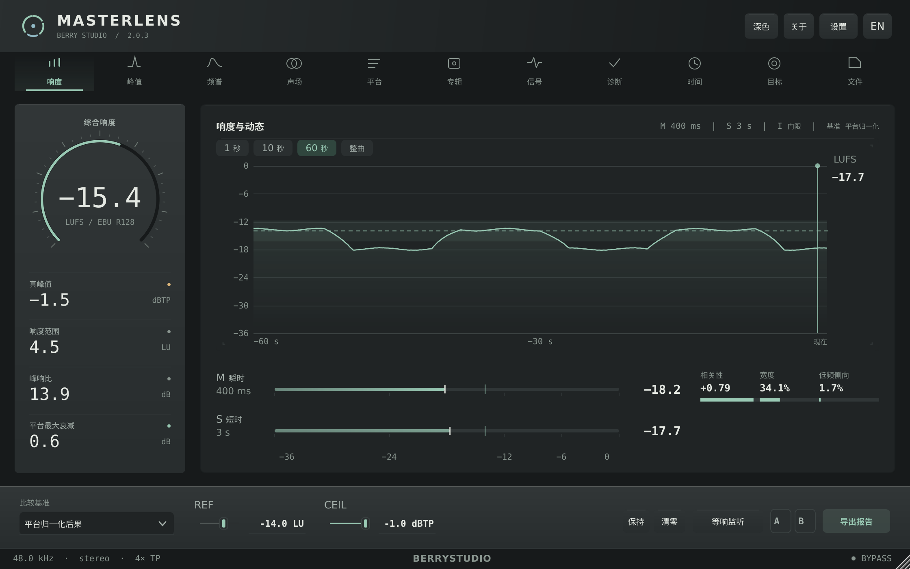

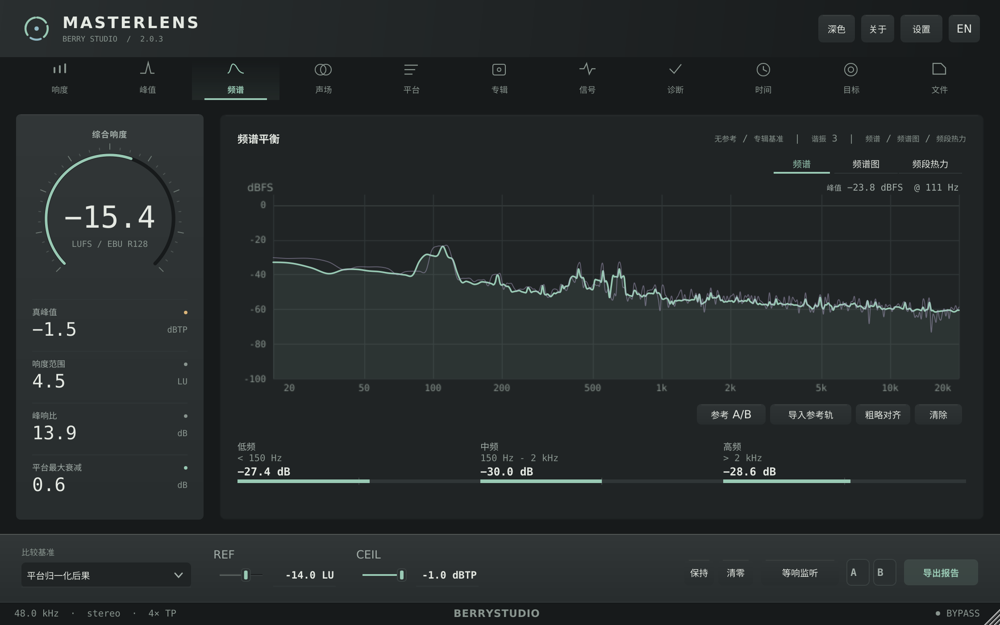

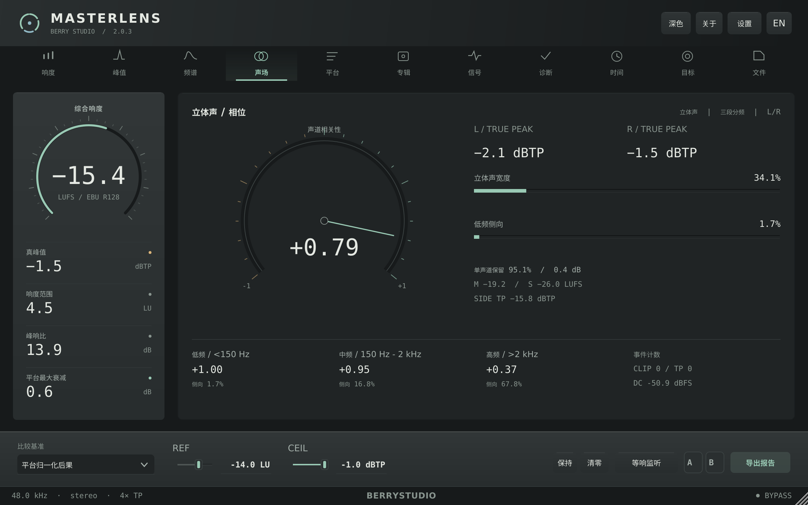

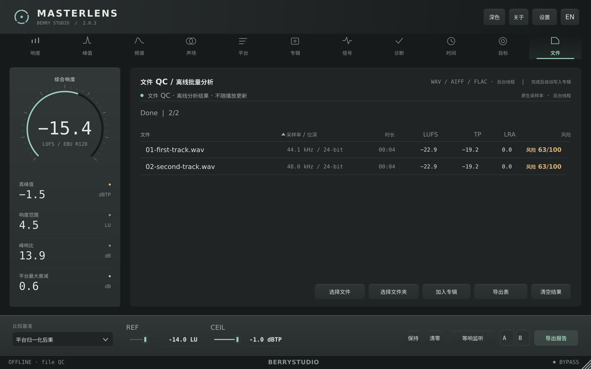

以上和下方所有界面图均由 **2.0.3 的 MasterLensUiShot 实际构建**生成，使用固定的合成音频；文件 QC 图中的两首 WAV 也经过了真实分析。它们用于展示界面与验证布局，不是商业母带的测量样本。

## 它检查什么

| 检查 | 内容 |
| --- | --- |
| 响度与动态 | ITU-R BS.1770-4 / EBU R128 的 I / M / S / LRA，PLR，独立 Mid / Side 响度 |
| 峰值与信号 | 4× 真峰值、L / R / Side 峰值、削波、直流、爆音、瞬态、混叠、超低堆积和中频掩蔽 |
| 频谱与声场 | 8192 FFT、频谱图、10 段频段热力、相关性、宽度、三段侧向能量、单声道折叠 |
| 平台后果 | Spotify、Apple Music、YouTube、Tidal、Amazon、SoundCloud、播客和俱乐部的增益、预测峰值与限幅后果 |
| 专辑门禁 | 曲目与专辑中位比较、覆盖度、可开关规则、风险排序、JSON / TXT 证明与证据哈希 |
| 文件 QC | WAV / AIFF / FLAC、递归文件夹、原生采样率分析、排序与 CSV 导出，结果自动加入当前专辑 |
| 参考与试听 | 参考轨 A/B、宿主播放头同步、等响监听、包络粗略对齐、信号区域试听 |
| 报告与自动化 | TXT / JSON / CSV / PDF、100 ms 原始序列、时间线选区估算和无 GUI CLI |

## 五分钟上手

### 先装好，再播一首

[下载 2.0.3](https://github.com/KNGTNPT/MasterLens/releases/tag/v2.0.3)。macOS 打开 DMG，运行「安装 Install.command」；Windows 运行对应 x64 / ARM64 的 EXE，然后重启 DAW。

把 MasterLens 插在母带链最后，播 20–30 秒。先看左侧综合响度、真峰值、LRA 和 PLR，再看中央的历史曲线。底部「比较基准」可切平台归一化后果、参考轨、专辑中位或手动参考。手动模式下才能编辑 REF；CEIL 是你自己的真峰值上限。

要重新测一次，点「清零」或按 R。按住空格可保持显示；A / B 存放读数快照，右键清空。

### 一张专辑直接跑文件 QC

按 F，拖入文件或整个文件夹，也可以点「选择文件 / 文件夹」。分析完成后，表格会列出采样率、位深、时长、LUFS、TP、LRA 与风险。表头可排序，行可点开查看，结果可导出 CSV。

成功的结果会写进**当前专辑**。做下一张专辑前，先换专辑名或清空上一张。按 5 查看专辑中位、风险排序与交付门禁，再导出证明。

实时采集也保留：填写曲目名和总长秒数，从头播放，覆盖度达到 95% 后点「采集本曲」。文件 QC 则直接得到完整文件的覆盖度。

### 参考、声场和问题区域

按 3 打开频谱。三种视图分别看当前频谱、最近的频谱图和频段热力。导入参考轨后，「参考 A/B」按宿主播放头播放参考；底部「等响监听」帮助你在接近的响度下比较。粗略对齐用的是响度包络，适合找段落。

按 4 看声场。自绘指针显示相关性，旁边保留宽度、低频侧向、左右真峰值和折叠结果；它显示的是统计量，不是假装成示波器的动画。

信号页的卡片可以实时 solo 当前输入，时间戳可以循环回听问题片段。Esc 停止。响度历史上拖动可选择区域；区域结果由 100 ms 包络估算，精确测量请跑完整文件。

### 报告与命令行

「导出报告」或 Cmd+E 会生成 TXT / JSON / CSV / PDF，以及 `-timeseries.csv` 原始序列。CLI 随安装包提供：

```bash
MasterLensCli analyze /path/to/album --json report.json
MasterLensCli analyze track.wav --csv
```

支持多个路径与递归文件夹。适合批量 QC，或者把结果接到自己的交付脚本里。

### 快捷键

空格保持，R 清零，1–9 切模块，0 曲风目标，F 文件 QC，Esc 停止试听或关闭面板，Cmd+E 导出。

## 其它页面

| English | 专辑门禁 |
| --- | --- |
| 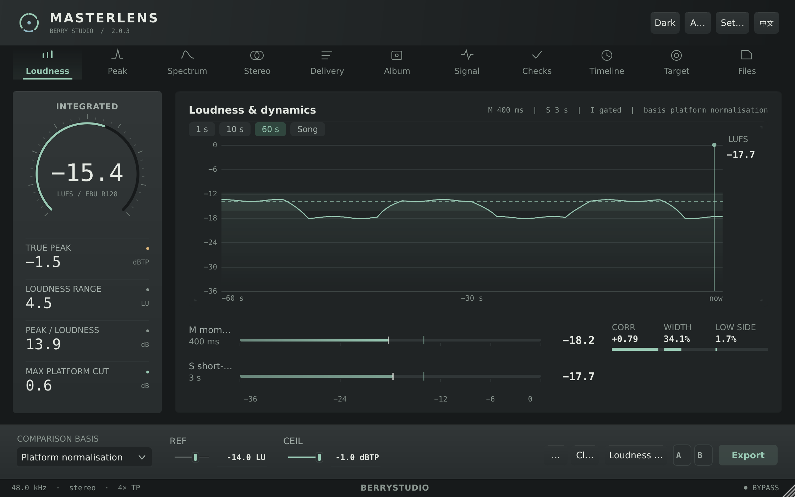 | 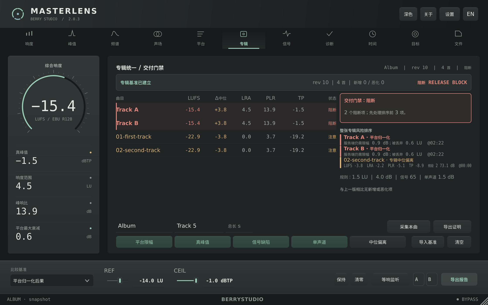 |

| 信号健康 | 平台归一化 |
| --- | --- |
| 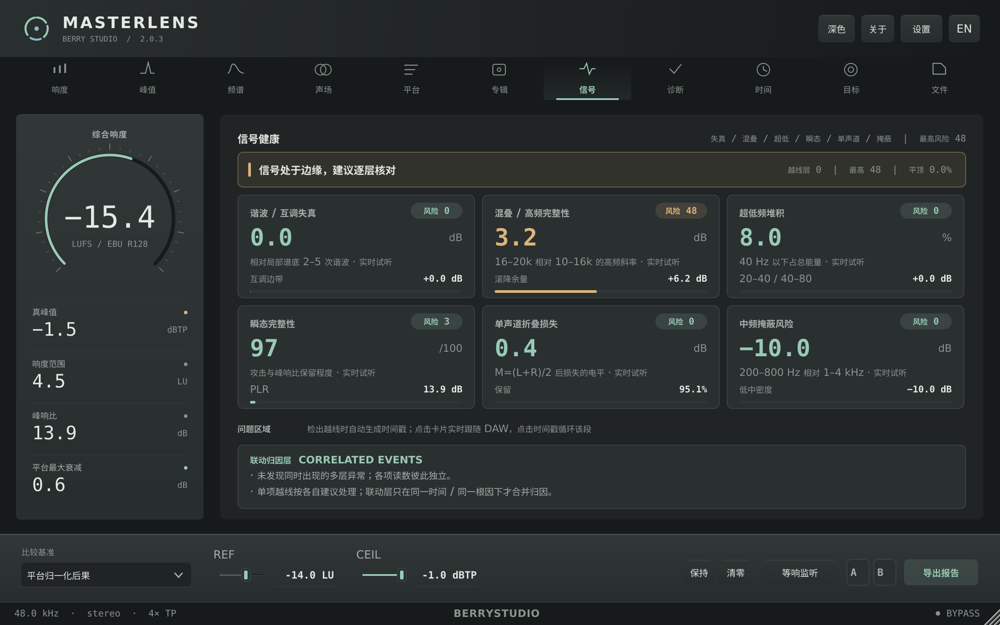 | 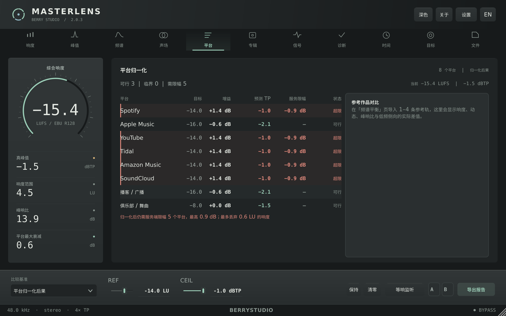 |

| 混音诊断 | 曲风目标 |
| --- | --- |
| 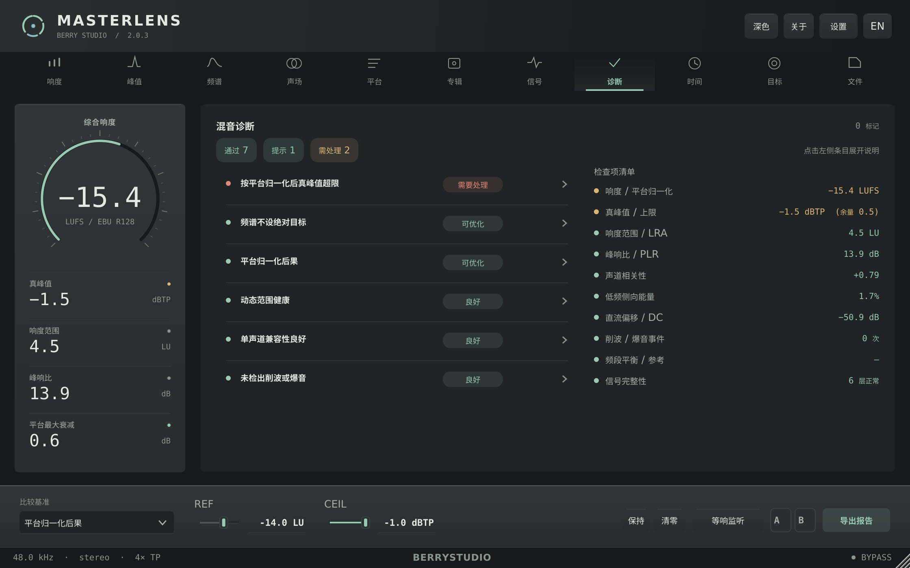 | 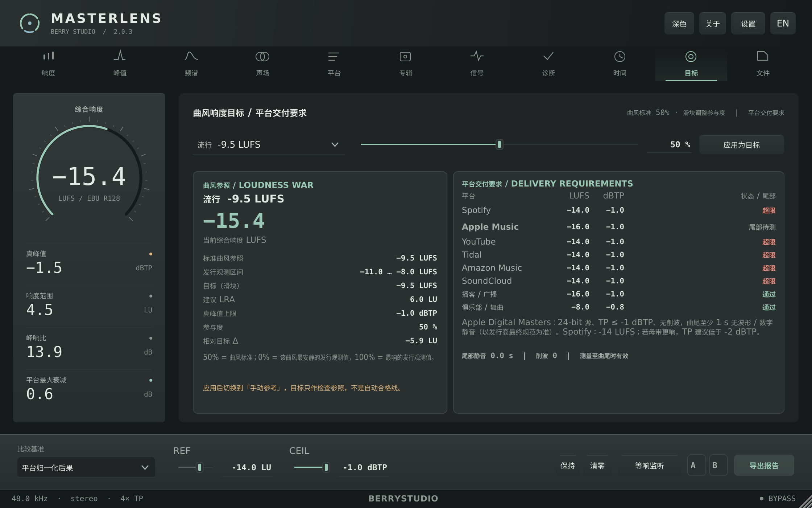 |

| 时间线 | 设置 |
| --- | --- |
| 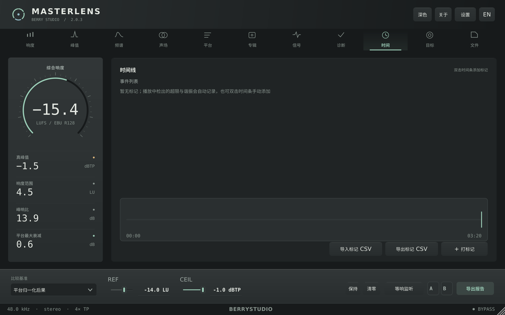 | 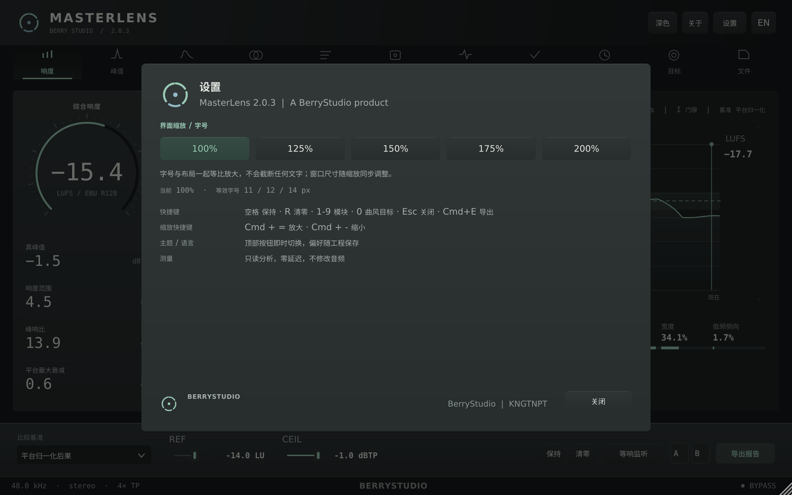 |

## 构建与验证

需要 C++17 编译器、CMake ≥3.22，以及固定版本 JUCE：

```bash
git clone --depth 1 --branch 8.0.15 https://github.com/juce-framework/JUCE.git .tools/JUCE
cmake -S . -B build -DCMAKE_BUILD_TYPE=Release
cmake --build build --config Release --target MasterLensCli MasterLensDspTest -j 4
./build/MasterLensDspTest_artefacts/Release/MasterLensDspTest
```

macOS 使用 Xcode Command Line Tools；通用二进制配置增加 `-DCMAKE_OSX_ARCHITECTURES="arm64;x86_64"`，插件目标为 `MasterLens_AU`、`MasterLens_VST3` 和 `MasterLens_Standalone`。Windows 使用 MSVC，插件目标为 VST3 / Standalone；DSP 测试的文件名带 `.exe`。

Linux 可用于开发与离屏回归，需要 ALSA、X11 / Xext / Xinerama / Xrandr / Xcursor / Xrender / Xcomposite、FreeType、Fontconfig 和 OpenGL 开发库。仓库已关闭 WebKit 和 CURL。截图使用 `MasterLensUiShot`，例如：

```bash
cmake --build build --config Release --target MasterLensUiShot -j 4
./build/MasterLensUiShot_artefacts/Release/MasterLensUiShot page0 size1120
./build/MasterLensUiShot_artefacts/Release/MasterLensUiShot page3 size1120 bench
```

无显示服务的 Linux 需要 Xvfb 和中文字体。同一个构建目录请串行执行 CMake / Ninja。

本次本地验证包含 **75 项 DSP 断言**、CLI 校准与新旧结果比较、默认旁路 / 零延迟检查、各页面布局、缩放及离屏性能。原生 macOS / Windows 安装包由 [GitHub Actions](https://github.com/KNGTNPT/MasterLens/actions) 构建；三个发布目标全部成功后才上传 Release，附带 `SHA256SUMS.txt`。Linux 离屏测试不能代替原生 DAW 与音频硬件回归。

## 工程结构

- `Source/PluginProcessor.*`：音频回调、参数、宿主状态、参考与试听。
- `Source/Editor*.cpp`：窗口布局、控制、调度和报告。
- `Source/ui/`：自绘界面、图表、页面与诊断规则。
- `Source/dsp/`：响度、真峰值、频谱与信号分析。
- `Source/audio/`、`Source/file/`、`Source/album/`：试听、文件 QC 与专辑门禁。
- `Tests/DspTest.cpp`：测量、试听、参考、文件分析回归与 CPU 基准。
- `Tools/UiShot.cpp`：实际编辑器截图、布局检查、刷新计数与性能采样。

## 仍然有边界

仅支持单声道 / 立体声。频谱 8192 FFT 的低频分辨率有限；选区是包络估算；宿主整曲长度需要手动填写。平台规则是静态交付参照，曲风目标也需要你判断。

MasterLens 不做总线 ARA：多数宿主只向音频轨开放 ARA，总线整张混音的离线分析由文件 QC 处理。AAX、DDP、编码预演、Apple 公证和商业代码签名需要另外的 SDK、编码器或证书。

首次打开未公证的 macOS 版本，可能需要通过系统的「右键 → 打开」。本次离屏截图与基准使用 Linux；原生安装包的构建结果以对应 CI 记录为准，DAW 实机体验还需要继续回归。

## English summary

MasterLens 2.0.3 is a mastering bus inspector for macOS and Windows: VST3, AU and Standalone, with a headless file-QC CLI. It is bit-transparent and zero-latency by default; auditioning, loudness matching and reference A/B are explicit actions.

This release rebuilds the editor around horizontal navigation, a dedicated loudness instrument, a large central graph and a separate control desk. Graphite surfaces, celadon accents, custom vector scales and a correlation needle replace the previous layout. Meter presentation is separated from FFT and diagnostic work; the true-peak FIR and audition history capture are optimised without changing the measurement standard.

All README screenshots come from the 2.0.3 renderer. See [the performance and validation record](docs/performance-2.0.3.md) for measured results and platform limits.

JUCE 8.0.15 使用 AGPLv3 / 商业双许可；本项目按 AGPLv3 使用 JUCE。

---

最后还是那句：数字帮你查漏，耳朵负责决定。检查完，就安心去听歌吧。🎧
