# MasterLens


**母带响度 / 文件 QC / 频谱 / 声场 / 专辑交付 / CLI**<br>
by **BerryStudio** · developer **KNGTNPT 兰**<br>
macOS / Windows · VST3 / AU / 独立版 · C++17 + JUCE 8<br>
当前版本：**3.0.2**（安装包自带 FFmpeg）

MasterLens 是放在母带链末尾的小检查员：这首歌有多响、峰值会不会顶过头、立体声合成单声道后会不会变薄、交出去之前还有哪里值得听一遍，它都帮你留意着。把它插在 Master / Stereo Out 的最后一级就好。

默认零延迟、逐位旁路，也就是只看、不动你的声音。点试听、开等响监听或切参考 A/B 时，才会临时改变输出。辛苦做好的声音，会好好留在原地。

歌该做成什么样，还是你的耳朵说了算。数字有点多也没关系，我们一项项看；它负责把容易漏掉的小细节摊开，陪你把交付前的最后一遍检查做完。

## 3.0.2：安装包自带 FFmpeg

3.0.2 只做一件事：把 3.0.1 准备好的运行时结构和门禁真正填满。安装后直接可用 AAC 256k / MP3 320k 编码 A/B，不需要 Homebrew、PATH 或手动安装 FFmpeg。

- **随包运行时**：macOS Universal（arm64 + x86_64）与 Windows x64 / ARM64 各带一份精简 LGPL FFmpeg 9.0.2（含 libmp3lame 3.100）。只保留 PCM / FLAC / MP3 / AAC / ALAC / Vorbis / Opus 解码，AAC / LAME 编码，以及 WAV / M4A / MP3 封装。
- **体积**：macOS Universal 约 6.6 MB，Windows x64 约 3.4 MB、ARM64 约 2.8 MB；DMG 约 37 MB（运行时随三份插件包与安装根目录各放一份）。
- **来源可复现**：`scripts/build-ffmpeg-runtime.sh` 固定源码 URL、SHA-256、LAME 补丁与 configure 参数；产物旁附 `build-info.txt` 与 LGPL 许可证。
- **门禁**：CI 直接校验仓库内运行时并设置 `MASTERLENS_REQUIRE_RUNTIME=1`；稳定版缺少运行时仍会拒绝发布。
- **路径**：macOS 插件包内 `Contents/Resources/ffmpeg`；Windows 的 `ffmpeg.exe` 位于安装目录的 `ffmpeg` 子目录与 VST3 包的 `Contents/Resources/ffmpeg`。

### 3.0.2 验证

详细结果见 [3.0.2 验证记录](docs/performance-3.0.2.md)。

- DSP / 可靠性断言：**178 项通过**（`MASTERLENS_REQUIRE_RUNTIME=1`，无跳过）。
- CLI 集成检查：**76 项通过**（随包运行时，无跳过）。
- UI 布局：**46/46 场景**（每场景先跑边界断言再渲染，含编码中 / 失败状态）。
- `auval` 通过；DMG 内三份插件包的嵌套运行时签名与能力校验通过。
- 6 张主截图 + 2 张编码状态证据，记录在 `docs/screenshots-3.0.2.json`。


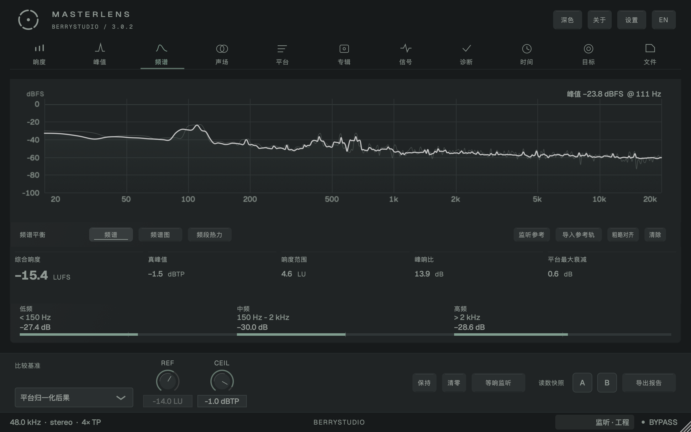


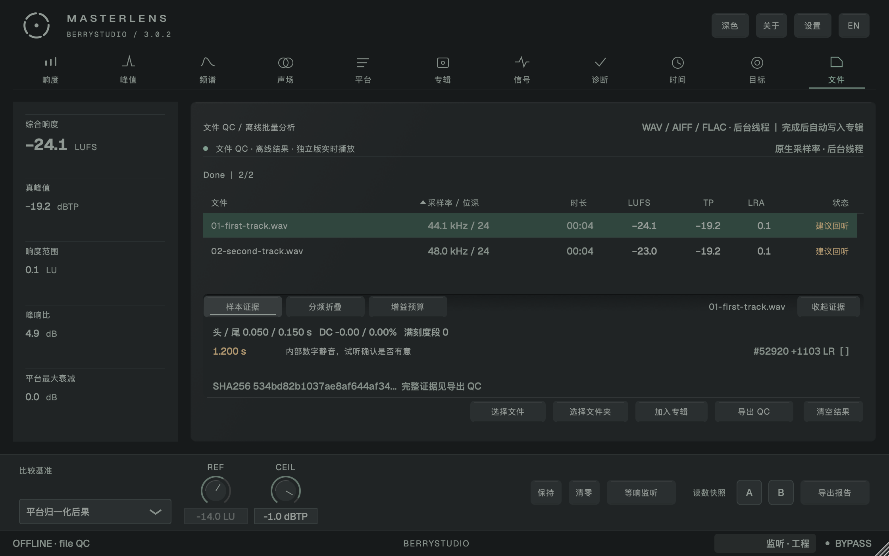

## 3.0.1：编码后端统一，发布门禁补齐（历史）

3.0.1 不改测量与监听，只把编码链路和发布流程做实：GUI、文件 QC 与 CLI 共用 `FFmpegRuntime`，失败分类、Unicode 路径、`REQUIRE_RUNTIME` 门禁与打包结构都在这一版完成。该 prerelease 未携带二进制，详细记录见 [3.0.1 验证记录](docs/performance-3.0.1.md) 与 [发布说明](docs/release-3.0.1.md)。

## 3.0.0：四种比较一起听，读数也回到一条基线

3.0 把 2.7 挂账的四项监听能力补齐；正式版在 rc.1 的基础上只动了两件事——修好三处读数对齐，把「必须先播过 / 必须有 ffmpeg」写进界面和文档。

- **频段独听**：频谱页「频段热力」的 10 段与低 / 中 / 高三段都可单击独听；4 阶 Butterworth（24 dB/oct），不做等响补偿，只改监听输出，`Esc` 停止。
- **选区等响**：时间页拖选后点「选区等响」，按 BS.1770-4 门限积分测工程选区与当前参考槽位 `OFS + 选区` 的响度，把差值写进参考 GAIN；工程声音不动。
- **长文件流式播放**：独立版文件传输改为固定环形缓冲（约 8 MB），读取线程预读 3 s；两小时以上的文件也能播放、拖动、循环，欠载时显示「缓冲中」，音频回调不阻塞、不分配。
- **编码 A/B**：文件 QC 用本机 ffmpeg 生成 AAC 256k / MP3 320k，解码回 float WAV 后按同一时间码切换「A 原始 / B 编码后」，显示 ΔLUFS / ΔTP；缺少 ffmpeg 时明确不可用。

**正式版修掉的三处对齐**（都在截图上被一眼看出来）：

- 侧栏与频谱页的读数：数字和单位不再各按各自的框居中，改为共用一条基线（`theme::text::drawValueUnit`），26 px 的主读数和 14 px 的单位不会再一高一低。
- 设置页页脚：logo、BERRYSTUDIO、开发者与关闭按钮统一到同一条水平中线；此前字标被放在顶部 14 px 的条带里、关闭按钮又被网格上移 4 px。
- 三条都在浅色 / 深色、80%–200% 每个缩放档下复验过。

「选区」指 MasterLens 时间线拖选，不是宿主 loop；长选区循环交给宿主，≤ 10 s 可用 12 s 历史环试听。参考轨仍整段解码，超过 1 小时或 512 MB 会明确拒绝。

**两条使用前提**（写在这里，是因为它们最容易被当成 bug）：

- **选区等响要先播过那一段**。选区的响度来自时间线已经采到的 100 ms 读数，没播过的区段没有数据，界面会提示「请先播放该段」。它不是整首歌的离线测量——要离线测整首歌，用文件 QC。
- **编码 A/B 要有本机 ffmpeg**。找不到时按钮会明确显示不可用，不会假装出结果。macOS 用 `brew install ffmpeg`；Windows 用 `winget install ffmpeg` 或官网包。

### 3.0.0 验证

详细结果见 [3.0.0 验证记录](docs/performance-3.0.0.md)。

- DSP / 可靠性断言：**178 项通过**（含 4 阶独听泄漏 ≤ −24 dB、门限积分、2 小时虚拟文件流式、编码预览）。
- CLI 集成检查：**66 项通过**；UI 布局：**44/44 场景通过**（每个场景先跑边界断言再渲染）。
- macOS / Windows x64 / Windows ARM64 构建与 Release 发布通过；Windows x64 安装冒烟通过。
- 11 个页面逐页截图检查；6 张 README 截图记录在 `docs/screenshots-3.0.0.json`。
- 布局回归 `scripts/check_ui.py` 已接入 CI（macOS job），44 个场景每次发布都跑；选区和编码状态机各有 `STATE … ready` 断言。


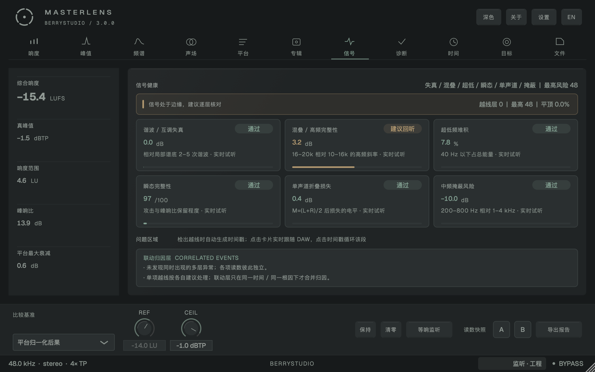


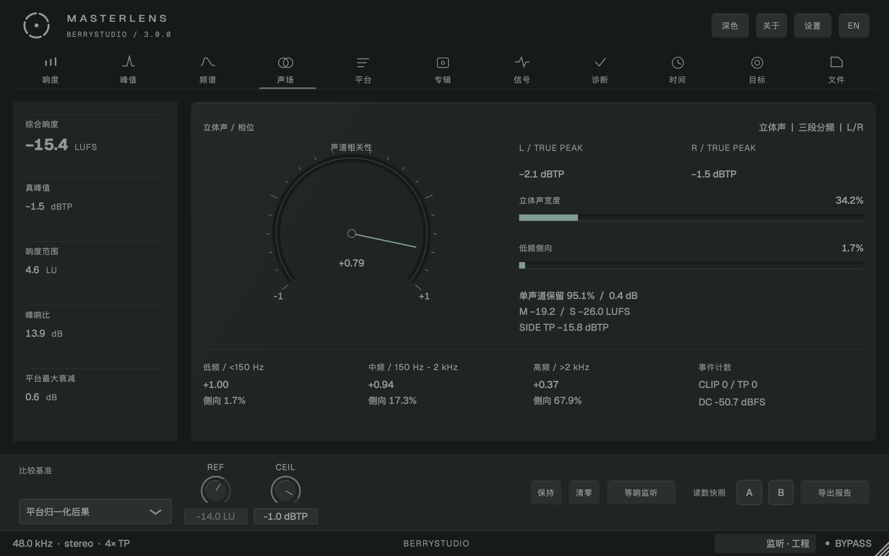

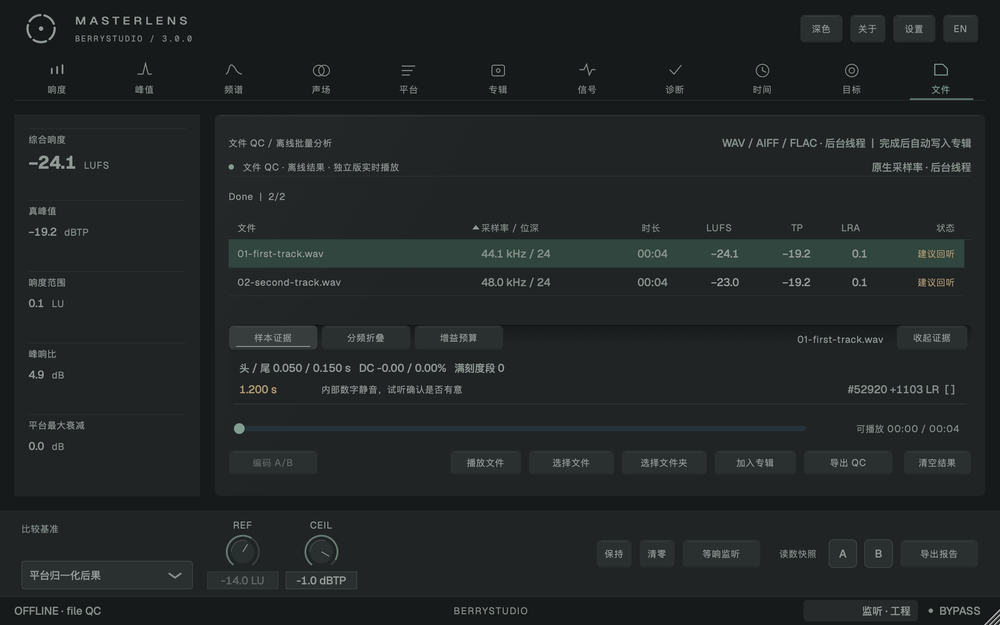


## 3.0.0-beta：参考槽位和排版一起收好喵

3.0-beta 把参考工作区先搭起来，同时把上一版发现的六个界面问题逐项修掉。

- **参考槽位**：频谱页可导入多条参考轨，用槽位下拉快速切换；每个槽位保存自己的 OFS（参考偏移）和 GAIN（匹配增益），随工程状态保留。
- **设置页页脚**：底层 logo、BERRYSTUDIO、开发者和关闭按钮改为同一水平组，以页面中点对齐。
- **左栏读数**：真峰值、综合响度、平台最大衰减等数值与单位回到同一基线；频谱页下方的读数同步。
- **平台下拉对齐**：平台归一化后果下拉下沉，与右侧 REF / CEIL 读数保持同一水平。
- **快照按钮**：A/B 字母在按钮控件内真正居中，小状态点移到右下角。
- **时间页按钮**：导入 / 导出标记与打标记按钮不再贴住事件轴，上下留白居中。
- **目标页行距**：曲风参照与平台要求两栏按可用高度分散行距，减少挤在顶部和底部大片空白。

2.7 的长文件流式播放、编码 A/B、选区等响和频段独听还没有进入 beta；这些仍继续走 3.0-rc。

### 3.0.0-beta 验证

详细结果见 [3.0.0-beta 验证记录](docs/performance-3.0.0-beta.md)。

- 11 个页面逐页截图检查数字、单位与标签基线。
- DSP / CLI / UI 回归：**151 / 66 / 35 通过**。
- macOS / Windows x64 / Windows ARM64 构建与 Release 发布通过；Windows x64 安装冒烟通过。

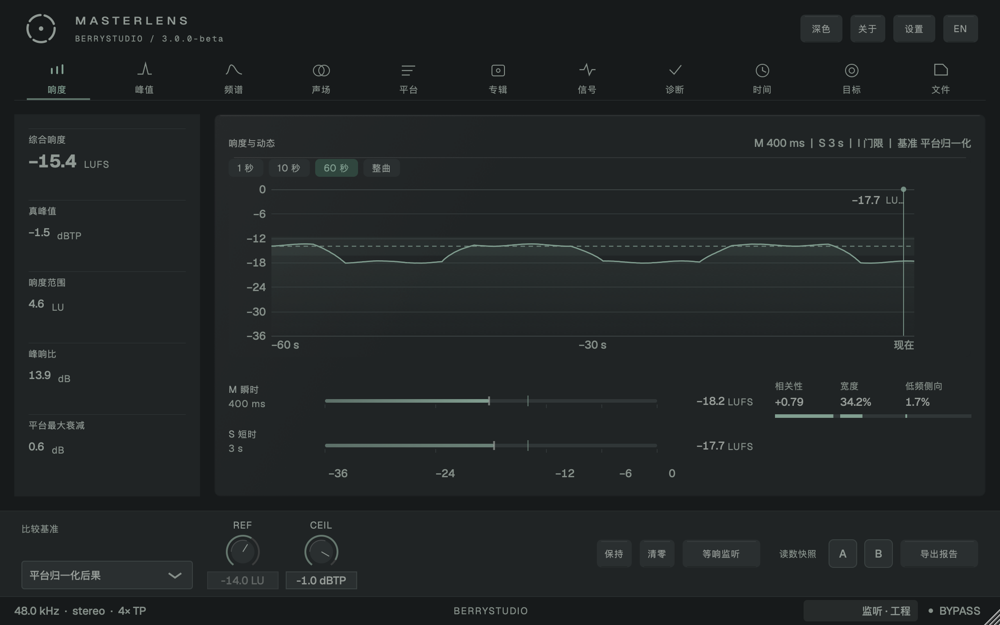

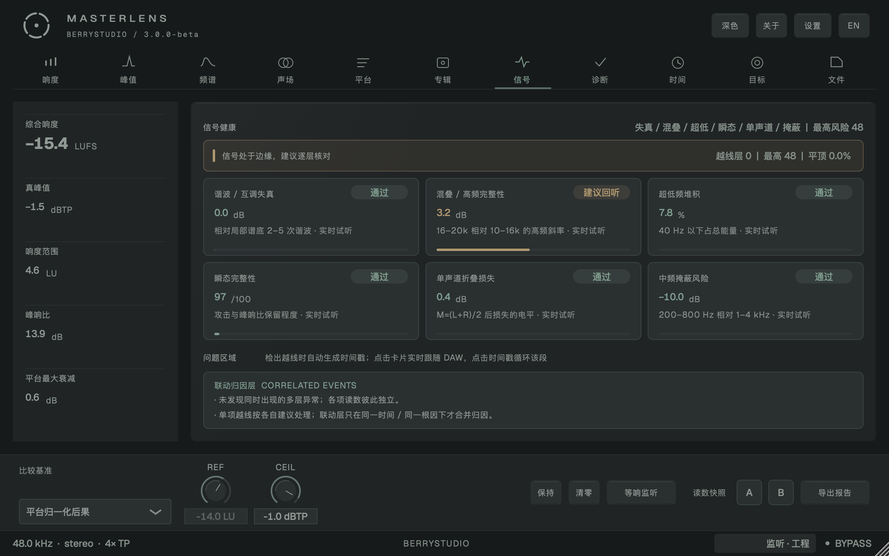


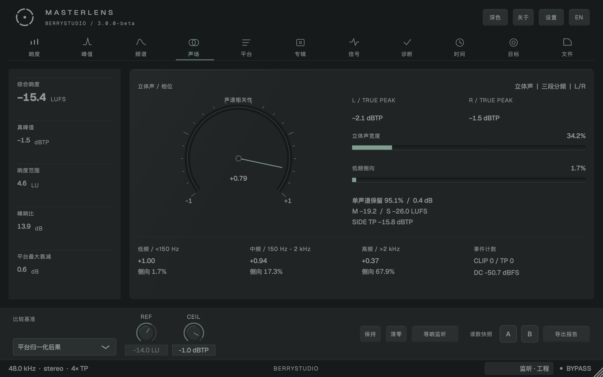

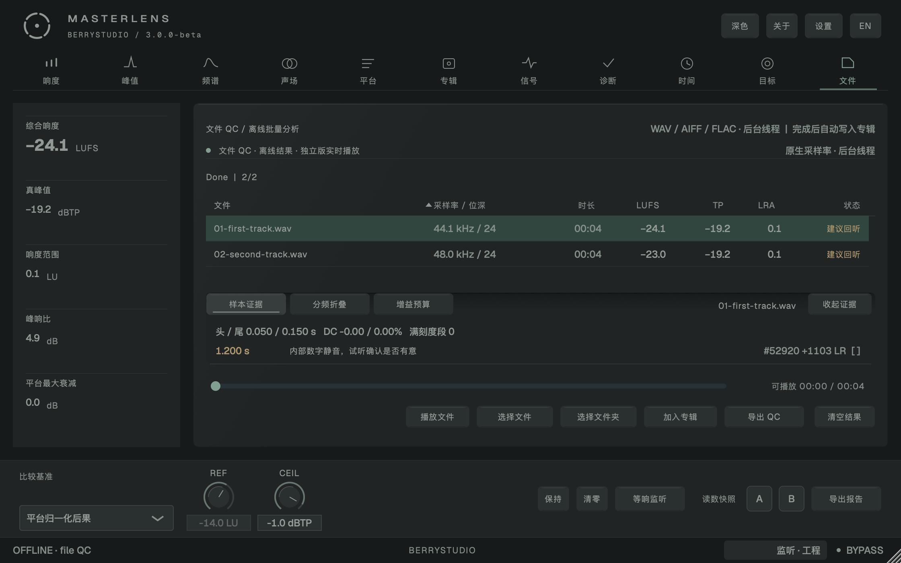


## 3.0.0-alpha：先把数字和单位排好喵

3.0-alpha 是一个只做排版的切片：不改音频、不改测量算法，把每一页的“数值 + 单位”重新摆正，让标签、数字和单位看起来像同一个读数，而不是三样东西。

- **响度页**：综合、M 瞬时、S 短时的单位和数值贴在一起；历史曲线末端显示 `−17.7 LUFS`，不再让单位单独漂在上方。
- **真峰值页**：`−1.5 dBTP` 成为一个整体，最大值标签不再重复写单位。
- **信号健康页**：卡片的 `dB`、`%`、`/100` 紧跟数值，不再被推到卡片最右侧；风险数字改为「通过 / 建议回听 / 需修复」。
- **平台归一化页**：目标、安全增益、预测 TP 和差额列都带单位，列宽重新分配，避免 `LUFS` 被裁成 `LUF…`。
- **目标页**：当前综合响度把 `LUFS` 放回数值旁边；平台要求表的单位列不再和数值错位。
- **全局字体**：继续使用 Geist 14 / 16 / 26px 三档语义字体、tabular numerals 和统一 tracking；这版重点校正单位基线与数字右对齐。

这是 **alpha**：2.6 / 2.7 的多参考、段落等响、长文件流式和编码 A/B 还没有进入本版。它们仍按之前的 3.0 路线继续做，不会用这个排版切片冒充完整 3.0。

### 3.0.0-alpha 验证

详细结果见 [3.0.0-alpha 验证记录](docs/performance-3.0.0-alpha.md)。

- 11 个页面逐页截图检查数字、单位与标签基线。
- DSP / CLI / UI 回归：**151 / 66 / 35 通过**。
- macOS / Windows x64 / Windows ARM64 构建与 Release 发布通过；Windows x64 安装冒烟通过。


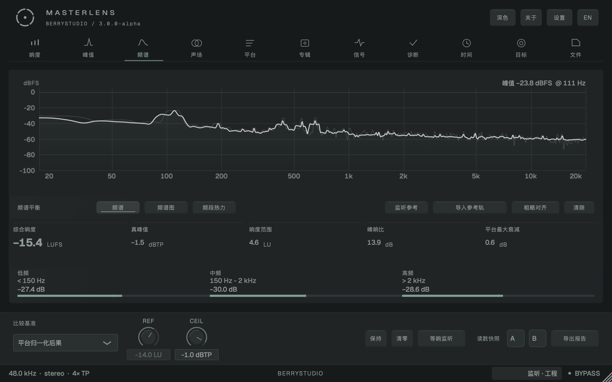

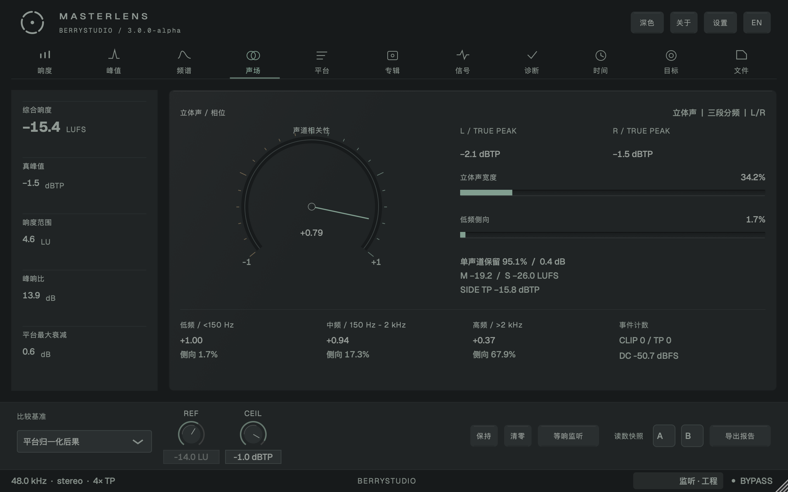

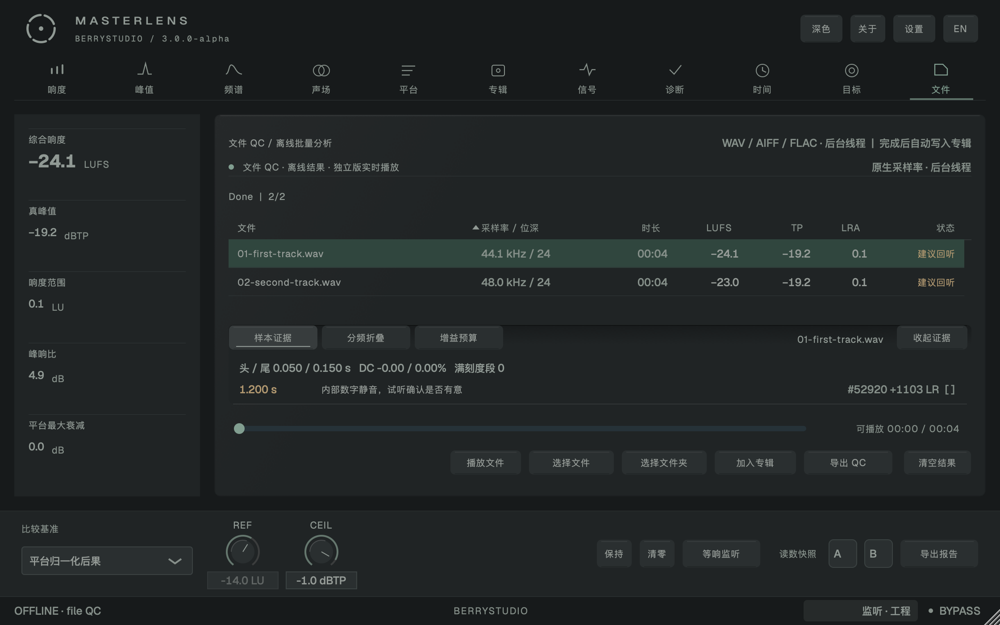

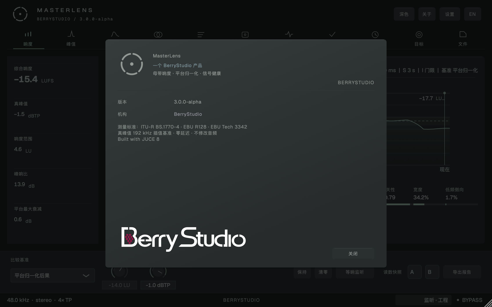

## 2.5.0：先看曲目，再听问题喵

2.5.0 只改监听和文件 QC 的操作路面，不动测量算法。以前文件 QC 的证据区会把曲目列表挤成一条，风险数字又比“到底要不要回听”更显眼；这一版把顺序倒过来：先看有几首歌、哪首需要回听，再展开原因。

- **两首曲目能同时看到**：文件表优先保留高度，证据详情默认展开但保证至少三行列表空间；右侧「收起证据 / 展开证据」可以随时让列表更大。
- **播放状态说清楚**：选中文件后显示真实总时长，并区分「未加载」「可播放」「播放中」；不再和未播放的 `00:00 / 00:00` 混在一起。
- **问题一键回听**：样本证据里的问题行单击即播放该事件前后片段，右侧圆点仍然只负责标记复核；双击定位保留。
- **状态先于分数**：文件表最后一列改为「建议回听 / 需修复 / 已复核 / 通过」，风险分数继续用于排序，不再要求用户先解释数字。
- **监听来源常驻**：底部固定显示「监听 · 工程 / 参考 / 问题片段 / 文件」，输出状态和监听来源分开；进入证据回听时左侧显示文件名与时间段。
- **A/B 不再混用**：参考按钮改名为「监听参考 / 监听工程」，A、B 明确标注为「读数快照」。
- **读数就近**：响度页的综合、瞬时、短时数值把单位放回数值旁边，减少视线来回找单位。

### 2.5.0 验证

详细结果见 [2.5.0 验证记录](docs/performance-2.5.0.md)。

- 文件 QC 默认窗口：两首曲目同时可见，证据可收起。
- 选中文件后显示真实时长；问题行单击回听，圆点复核。
- 监听来源与输出状态分离；A/B 标注为读数快照。
- DSP / CLI / UI 回归：**151 / 66 / 35 通过**；默认窗口两首曲目同屏，证据可收起。
- Windows x64 安装冒烟测试通过；VST3 与独立版均安装到正确目录。

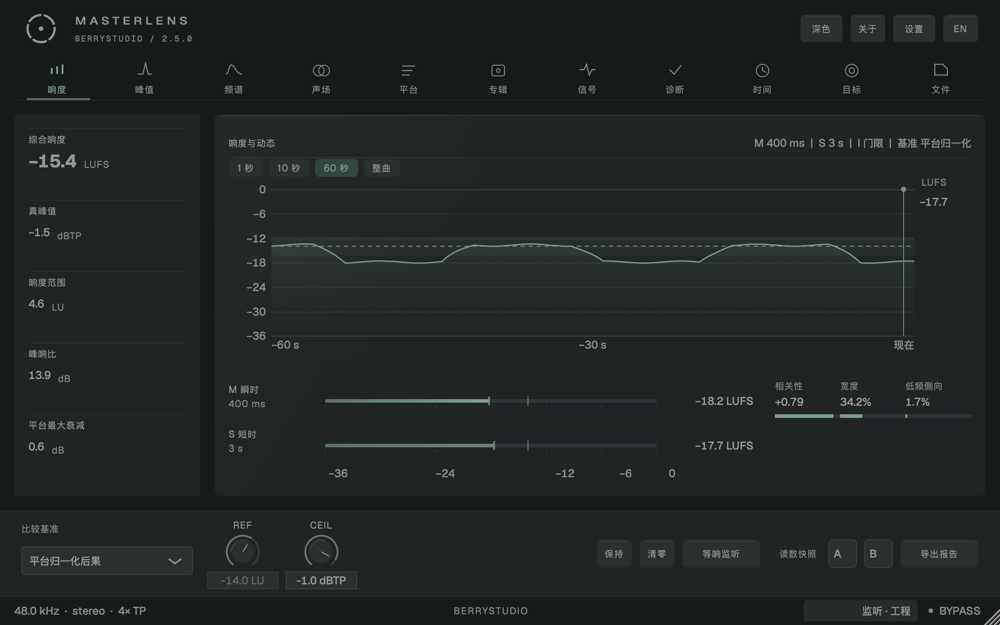

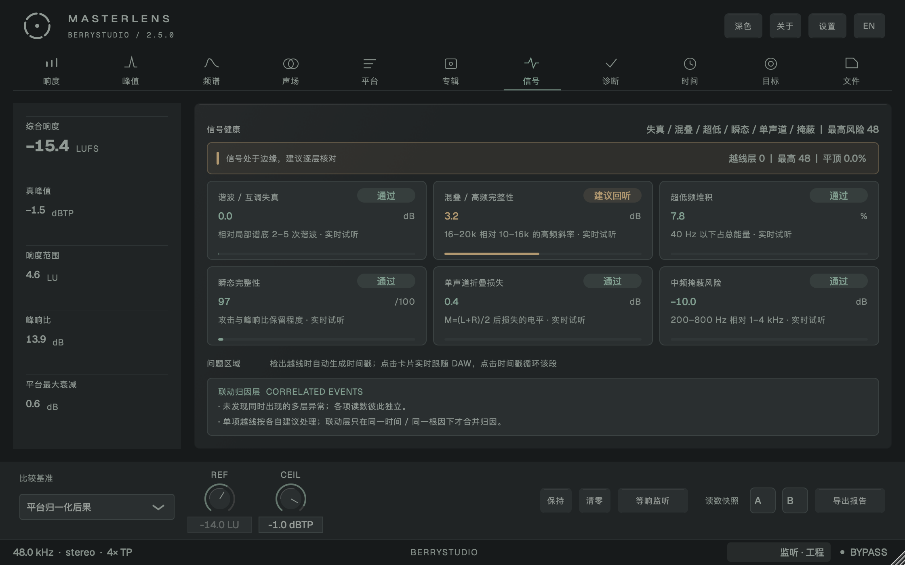


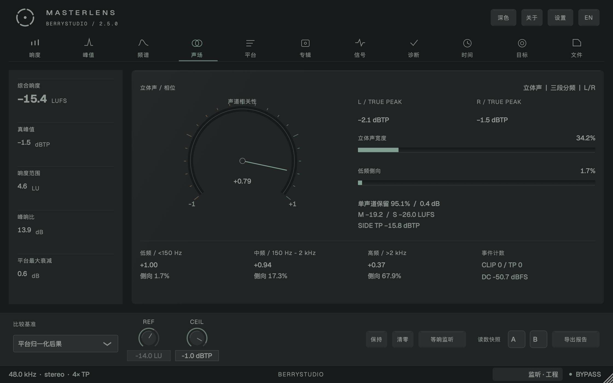


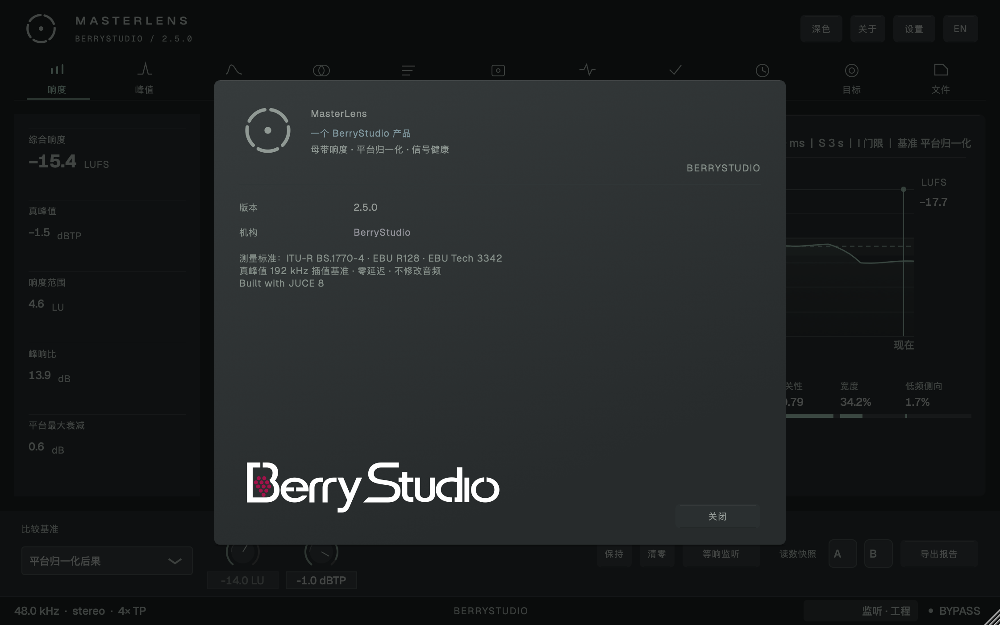

## 2.4.1：Windows 安装器回到正确目录喵

2.4.1 是一个只修 Windows 安装路径的小补丁。声音没有变，界面没有变，变的是 VST3 终于会被放到 DAW 真正会扫描的地方。

Windows x64 装完找不到 MasterLens，根因在 NSIS 安装脚本：`$COMMONPROGRAMFILES64` 并不是有效变量，正确的名字是 `$COMMONFILES64`。NSIS 编译时只会给一个 warning 6000，安装器仍然能生成，但 VST3 的安装目录被解析错了。现在安装和卸载都走 `$COMMONFILES64\VST3\MasterLens.vst3`，也就是：

```text
C:\Program Files\Common Files\VST3\MasterLens.vst3
```

另外把 CI 的 `makensis` 加上了 `-WX`。以后再有类似的未知变量，安装包会直接构建失败，不会又悄悄产出一个“看起来装完了”的坏包。

- **修复范围**：Windows x64 / ARM64 安装器的 Common Files 路径，以及卸载路径。
- **没有改动**：DSP、旁路、文件 QC、界面布局、项目格式和 macOS 功能。
- **升级方式**：Windows 2.4.0 用户重新下载 2.4.1 安装包，安装后重启 DAW。若旧安装器把 VST3 放到了别处，可以顺手清理那个错位目录。
- **验证**：本地 `makensis -WX` 通过；Windows x64 CI 静默安装与目录检查通过；DSP / CLI / UI 回归继续通过。详见 [2.4.1 验证记录](docs/performance-2.4.1.md)。

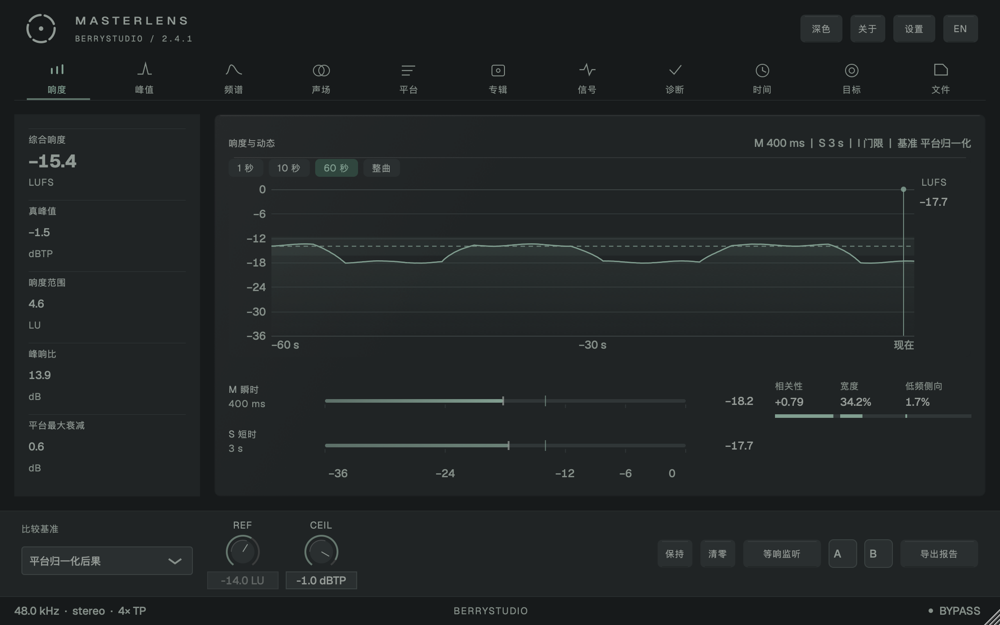


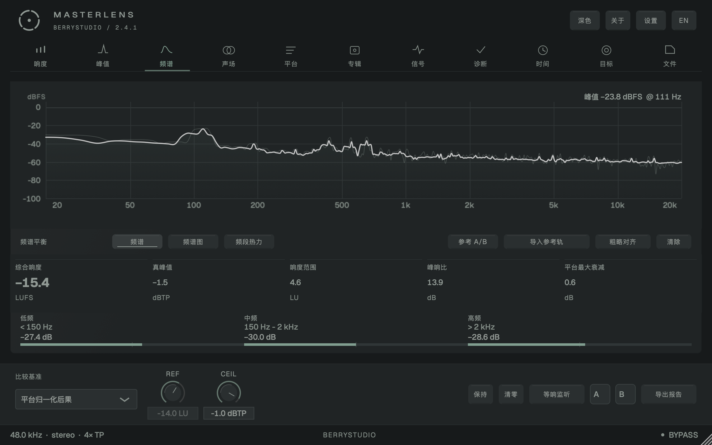

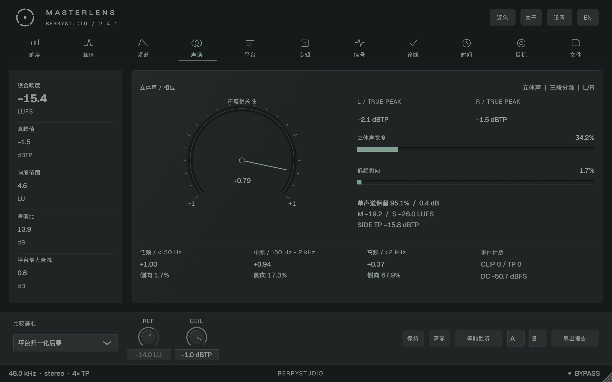

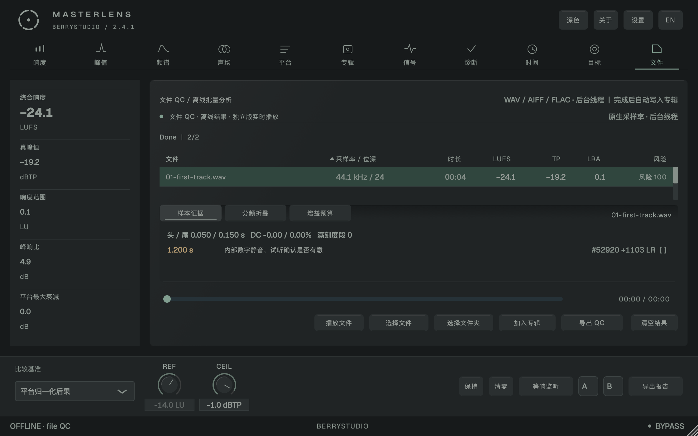

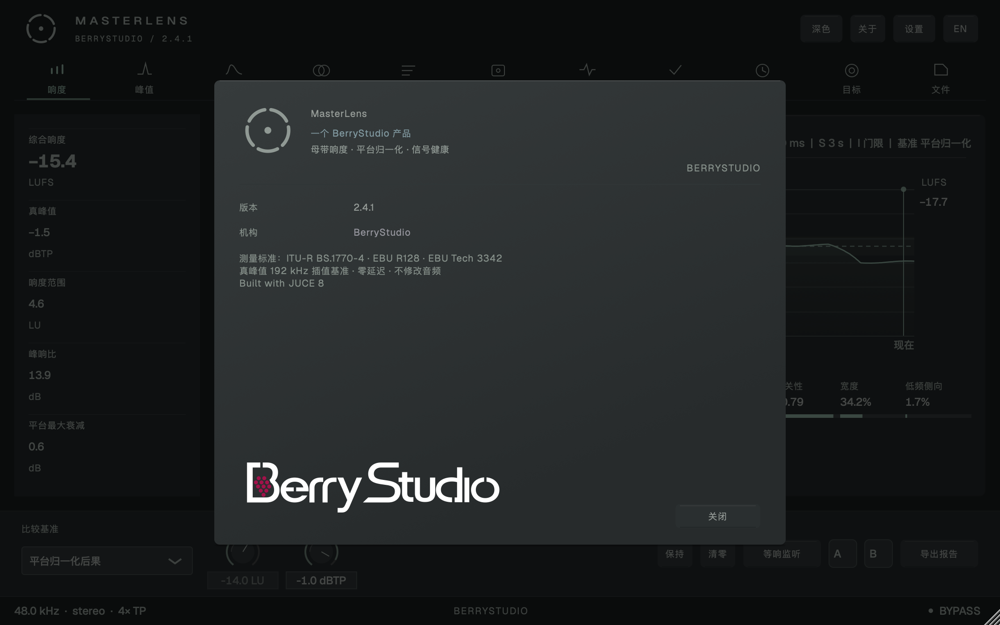

## 2.4.0：导入文件真正进入测量链路喵

2.4.0 修的是“看起来在播、其实没有进入测量”的问题，同时处理三处会被专业用户一眼看出的底层技术债。

- **独立版导入文件会更新全部页面**：播放文件时，音频先进入 400 ms / 3 s / LRA / TP / 频段 / 声场分析，再送到输出；不再只是覆盖扬声器输出。切换响度、峰值、频谱、声场、诊断等页面都能看到实时读数。
- **文件播放进度与定位**：独立版 File QC 增加进度条和时间显示；拖动进度条可从头定位文件，播放 / 停止仍然由文件页按钮控制。
- **Logic Pro 空格键**：插件窗口在前台时，普通空格不再被 MasterLens 的 Hold 快捷键吞掉，而是交回宿主 transport；Hold 改为 `Shift+Space`，避免占用 DAW 的播放 / 停止。
- **SpectrumRing 线程安全**：音频线程写入的每个样本改成 atomic float，UI 读取不再与普通 float 写入构成 C++ data race；允许显示器撕裂，但不允许未定义行为。
- **TpEventRing 读取校验**：事件槽改为 atomic，读取端在复制前后检查版本并重试；注释里承诺的版本校验现在真的执行。
- **真峰值采样率基准**：TP 插值目标改为 BS.1770 的 192 kHz 基准：48 kHz 使用 4×、96 kHz 使用 2×、192 kHz 使用 1×，不再把 96 kHz 当成 384 kHz 的 4×。
- **关于页 SVG**：原始矢量字节与几何不变；移动到卡片左下角。暗色模式只把黑色 ink 提升为白色，红色保持原色，不重画、不识别内容。
- **标签栏下划线**：继续保留 2.3.3 的修复，点击顶部标签时指示线跟随当前页面。

### 2.4.0 验证

详细结果见 [2.4.0 验证记录](docs/performance-2.4.0.md)。

- DSP / 可靠性断言：151 项通过。
- CLI 集成检查：66 项通过。
- UI 布局检查：35/35 通过。
- 新增 96 kHz / 192 kHz 真峰值倍率、TpEventRing 版本和事件快照检查。
- macOS Universal AU / VST3 / Standalone / CLI 与 DMG 构建通过；`auval` 通过。
- Windows ARM64 仍为交叉构建，未做该环境实机测试；macOS 仍为 ad-hoc 签名、未公证。


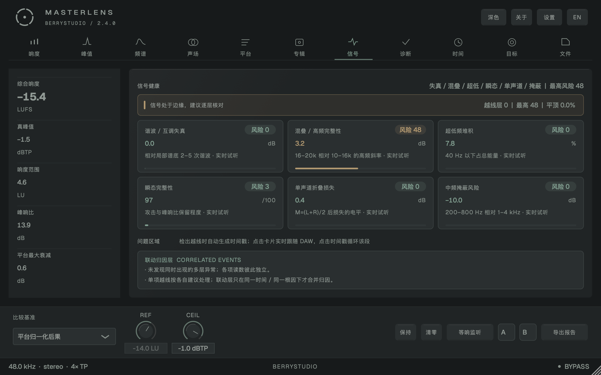


## 2.3.3：把播放、试听和导航接清楚喵

2.3.3 集中修交互里最容易让人误会的地方：独立版导入文件后能直接播放；点信号卡试听后，卡片会亮，切到别的页面也还知道自己在听什么；横向标签栏的下划线会跟着当前页面走。

- **独立版文件播放**：File QC 选中已分析文件后，文件页出现「播放文件 / 停止播放」。它使用插件自己的输出播放文件，不依赖宿主播放头；停止或播放结束后恢复旁路。播放缓存上限为 900 秒，超长文件会截断。
- **信号实时试听有状态**：点击信号健康六张卡会进入实时跟随试听，当前卡片显示青绿描边和左侧亮条；切到其它页面时，页头保留 `LIVE · 具体功能` 提示，底部也写明“正在实时试听：… · Esc 停止”。
- **横向标签下划线跟随**：点击顶部页面标签时，下划线从旧页面滑到新页面，不再停在旧标签下面。
- **页头字标**：`MASTERLENS` 字标垂直压缩 15%，字距增加 30%，字标与下方 byline 的留白减少 20%；图形标记保持原比例。
- **关于页 SVG**：直接使用提供的原始 SVG 资源渲染，不重画、不追踪、不识别内容、不改颜色；资源字节原封不动进入包内。

本版没有改动默认测量算法、旁路路径或现有项目格式。

### 2.3.3 验证

详细结果见 [2.3.3 验证记录](docs/performance-2.3.3.md)。

- DSP / 可靠性断言：144 项通过。
- CLI 集成检查：66 项通过。
- UI 布局检查：35/35 通过。
- 关于页 SVG 使用原始资源 SHA-256 `ce185364ec34c4e1bb8e79c36f0da9ae59017c9873d5dff62ba9e182f2c278ee`，没有做颜色替换。
- macOS Universal AU / VST3 / Standalone / CLI 与 DMG 构建通过；`auval` 通过。
- Windows ARM64 仍为交叉构建，未做该环境实机测试；macOS 仍为 ad-hoc 签名、未公证。


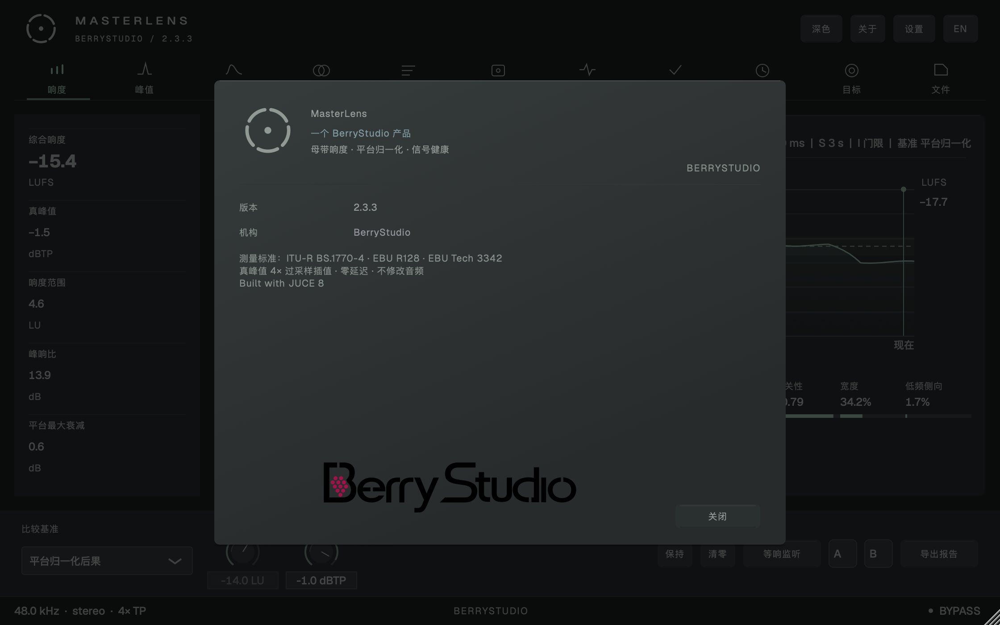

## 2.3.2：每一个「通过」，都再认真一点喵

这一版先把小检查员的尺子校稳：读数能重跑，文件换了就重新复核，检查没做完就老实说没做完。声音交出去之前，心里也能踏实一点点。

- **读数有对照**：补齐固定窗起算、文件尾部真峰值和 LRA 采样；加入 EBU v5 单声道 / 立体声标准序列、FFmpeg 独立对照，以及 32–192 kHz 动态、尾部脉冲、近奈奎斯特与静音测试。随机缓冲区也要得到相同结果。具体误差和验收范围放在[验证记录](docs/performance-2.3.2.md)，不拿测试数量冒充认证。
- **没有检查完，就不盖章**：未知曲长或位置显示未知；循环同一段不会增加覆盖度，专辑交付要求完整覆盖。证明区分 PASS / INCOMPLETE / BLOCKED，保存失败也会明确提示。
- **复核跟着这份声音走**：每个插件实例保存自己的项目，复核绑定源文件 SHA-256、分析版本和事件样本位置。换了文件或升级分析版本，旧圆点不会偷偷替新结果背书；打开项目保留当时的快照。
- **编码真的来回走一遍**：AAC / MP3 分别编码、解码、重新测量，记录编码文件与解码文件的指纹。缺少 FFmpeg、编码失败、超时或规格不合格，CLI 都会返回失败；临时文件用完收好。
- **试听更安静地切换**：参考与证据回听的音频回调去掉锁和共享对象释放路径，参考 A/B 加入 5 ms 交叉淡变，浮点输出保留峰值余量。Debug 退出时的 DynamicObject 生命周期断言也已修复。
- **浅色频谱终于看清啦**：浅色主题的频谱绘图区改成深石墨测量面，主曲线对比更清楚；按钮松开时的回弹与浅光晕稍稍明显一些。关于页的工作室 SVG 原封不动保留。

完整结果、复现命令和仍待补齐的宿主 / 硬件覆盖见 [2.3.2 验证记录](docs/performance-2.3.2.md)。不需要账号、模型或训练数据集，音频继续留在本地。

Windows ARM64 安装包由交叉构建生成；**手头没有 Windows on ARM 设备，尚未经该环境实机测试**。

## 2.3.1：字大一点，眼睛就轻松一点喵

这一版不让你再凑近屏幕猜小字啦。标签、数值、关键读数改成 **14 / 16 / 26px**，初次打开优先用 125%，再按屏幕可用空间收好。拖大拖小窗口时，文字、控件和留白整张一起缩放，位置不会各跑各的；设置里也可以选 80–200%。

- **播放时，圆环陪着转**：左上角镜头围绕中心点每 8 秒转一圈，停止后停在原位；中心点不乱跑。
- **按钮有一点手感**：按下会有轻浅光影，松开带一点阻尼回弹。幅度很小，点按位置保持原样，也不耽误读数。
- **量表跟着屏幕走**：可见窗口优先使用显示器刷新时钟，以 60 FPS 为目标；后备时钟留有 90Hz 调度余量。FFT、报告和问题分析继续分开调度，不把声音处理拖进动画里。


2.3.0 的项目保存、证据复核与回听、交付规格、文件夹监控和 CLI 都继续保留。默认旁路、响度、真峰值与 M/S 测量沿用原有路径。测量和显示实测见 [2.3.1 验证记录](docs/performance-2.3.1.md)；显示速度仍会受宿主、屏幕刷新率和负载影响，不把调度目标写成所有机器上的保证。

## 2.3.0：曲线站前面，工作流也接起来喵

2.3.0 是正式版：界面换成 Precision Instrument，文件 QC 到项目交付的那条路也补齐了。频谱曲线站到最亮的一层，文字和按钮退后；顶部标识放大 30%，BERRYSTUDIO、开发者和版本排在同一行。频谱页保留 32px 安全留白，读数和控制落在 4px 网格上；输出 SpectrumFifo 已接通，原有响度、真峰值、M/S 与旁路行为保持不变。

**项目与版本**

- 专辑页右上角新增「项目」菜单：保存 / 打开项目文件、导出差异证明、导入交付规格、监控文件夹。
- 项目文件把专辑快照、稳定曲目 ID、版本号、参考和证据放在一起；曲目 ID 由“曲目名 + 来源”生成，不再用毫秒时间戳，改一版不会换身份。
- 版本差异继续比较上一版曲目风险，项目文件里的 `projectVersion` 和 `revision` 一起留档。

**文件 QC 证据**

- 证据行右侧有复核圆点：点一下标记为已复核，导出 CSV / JSON 会带上 `reviewed`。
- 双击证据行会在插件输出里循环预听事件前后 4 秒；双击文件行在 Finder / 文件管理器中定位原文件。Esc 停止预听。
- 复核状态、样本地址、源文件 SHA256 和前后预听位置仍在同一条证据链里。

**交付规格与监控**

- 支持导入 JSON 交付规格：目标 / 上限 / 响度容差、采样率、位深、声道数、命名模板。文件 QC 会显示 `DELIVERY SPEC: PASS/FAIL`，项目菜单也能导出模板。
- 文件夹监控使用文件大小 + 修改时间指纹缓存；导出后文件发生变化会自动重新分析。报告中的源文件 SHA256 仍是最终指纹。
- CLI 增加 `--spec` 与 `--codec aac|mp3`。后者需要本机安装 ffmpeg：先编码再解码成临时 WAV，重新测量真峰值，不会假装替代编码器试听。

**参考与局部**

1–4 条参考轨、区域标记和问题片段循环沿用已有实现；多参考谱是能量汇总，不是把几条参考拼成一条假母带。局部精确重算仍以文件 QC / 离线分析为准，实时选区继续是 100 ms 包络估算，避免把估算写成精确值。

验证、限制和本地测量见 [2.3 验证记录](docs/performance-2.3.0.md) 与 [界面验收记录](docs/instrument-ui.md)。


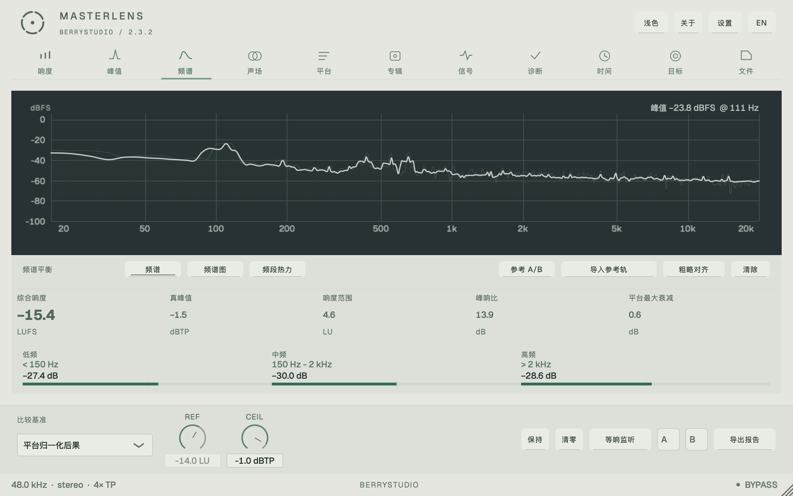


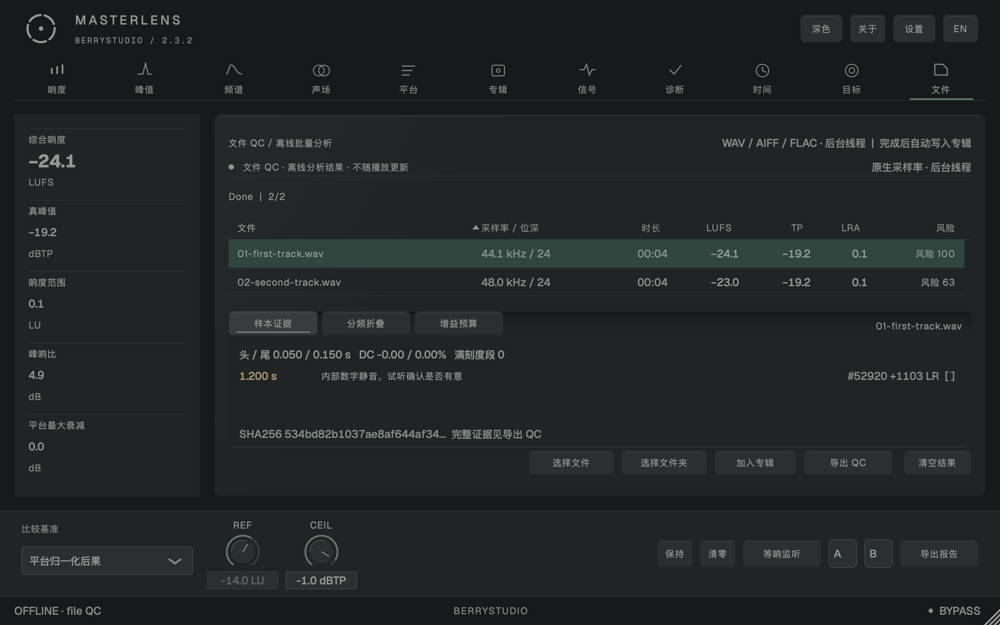

## 从 2.1.1 到 2.3.0

2.1.1 的读数基线和 100 ms 窗口修正保留；2.3.0 在此基础上换成 Precision Instrument 界面，并接上项目、证据复核、交付规格、文件夹监控和可选编码后复测。2.1.1 的详细变更仍可在 git tag `v2.1.1` 和 `docs/performance-2.1.1.md` 查看，不再把旧截图混进当前版本说明。

## 它会帮你留意这些

不用先背熟所有缩写，先找你关心的那一项就好。

| 检查 | 能帮你看什么 |
| --- | --- |
| 响度与动态 | 整首有多响、短时间内怎么变化、强弱起伏有多大。按 ITU-R BS.1770-4 / EBU R128 测量 I / M / S / LRA，保留 PLR 与独立 Mid / Side 响度 |
| 峰值与信号 | 有没有顶过头，哪些地方可能需要回听。包含 4× 真峰值、L / R / Side 峰值，以及削波、直流、爆音、瞬态、混叠、超低堆积和中频掩蔽检查 |
| 频谱与声场 | 低中高频怎么分布，左右有多宽，合成单声道后会不会变薄。提供 8192 FFT、频谱图、10 段频段热力、相关性、宽度与三段侧向能量 |
| 平台后果 | 按不同平台参照，看看可能需要调多少电平、峰值会到哪里。包含 Spotify、Apple Music、YouTube、Tidal、Amazon、SoundCloud、播客和俱乐部的本机情景与目标差额 |
| 专辑门禁 | 哪首和整张专辑差得有点远，哪些检查还没过。包含专辑中位比较、测量覆盖度、可开关规则、风险排序、JSON / TXT 证明与证据哈希 |
| 文件 QC | 不用在 DAW 里从头播完，直接检查导出的音频。按原生采样率分析，保留样本证据、头尾静音、分频折叠、增益预算与源文件 SHA256；导出 CSV + JSON，成功结果写入当前专辑 |
| 参考与试听 | 和参考曲比一比，也能单独回听可疑片段。支持参考轨 A/B、宿主播放头同步、等响监听、包络粗略对齐和信号区域试听 |
| 报告与自动化 | 把检查结果留档，或交给脚本批量处理。提供 TXT / JSON / CSV / PDF、100 ms 原始序列、时间线选区估算和无界面的 CLI |

## 五分钟上手

### 先装好，再播一首

[下载 3.0.2](https://github.com/KNGTNPT/MasterLens/releases/tag/v3.0.2)。macOS 打开 DMG，运行「安装 Install.command」；Windows 运行对应 x64 / ARM64 的 EXE，然后重启 DAW。

把 MasterLens 插在母带链最后，先播 20–30 秒，跟它打个招呼。左侧的综合响度看整体有多响，真峰值看最高处有没有越线；LRA 看强弱变化的范围，PLR 看峰值与平均响度之间还留了多少空间。中央曲线会把变化过程画出来。

底部「比较基准」决定拿谁来对照：平台参照、参考曲、专辑中位，或者你自己设定的目标。想手动填目标，就选「手动参考值」再改 REF；CEIL 是你设定的真峰值上限。先用默认值熟悉界面也完全可以呀。

要重新测一次，点「清零」或按 R。按住 Shift+空格可保持显示；A / B 存放读数快照，右键清空。

### 整张专辑，拖进来一起看看

按 F，拖入文件或整个文件夹，也可以点「选择文件 / 文件夹」。等它跑完，表格就会列出每首歌的采样率、位深、时长、响度（LUFS）、真峰值（TP）、响度范围（LRA）与风险。点表头可以排序，点一行就能看这首歌的详情，左侧读数也会一起切过去。

- **样本证据**：先帮你找到值得回听的位置。头尾按 −80 dBFS 定位；内部至少 10 ms 的数字静音会提醒试听；连续满刻度、直流和非零剪辑边界会留下样本地址。鼠标放在证据区滚动，可以看后面的条目。停顿也可能是编曲的小心思，所以不会只凭静音就当作掉音阻断。
- **分频折叠**：看左右合起来之后，哪些声音变小了。同相约 0 dB，无关声道约 3 dB；高于 6 dB 的频段值得回听。灰色表示能量占比不足 0.1%，不拿几乎没有声音的频段吓你一跳。
- **增益预算**：回答“在不超过峰值上限的前提下，还能整体推高多少”。使用底部 REF / CEIL；要改 REF，先切到「手动参考值」。它只算整体加减电平的结果，预计 LUFS 是估算，不会替你压限或改写音频。

「导出 QC」一次得到 CSV 摘要和同名 JSON 完整证据，包含每个事件、频段与源文件 SHA256。默认最多保留 128 条事件，完整计数与省略数量另存。

成功的结果会写进**当前专辑**。小提醒：做下一张专辑前，记得先换专辑名或清空上一张，别让两张专辑挤进同一个小本子。按 5 可以看每首歌与专辑中位的差别、风险排序和交付门禁，再导出证明。

也可以边播放边采集：填写曲目名和总长秒数，从头播放，覆盖度达到 95% 后点「采集本曲」。覆盖度就是这首歌有多少部分已经测过；直接跑文件 QC，则会检查完整文件。

### 参考、声场和问题区域

按 3 打开频谱，三种视图分别看当前频率分布、最近一段时间的变化和频段热力。导入参考曲后，「参考 A/B」会跟着 DAW 的播放位置播放参考；底部「等响监听」把比较时的响度拉近一点，免得更响的那边轻易把耳朵拐走。粗略对齐会根据响度变化寻找相近段落，不是逐个采样点的精确对齐。

按 4 看声场。相关性指针帮助你观察左右声道有多一致，旁边还可以看宽度、低频里有多少侧向能量、左右真峰值和单声道折叠结果。这里显示的是统计量，适合找线索；最后还是要切回单声道亲耳听听。

信号页可以单独监听当前输入里的对应部分，点时间戳还能循环回听问题片段，按 Esc 就停。也可以在响度历史上拖出一段区域，先看看局部情况；这里用的是每 100 ms 的包络估算，想拿到完整文件的精确测量，还是交给文件 QC。

### 报告与命令行

只想点点按钮的话，用界面就好；习惯脚本的朋友，也留了一条批量处理的小路。

「导出报告」或 Cmd+E 会生成 TXT / JSON / CSV / PDF，以及 `-timeseries.csv` 原始序列。CLI 随安装包提供：

```bash
MasterLensCli analyze /path/to/album --json report.json
MasterLensCli analyze track.wav --csv
MasterLensCli analyze /path/to/album --target -14 --ceiling -1 --fail-on error --json qc.json
MasterLensCli analyze track.wav --spec delivery-spec.json --json spec-qc.json
MasterLensCli analyze track.wav --codec mp3 --json codec-qc.json
```

支持多个路径与递归文件夹。`--fail-on error` 对样本阻断或超过自选 TP 上限返回 2；`--fail-on warning` 连需要试听的提示与明显分频抵消也一起拦下。0 是分析完成，1 是输入、解码或写报告失败，2 是 QC 未通过。默认不开门禁，适合先拿报告再判断。

多于两声道、坏文件、NaN / Inf、拼错的路径或写不出的报告都会明确失败。CSV 的文件名有逗号或引号也能正确读回。

### 快捷键

Shift+空格保持，R 清零，1–9 切模块，0 曲风目标，F 文件 QC，Esc 停止试听或关闭面板，Cmd+E 导出。

| 分频单声道折叠 | 增益预算 |
| --- | --- |
| 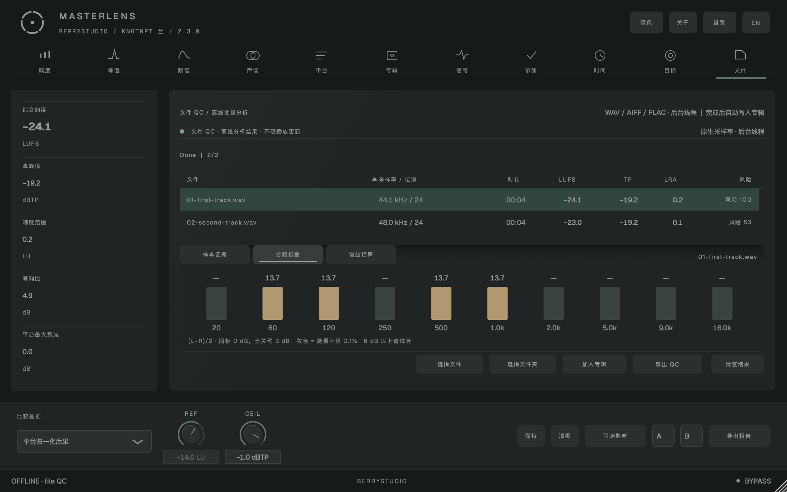 | 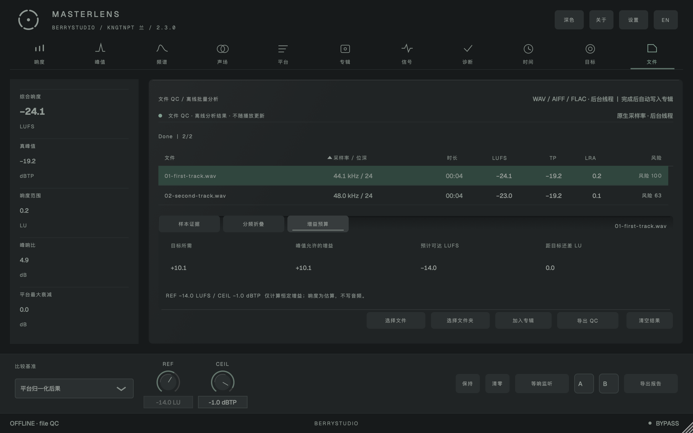 |

## 其它页面

| English | 专辑门禁 |
| --- | --- |
| 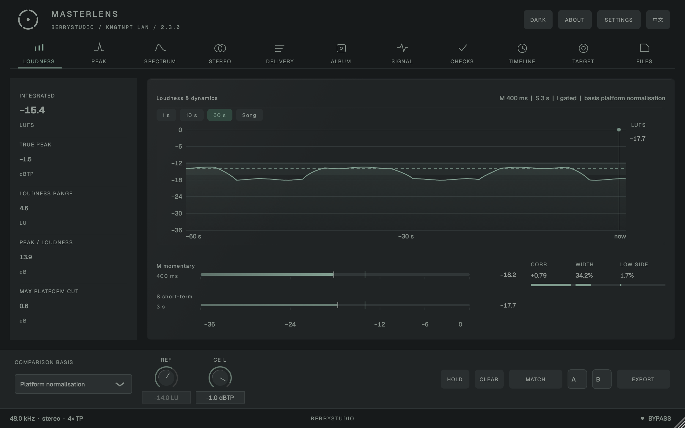 | 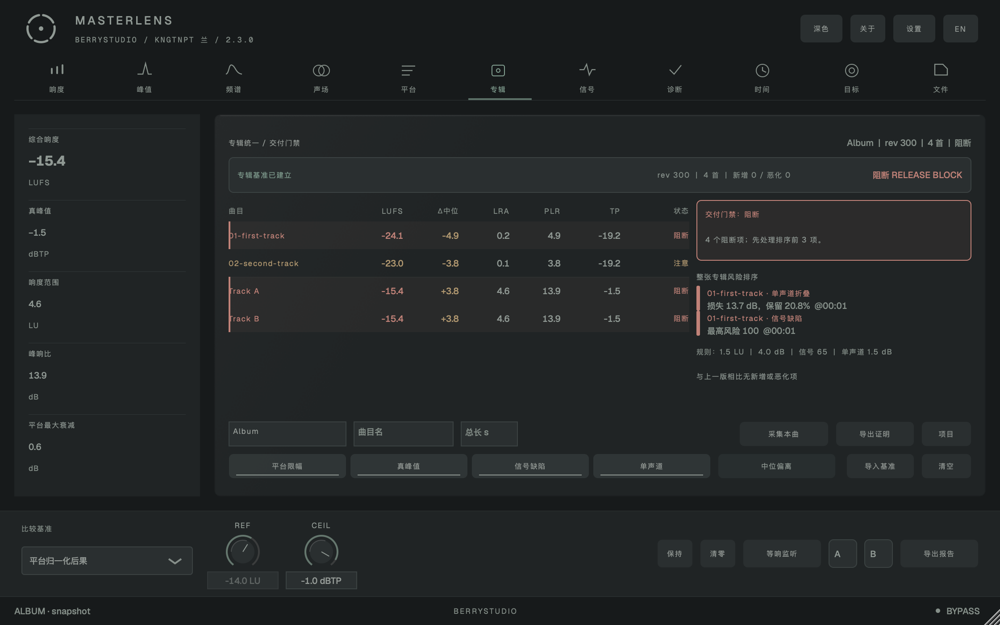 |

| 信号健康 | 平台归一化 |
| --- | --- |
| 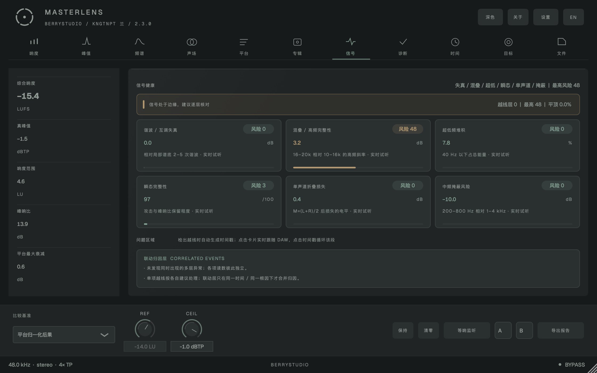 | 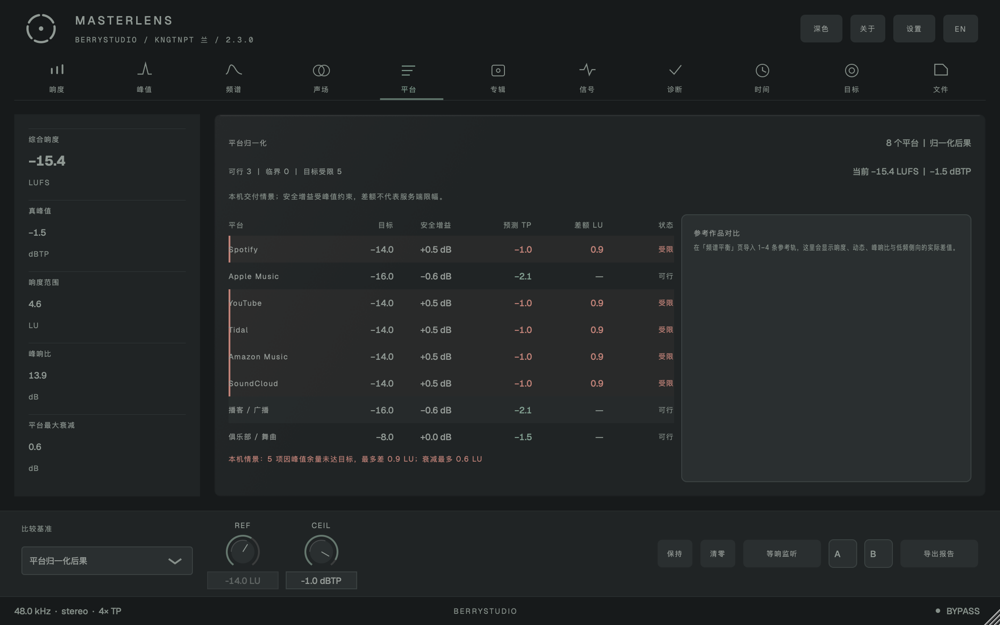 |

| 混音诊断 | 曲风目标 |
| --- | --- |
| 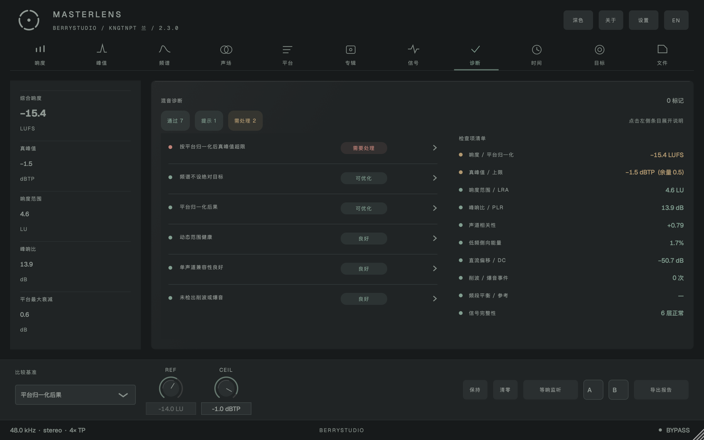 | 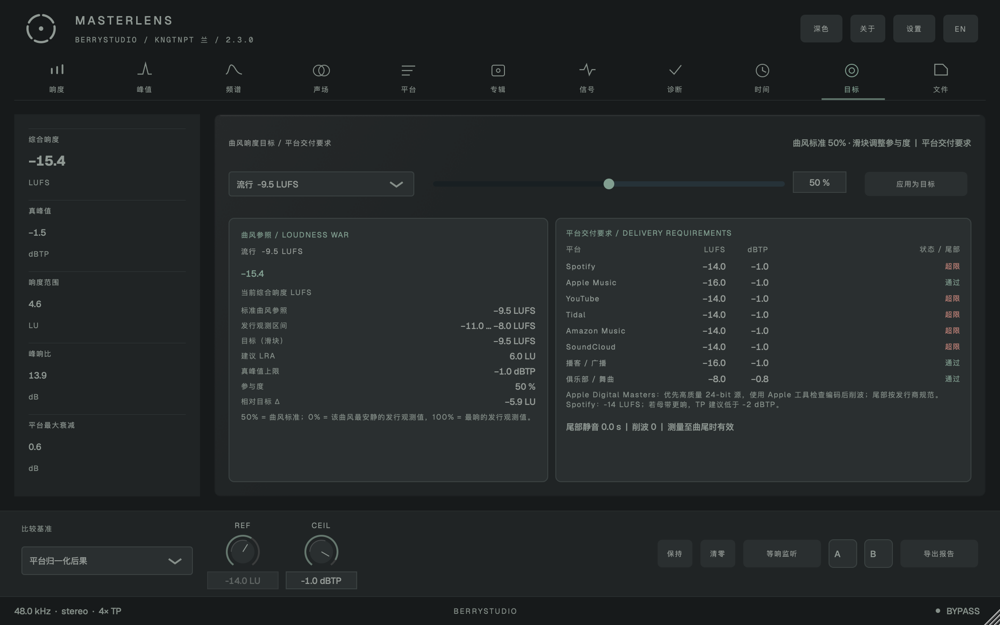 |

| 时间线 | 设置 |
| --- | --- |
| 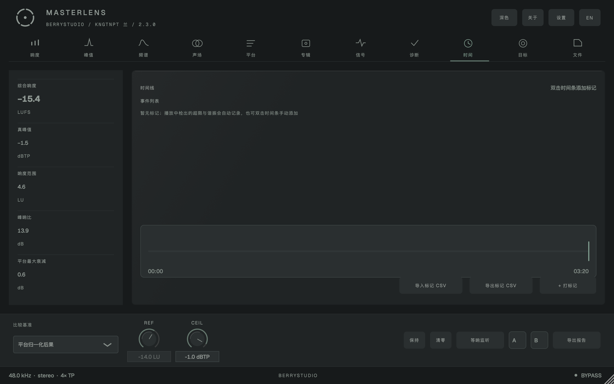 | 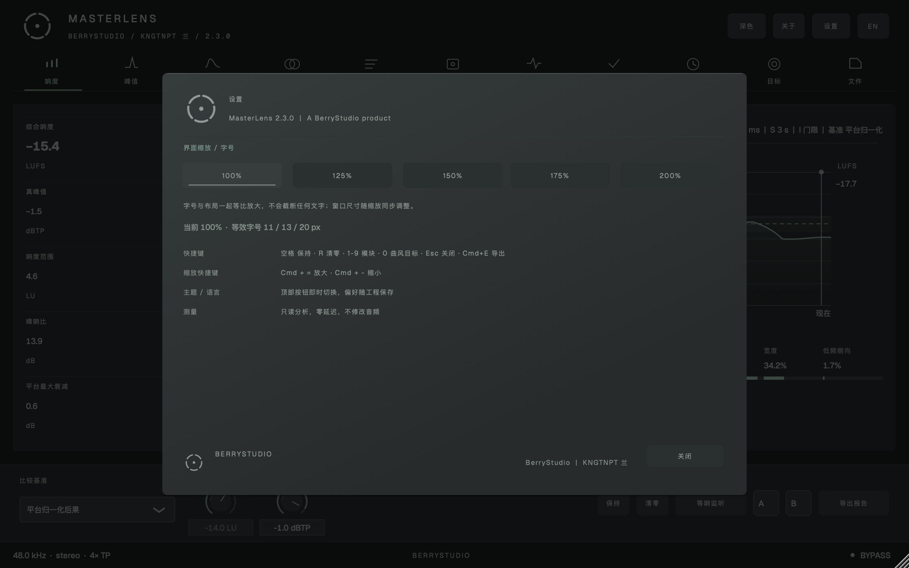 |

| 关于 | 浅色 |
| --- | --- |
| 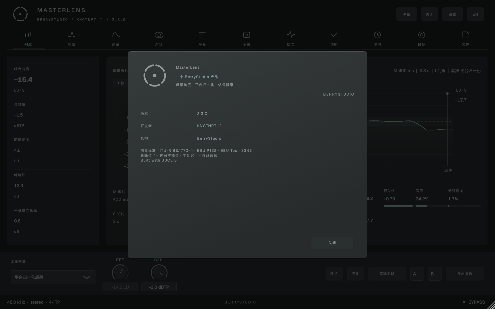 | 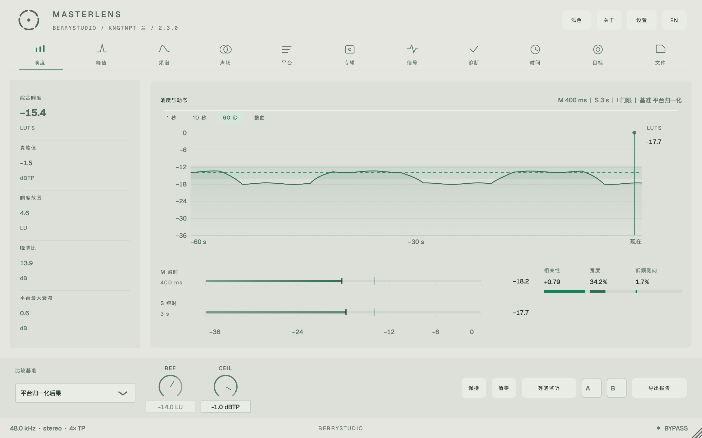 |

## 构建与验证

想自己编译或看看检查过程，可以从这里开始。只想使用插件的话，下载上面的安装包就好，不用陪编译器熬夜。

需要 C++17 编译器、CMake ≥3.22，以及固定版本 JUCE：

```bash
git clone --depth 1 --branch 8.0.15 https://github.com/juce-framework/JUCE.git .tools/JUCE
cmake -S . -B build -DCMAKE_BUILD_TYPE=Release
cmake --build build --config Release --target MasterLensCli MasterLensDspTest -j 4
./build/MasterLensDspTest_artefacts/Release/MasterLensDspTest
python3 Tests/test_cli.py ./build/MasterLensCli_artefacts/Release/MasterLensCli
```

macOS 使用 Xcode Command Line Tools；通用二进制配置增加 `-DCMAKE_OSX_ARCHITECTURES="arm64;x86_64"`，插件目标为 `MasterLens_AU`、`MasterLens_VST3` 和 `MasterLens_Standalone`。Windows 使用 MSVC，插件目标为 VST3 / Standalone；DSP 测试的文件名带 `.exe`。

Linux 可用于开发与离屏回归，需要 ALSA、X11 / Xext / Xinerama / Xrandr / Xcursor / Xrender / Xcomposite、FreeType、Fontconfig 和 OpenGL 开发库。仓库已关闭 WebKit 和 CURL。截图使用 `MasterLensUiShot`，例如：

```bash
cmake --build build --config Release --target MasterLensUiShot -j 4
./build/MasterLensUiShot_artefacts/Release/MasterLensUiShot page0 size1120
./build/MasterLensUiShot_artefacts/Release/MasterLensUiShot page3 size1120 bench
```

无显示服务的 Linux 需要 Xvfb 和中文字体。同一个构建目录请串行执行 CMake / Ninja。

发布流程永久遵循 [`docs/ffmpeg-release-readiness-guide.md`](docs/ffmpeg-release-readiness-guide.md)：先准备随包 FFmpeg（`scripts/fetch-ffmpeg.sh` + `scripts/verify-runtime.sh`），再跑 DSP / CLI / 布局 / 安装产物门禁。开发环境没有随包运行时，可用 `MASTERLENS_ALLOW_SYSTEM_FFMPEG=1` 让测试显式使用系统 ffmpeg；发布门禁使用 `MASTERLENS_REQUIRE_RUNTIME=1`，缺失运行时直接失败。

本次本地验证包含 **151 项 DSP / 可靠性断言**、**66 项 CLI 集成检查**、默认旁路 / 零延迟检查、各页面布局、五档缩放及离屏性能。原生 macOS / Windows 安装包由 [GitHub Actions](https://github.com/KNGTNPT/MasterLens/actions) 构建；三个发布目标全部成功后才上传 Release，附带 `SHA256SUMS.txt`。离屏检查和构建不能代替真实 DAW 与音频硬件回归。

## 工程结构

- `Source/PluginProcessor.*`：音频回调、参数、宿主状态、参考与试听。
- `Source/Editor*.cpp`：窗口布局、控制、调度和报告。
- `Source/ui/`：自绘界面、图表、页面与诊断规则。
- [`FRONTEND-DESIGN.md`](FRONTEND-DESIGN.md)：团队共享的前端审美、明暗主题 token、组件与 skill 取舍参考；不约束 MasterLens 后续前端改动。
- `Source/dsp/`：响度、真峰值、频谱与信号分析。
- `Source/audio/`、`Source/file/`、`Source/album/`：试听、文件 QC 与专辑门禁。
- `Tests/DspTest.cpp`：测量、试听、参考、文件分析回归与 CPU 基准。
- `Tools/UiShot.cpp`：实际编辑器截图、布局检查、刷新计数与性能采样。

## 有些事情，还是要说清楚

目前只支持单声道 / 立体声。8192 FFT 的低频分辨率有限，靠得很近的低频细节不一定能分开；选区结果是包络估算，宿主里的整曲长度需要手动填写。平台数字是本地比较用的参照，不能保证真实播放端的设置或处理；曲风目标也不是必须照着做的作业。

出现提示时，先回听，再决定要不要改。MasterLens 会认真报数，但不会替你判断一首歌好不好听。

MasterLens 不做总线 ARA：多数宿主只向音频轨开放 ARA，总线整张混音的离线分析由文件 QC 处理。AAX、DDP、编码预演、Apple 公证和商业代码签名需要另外的 SDK、编码器或证书。

首次打开未公证的 macOS 版本，可能需要通过系统的「右键 → 打开」。本次离屏截图与基准使用 Apple Silicon macOS；原生安装包的构建结果以对应 CI 记录为准，DAW 实机体验还需要继续回归。

## English summary

MasterLens 2.3.0 is a little extra pair of eyes at the end of your mastering chain. It helps you check loudness, peaks, stereo balance and delivery risks on macOS and Windows, with VST3, AU, Standalone and a file-QC CLI. By default, it adds no latency and leaves your audio untouched. Auditioning, loudness matching and reference A/B only change the output when you turn them on.

The 2.3 Precision Instrument editor puts the spectrum first, uses embedded Geist typography and keeps a 32 px safety anchor around the graph. Project files now carry the album snapshot, stable track IDs and a version label; the File QC evidence rows can be reviewed, previewed around the event, looped, and opened at their source. A JSON delivery spec checks sample rate, bit depth, channels, naming, loudness tolerance and true peak. Folder watch rechecks changed exports using a size + mtime fingerprint cache, while SHA256 remains the final source identity. The CLI adds `--spec` and optional `--codec aac|mp3` ffmpeg round-trip true-peak rechecks.

Multi-reference files (1–4), region markers and problem-loop audition remain part of the workflow. Multi-reference spectra are energy aggregates, not a synthetic “reference master”; live region figures remain 100 ms envelope estimates, while file QC stays the exact offline path. No dataset, model or cloud inference is used. See the [research and algorithm notes](docs/research-2.3.0.md) and [validation record](docs/performance-2.3.0.md) for scope and limits.

JUCE 8.0.15 使用 AGPLv3 / 商业双许可；本项目按 AGPLv3 使用 JUCE。

---

最后还是那句：数字帮你查漏，耳朵负责决定。

检查完就让眼睛歇一会儿，给自己倒点喜欢喝的，再好好听一遍这首歌吧。做音乐已经很费心了，最后这一小段，让 MasterLens 陪你慢慢收好。🎧 🍵
