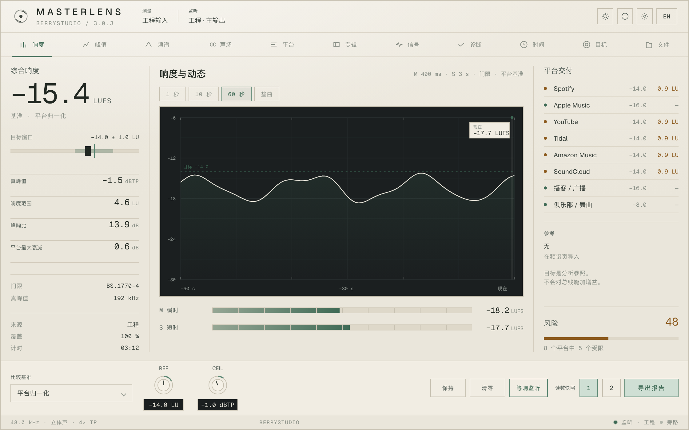
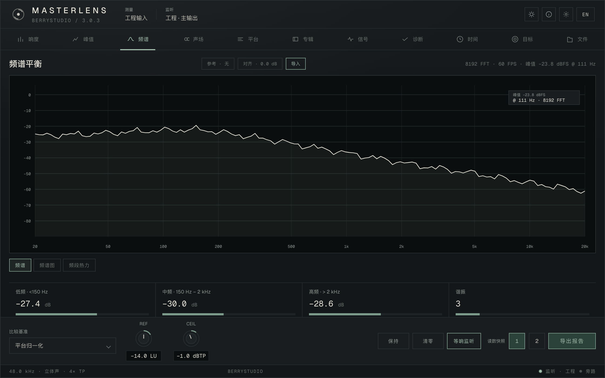
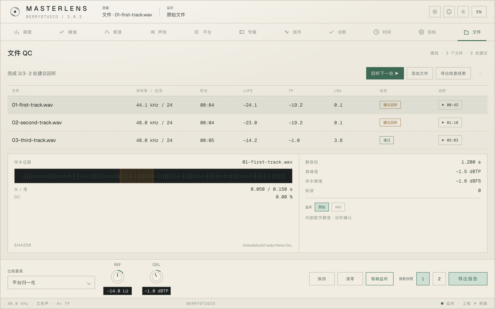
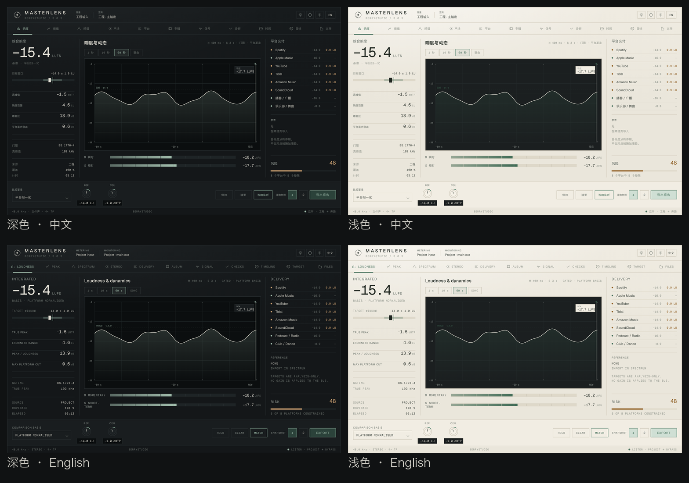
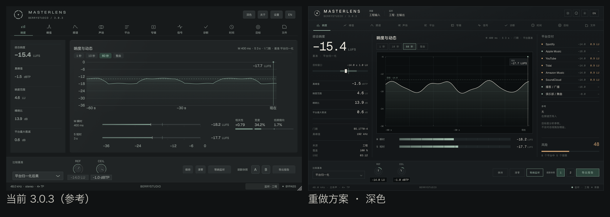

# MasterLens 3.1 视觉方向：Calibrated Plate

> 状态：**3.1.0 已实现。** 已落地：测量/监听上下文条、快照 1/2、响度页（46px 主读数、目标窗口、指标行、覆盖、平台交付账本、去页卡）、两主题共用的深石墨测量窗、频谱整幅深窗、信号六宫格细线化、页标题 15 / 元信息 10。验证记录见 [performance-3.1.md](performance-3.1.md)；3.2–3.4 首批与紧凑档都已并入 3.1.0。
> 关系：`DESIGN.md` 仍是硬性约束，本文是其中「3.1 起」的细化与提案；两者冲突时，以 `DESIGN.md` 的优先级条款为准，再由本文给出具体的 3.1 取舍。
> 示意：`docs/design-3.1/` 下的 8 张图（深浅 × 中英矩阵、四页组合、与 3.0.3 的对比）。示意图按 1x CSS px 绘制，字号与像素为近似值；落地以 §3 / §4 的数值为准。

## 0. 一句话

**一块校准面板，一扇测量窗口，一套等宽数字。** 深色是石墨仪器，浅色是暖纸阳极氧化面板；两种主题都保留，但浅色的测量窗口保持深石墨——这是整套设计的签名。

## 1. 为什么重做

3.0.3 解决了排印分级、对比度和中英混排，但界面仍是「一叠带边框的卡片」：

- 层级靠字号、颜色、边框叠加，视线没有单一落点；
- 卡片边框把连续的测量关系切碎，图表与读数不在同一条视线里；
- 文件 QC 的主操作不随状态变化，用户看到「建议回听」却不知道下一步点哪；
- 「测谁 / 听谁」「快照 / 参考 / 编码」三组 A/B 没有写出对象；
- 中文与全大写拉丁的宽度差异靠人工调，换语言就会推挤标签和按钮行。

3.1 只做四件事：**去卡片、立读数、把下一步写出来、把语言差异锁进网格**。

## 2. 材质与主题

两种主题不是反相，而是两种材料：

| | 深色 | 浅色 |
| --- | --- | --- |
| 面板 | 石墨，顶部极轻的漫射 | 暖纸色阳极氧化，顶部更亮 |
| 测量窗口 | 比面板更黑的一块玻璃 | **保持深石墨**，像嵌进纸面的仪器视窗 |
| 层级 | 靠内凹窗口与细线 | 靠细线与材质差，不靠灰阶 |
| 光影 | 1px 顶部高光 + 底部暗线 | 1px 顶部高光 + 底部暖影 |
| 圆角 | 2px（只在线条交接处） | 同左 |

### 2.1 token

| token | 深色 | 浅色 | 用途 |
| --- | --- | --- | --- |
| `plate` | `#141719` | `#eae6db` | 面板底 |
| `plateTop` | `#171b1d` | `#efebe1` | 顶部渐变 |
| `panel` | `#191d1f` | `#f1ede3` | 浮层 / 分段底 |
| `well` | `#0b0e0f` | `#1b1f20` | 测量窗口（两主题都深） |
| `edge` | `#2b3133` | `#c6c0b0` | 1px 外框、控件边 |
| `hair` | `#252b2d` | `#d3ccbd` | 分隔线 |
| `hair2` | `#1e2426` | `#ded8c9` | 次级分隔 / 轨道底 |
| `ink` | `#e9e6dc` | `#212822` | 主文字、主读数 |
| `ink2` | `#c9c7bd` | `#3a423c` | 次文字、数值 |
| `label` | `#939b95` | `#5c665f` | 标签 |
| `faint` | `#6d746f` | `#8a9087` | 元信息、单位旁注 |
| `accent` | `#a3bfae` | `#3e6a55` | 当前值 / 当前页 / 主操作 |
| `accent2` | `#7c9b8a` | `#5d8874` | 次级强调、刻度高亮 |
| `accentDim` | `#2b423a` | `#cfdfd4` | 主操作底（深色）/ 选中底（浅色） |
| `warn` | `#cfa373` | `#8c5a1d` | 注意 / 建议回听 |
| `bad` | `#cd8f82` | `#a33f33` | 超限 / 错误 |

测量窗口内的曲线与刻度使用固定的浅色（`#e7e4d9` / 网格 `#232a2b` / 轴标 `#8d948f`），与主题无关——仪器视窗的读数一致性优先。

### 2.2 禁止

- 不用圆角卡片、投影和彩色底来分层；分区只靠 1px 细线、内凹窗口和留白。
- 不把强调色铺到大面积；一个屏幕最多一个实心强调按钮。
- 不在浅色面板上直接放浅灰细线（低于 3:1）；细线用 `hair` 的暖灰。
- 不允许图表背景比面板更亮（浅色主题必须保持深窗）。

## 3. 排印

### 3.1 角色

| 角色 | 设计 px | JUCE 字体高度 | 说明 |
| --- | --- | --- | --- |
| Display | 46 | 46 | 综合响度；同屏只此一处 |
| Title | 15 | 15 | 页标题、面板标题 |
| Value | 15 | 15 | 指标、表格数字、平台差值 |
| Label | 12 | 12 | 标签、导航、按钮；大写拉丁 +0.10em，中文 +0.02em |
| Micro | 10 | 10 | 元信息、单位旁注、页脚 |

- 所有数字用 **Geist Mono**（等宽、表格对齐）；标签和标题用 **Geist**；单位跟数值同一基线，字号比数值小 1–2 档。
- 中文标签不加字距；只有全大写拉丁加 0.10em。
- 单位保留正确大小写（LUFS / dBTP / kHz），不做 uppercase。
- 主读数使用 U+2212 减号；范围用 en dash；负零归零。

### 3.2 语言安全

| 机制 | 规则 |
| --- | --- |
| 固定槽位 | 标签列、数值列、状态列各自定宽；中英文共用同一列，不靠文本撑宽 |
| 字距分离 | 中文 0.02em；全大写拉丁 0.10em |
| 按钮最小宽 | 次级按钮 ≥ 58px；主按钮 ≥ 88px；切换语言只改文字，不推挤行 |
| 数值不漂移 | 数值、状态、试听列右对齐或定宽；语言只影响左侧文字 |
| 图表注释 | `现在 / NOW`、`目标 −14.0 / TARGET −14.0` 同位置同字号 |
| 不缩中文 | 中文标签不小于 12px；紧凑模式优先收栏，不缩字 |

## 4. 版面

固定 1120×700 设计画布（窗口 1120×700 → 2240×1400，整数倍缩放）：

| 区域 | 高度 |
| --- | --- |
| 顶栏（品牌 + 测量/监听上下文 + 工具） | 52 |
| 模块导航（11 项） | 40 |
| 主体 | 496 |
| 底部控制条（基准 / REF / CEIL / 主操作 / 快照） | 88 |
| 状态行 | 24 |

- 4px 网格；组内 8，区块 16，大分组 24，图表安全区 32。
- 响度页三栏：左 226 / 中弹性 / 右 236，间距 16，外留白 14–16。
- 其余页面整幅使用；表格与证据区对齐同一左基线。

## 5. 组件

- **细线**：1px；只在真正分区处出现，不为每个读数画框。
- **测量窗口**：内凹 1px；四边刻度；网格 1px；曲线 1.3px；阈值虚线；右下角「现在」游标与读数贴片。
- **主读数**：46px Mono，单位 11px；下方是目标窗口刻度带（6px 轨道 + 目标区 + 10×16 游标）。
- **指标行**：36px 高，标签左、数值右，行间 1px 细线；不再用 2×2 带框格子。
- **电平条**：10px 轨道 + 10% 分段刻度；填充用 accent 渐变。
- **平台账本**：27px 行；状态点 5px；名称、目标、差值三列；差值只对受限平台着色。
- **上下文条**：顶栏内两段，`测量` / `监听` 各一行 7.5px 标签 + 10.5px 值。
- **按钮**：30px 高、1px 边；主操作实心 accent（每屏一个）；次级透明；`⋯` 收纳清空等破坏性操作。
- **快照键**：30×30，键面写 `1` / `2`，不再用 `A` / `B`。
- **导航**：11 等分；图标 14 + 9.5px 标签；当前项 2px 底线 + accent 文字。

## 6. 页面

### 6.1 响度

- 左栏：综合响度 46px + 目标窗口；四项指标行；底部来源 / 覆盖 / 计时。
- 中栏：页标题 + 时间窗分段；测量窗口；M/S 两条电平。
- 右栏：平台交付账本 + 参考状态 + 风险比例。

### 6.2 频谱

- 整幅测量窗口；峰值读数收进窗口右上贴片；底部分频段读数；参考 / 对齐 / 导入一行小控件。

### 6.3 信号

- 顶部结论条；六宫格仪表格（状态灯 / 结论 / 数值 / 依据 / 风险条）；问题区域时间戳；联动归因。

### 6.4 文件 QC

- 状态驱动主操作：`添加文件 → 回听下一处 → 导出检查结果`；行内「试听 00:42」；`⋯` 收清空。
- 证据面板：波形 + 静音段 + 头/尾 + DC + SHA256；`监听 原始 / AAC`。

### 6.5 深浅 × 中英

### 6.6 与 3.0.3 的对比

四页组合见 [board-pages.png](design-3.1/board-pages.png)。示意图源文件为 [mockup.html](design-3.1/mockup.html)（字体取 `../../Resources/fonts/`），用 `?screen=loudness|spectrum|signal|files&theme=dark|light&lang=zh|en` 重新出图。

## 7. 交互与状态

- **主操作随状态走**：文件 QC 空态「添加文件」；有结果「回听下一处」；全部确认「导出检查结果」。每屏只保留一个实心主按钮。
- **测谁 / 听谁**：顶栏常驻 `测量` 与 `监听` 两个对象；文件页显示具体文件名与「原始文件」；参考页显示「参考 · 无 / 参考曲」。
- **三组 A/B 写对象**：`快照 1 / 2`、`工程 / 参考`、`原始 / AAC`；不共用模糊的 A/B 文案。
- **证据旁回听**：行内试听按钮与证据面板的试听使用同一时间码；点击即定位。
- **破坏性操作降级**：清空进 `⋯`，不放在主操作行。
- **焦点**：1px accent 内描边，键盘顺序 = 顶栏 → 导航 → 主体 → 控制条 → 状态行。

## 8. JUCE 实现清单

| 文件 | 改动 |
| --- | --- |
| `Source/ui/Theme.h` / `.cpp` | 新增 `plate/plateTop/panel/well/edge/hair/hair2/ink/ink2/label/faint/accent/accent2/accentDim/warn/bad`；新增 `getDisplayFont()`（46 Mono）与 `getMonoFont(size)`；字号访问器改为 12/15/15/46，标签字距按脚本区分 |
| `Source/ui/Layout.h` | 顶栏 52 / 导航 40 / 控制条 88 / 状态 24；响度三栏 226/1fr/236；`down()` 与安全区保持 4px |
| `Source/EditorPaint.cpp` | 顶栏改为品牌 + 测量/监听上下文 + 工具；导航 40px；状态行；去掉卡片分区 |
| `Source/EditorControls.cpp` | 方形按钮、分段控件、下拉、快照键 1/2、旋钮值井；主按钮唯一 |
| `Source/ui/Panels.cpp` | ReadoutBand → 46px 主读数 + 单位；目标窗口；指标行；M/S 细电平 |
| `Source/ui/DetailPages.cpp` | 页标题 15、元信息 10；页面边距与细线 |
| `Source/ui/Spectra.cpp` | 整幅测量窗口、四边刻度、dB 网格、峰值贴片、分频段条 |
| `Source/ui/DetailSignal.cpp` | 六宫格仪表格、问题区域、联动归因 |
| `Source/ui/DetailFiles.cpp` / `Source/EditorFiles.cpp` | 状态驱动主操作、行内试听、`⋯` 菜单、证据面板与编码 A/B |
| `Source/ui/DetailMix.cpp` / `DetailTarget.cpp` / `DetailAlbum.cpp` / `DetailTime.cpp` | 细线分区、等宽数字、单位降档、状态色只作墨色 |
| `Source/ui/About.cpp` / `Settings.cpp` | 浮层改为一块板；按内容收紧；快照 1/2 与语言规则一致 |
| `Source/ui/Stereo.cpp` / `Meters.cpp` / `Rail.cpp` / `History.cpp` | 轨道、标签、导航的状态色与字形统一 |
| `Source/PluginEditor.cpp` | 窗口限制保持 1120×700–2240×1400；缩放档 1.0/1.25/1.5/1.75/2.0 |
| `Tools/LayoutCheck.h` | 新增：主读数 46、标签 12、细线 1px、上下文条、快照键、文件表、编码对；保留宿主约束器断言 |
| `scripts/capture_ui.py` / `docs/*` | 生成 8 张 3.1 截图与 provenance；主题 × 语言矩阵 |

## 9. 验收

- 46 个既有布局场景保持通过；新增中英 × 深浅 × 1120/2240 的上下文条、文件表、证据区断言。
- 人工检查：Windows 125% 显示缩放、超长中文文件名、`−1.0 dBTP` 混排、键盘焦点、`⋯` 菜单可触达。
- 对比度：12px 文字 ≥ 4.5:1；细线 ≥ 3:1；强调色只用于语义。
- 截图：深浅 × 中英 × 响度/频谱/信号/文件，共 16 张，逐张检查截断、基线、换行。

## 10. 迁移顺序与未决项

1. token 与字体访问器（不改行为）→ 2. 顶栏/导航/控制条/状态行 → 3. 响度 → 4. 频谱 → 5. 信号 → 6. 文件 QC → 7. 浮层与剩余页 → 8. 截图与验收。

未决：

- **≤ 1024 紧凑模式**：本方向只定义 1120 画布；紧凑模式需要单独一版（收左栏、次要工具进 `⋯`、字号不缩），不在这版示意里。
- **响度页右栏「平台交付」**：3.0.3 该页没有这一栏，数据来自现有平台归一化结果；实现前确认数据来源与空态。
- **中文 12px 的实测**：若 1x 屏或 Windows 125% 下偏小，整体标签 +1px（13），不改布局。
- **浅色深窗**：已按现有频谱页的深色测量面延伸；如果团队希望浅色全亮，需要另一套图表 token。
