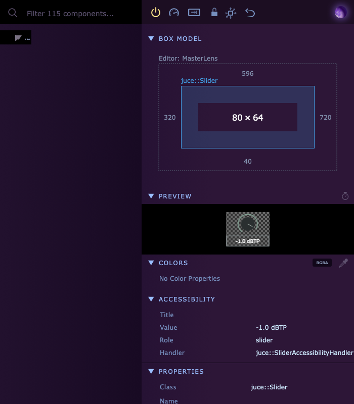
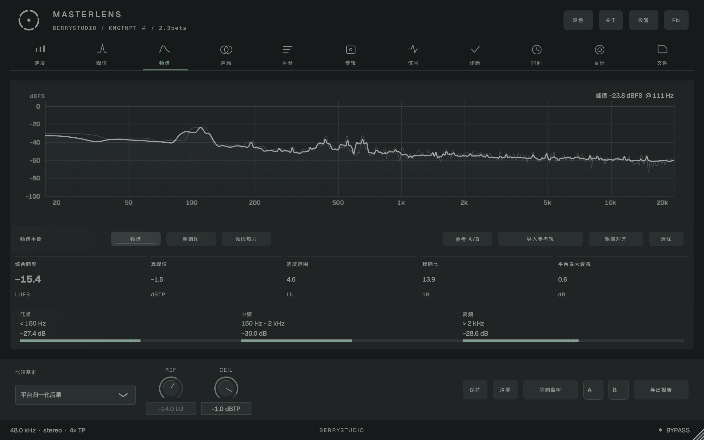
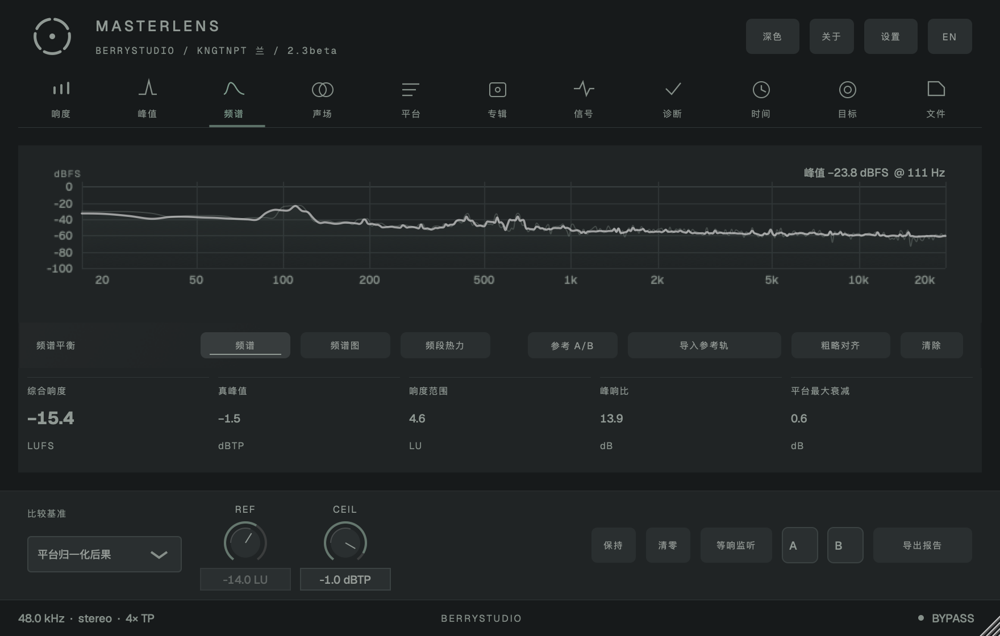
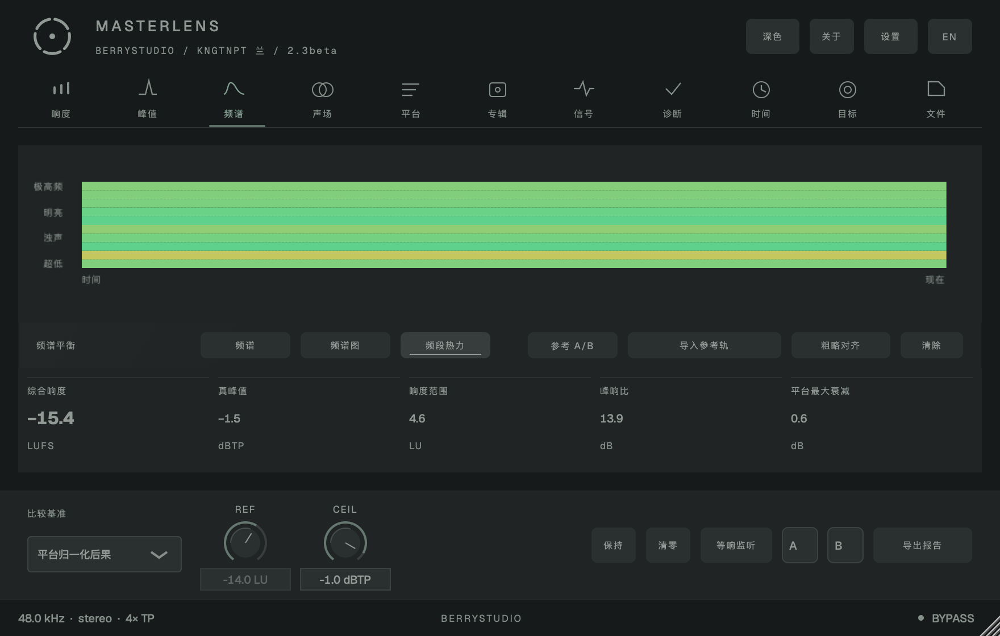
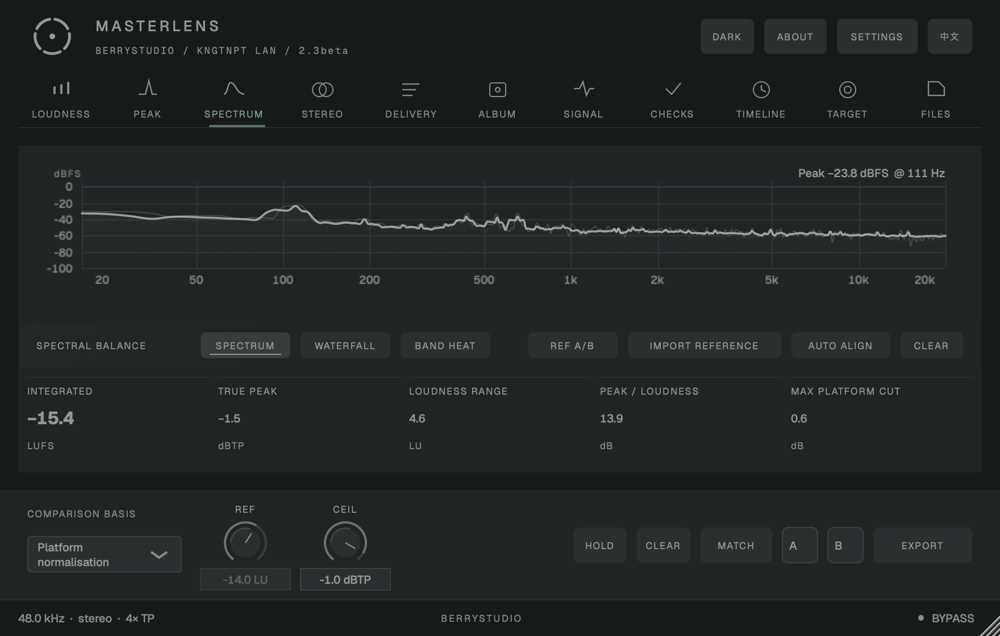

# Precision Instrument：控件与布局验收

> **状态说明（2026-11）**：本文记录 2.x 的 Precision Instrument 实施细节（11 / 13 / 20 字号、13,150 次边界检查），其中字号与部分布局数字已被 3.0.3 的 14 / 18 / 20 / 30 取代；3.1 的 Calibrated Plate 方向见 [docs/design-3.1.md](design-3.1.md)，当前实现约束见 [DESIGN.md](../DESIGN.md)。本文保留作为历史验收记录。

本阶段按 `DESIGN.md` 的优先级实施：MasterLens 母带仪器定位 → audio/ui 硬件规则 → high-end-visual-design 排印规则。按本次确认，**仅频谱页**使用上下布局，其余检查页保留任务内容与左侧读数的组织方式。

## 实现

- 内嵌 Geist Regular / Medium / Bold（SIL OFL 1.1），统一提供 `getLabelFont()` 11px plain、`getValueFont()` 13px medium / tabular、`getCriticalFont()` 20px bold / tabular。组件不构造字体，拉丁字体不依赖系统安装；中文保留明确 CJK fallback。
- 组件中的 `uiFont(height)` / `monoFont(height)` 调用已迁移到语义访问器。关键字号只用于综合 LUFS 与真峰值；英文控件标签统一大写，单位保留正确大小写。
- `MasterLensLookAndFeel` 只重写 `drawRotarySlider` 和 `drawButtonBackground`。独立的 `InstrumentTypography` 负责字体与原生文本框网格回调，不增加其他控件绘制覆盖。
- REF / CEIL 改为可精确输入的垂直拖动旋钮，保留参数绑定、范围、步长与双击复位。值弧使用现有青绿 `alpha=0.6`，背景弧使用 darkgrey `alpha=0.5`，本体有左上 1px 高光；键盘 focus 为 1px 青绿内描边。
- 按钮按压只降低亮度，hover 仅叠加 `white.withAlpha(0.08f)`；无磁吸或 Double-Bezel。
- 窗口用矩形细分，header 64px、导航 48px、控制区 96px、footer 32px。频谱页分配可用主体高度的约 56% 给图表，其余给读数，分区间距为 8px；较小窗口自动收起辅助的低 / 中 / 高频摘要，三种频谱视图仍可切换。
- `Source/ui/Layout.h` 用 JUCE `Grid::setGap(Px(8))` 管理成组控件，使用明确的 4px 整数轨道和逻辑边界。窗口自由缩放也吸附到逻辑网格。
- 频谱绘图区保留左 56、上 32、右 32、下 48px：32px 锚点固定，左 / 下额外空间给刻度。网格、曲线和标注使用一致的绘图区。背景缓存和填充渐变在尺寸 / 主题更新阶段准备。
- 11 个导航项的图标和文字仍使用同一条中线；分栏边界按 4px 网格分配，不靠改变文字位置修补。

## 自动检查与 Inspector

2026-11-02，Apple Silicon macOS / JUCE 8.0.15：

- 自动读取实际组件树的 `getBounds()`，检查项目管理的边界、父容器包含关系及频谱比例；覆盖中英文、100 / 125 / 150 / 175 / 200% 缩放、11 页、三种频谱视图、880×560 / 1120×700 / 1440×900 以及非网格输入尺寸。另检查设置与曲风面板。
- macOS arm64 的 Debug / Release VST3、AU、Standalone 与 UiShot 全部编译通过；Inspector 首次自动获取的全新配置通过。
- **13,150 次边界检查通过，0 失败。** 字号为 11 / 13 / 20，标签比常规值小 2px；Geist 等宽数字宽度检查通过，实际标签 / 编辑器字体检查未发现 Inter、Roboto、Arial、Helvetica 或 Open Sans。
- 按钮渲染采样验证：hover 与 8% 白色叠加相符，按下亮度下降且色相保持。
- Inspector 直接挂载同一编辑器组件树。示例旋钮 `80×64`，与父边界距离 `320 / 596 / 720 / 40`，均为 4 的倍数。

内部旋钮数值 Label 与下拉框文本 Label 也参与网格检查。输出 FIFO 的前置及 UI 同步回归继续通过：48 帧，原始采样误差 0，Blackman 误差约 `6.15e-8`。

这里的 4px 指 **100% 设计逻辑像素**；125% 显示时，4 个逻辑像素对应 5 个显示像素。JUCE 内部的光标、滚动条和窗口缩放手柄不是项目排版间距，不纳入项目网格计数。

Debug 可选启用 Inspector（固定到 `9c483f865854d83fe9873e1c20e3fd772f695f80`）：

```sh
cmake -S . -B build-debug -DCMAKE_BUILD_TYPE=Debug -DCMAKE_OSX_ARCHITECTURES=arm64 -DMASTERLENS_ENABLE_INSPECTOR=ON
cmake --build build-debug --target MasterLensUiShot MasterLens_Standalone -j 4
./build-debug/MasterLensUiShot_artefacts/Debug/MasterLensUiShot.app/Contents/MacOS/MasterLensUiShot layoutcheck size1120
```

首次启用会获取固定提交的 Inspector，普通构建默认关闭。Debug 插件 / 独立版按 Cmd/Ctrl+I 打开；验收工具也可用 `inspector size1120 page2` 保持窗口供交互检查。



## 界面预览



| 最小窗口 | 最小窗口的频段热力 |
| --- | --- |
|  |  |

## 范围与限制

本记录是控件、字体与布局阶段验收，不等同于整份设计宪法全部完成。其他页面的绘制缓存 / 文案分配和完整跨平台宿主检查仍需单独迁移。Debug 退出仍报告既有 DynamicObject 生命周期断言；本次字体初始化及字体缓存退出断言已消除。

## 视觉权重复审（2026-11-02）

只调整已有元素，保留布局、参数、读数与信号来源。

- 深色主题的常规文字、状态色和频段条统一降亮度；原生 CEIL 文本框残留的默认白字改回主题色。主曲线仍为 `lightgrey.withAlpha(0.7f)`，最后绘制以免保持线覆盖它。
- 峰值保持线改为低亮度中性灰，保留实时 / 保持的区别；保留表达风险、选择及能量的颜色。
- 去掉页头渐变、导航选中渐变底、图窗装饰角标和 Logo 双色；控制区改为平静底色。未发现 Double-Bezel、磁吸或大幅滚动入场动画；通用光晕辅助函数也收敛为单线状态边界。
- MASTERLENS 使用已有 13px Geist Medium，tracking 0.16em；图标与字标间距 16px，标题 / 副标题各 20px，中间 4px。排字在主题初始化时缓存，不在 paint 内生成。Logo 五段弧等分，32px 以下加宽断点留隙，避免圆头挤在一起；现有 SVG 同步更新。
- 最终 1120×700 深色频谱页的实际 PNG 采样：图表区域最高 Rec.709 加权码值 **172.57/255**，页头、控制区、下部读数均不超过 **154.44/255**；已人工复查截图。该数字是这张截图的采样结果，不表示所有主题 / 宿主 / 告警状态的完整认证。
- 最终 macOS arm64 Debug / Release 的 UiShot、VST3、AU、Standalone 编译通过；布局 / 字体回归仍为 **13,150 项、0 失败**。既有 Debug 退出 DynamicObject 断言仍在。

### processBlock 静态审查

检查了 `PluginProcessor::processBlock` 以及它调用的测量处理 / reset、真峰值 / Biquad、输入 SpectrumRing 写入、AuditionEngine 回听、ReferencePlayer::render、覆盖率更新和输出 SpectrumFifo 写入：**未发现 FFT、new、Path 构造 / 增长或 vector 扩容**。AuditionEngine 的 vector 只在 prepare 时分配，回调按已有容量索引；SpectrumRing 同理；SpectrumFifo 使用固定数组。`AnalysisEngine::copyRecentShortTerm` 的 reserve / push_back 不在回调调用链内。FFT 位于 UI 的 `EditorTimer → SpectrumAnalyzer::update`，FFT 创建与相关容量配置在 prepare 阶段。

这不是完整的实时安全认证：既有 `ReferencePlayer::render` 会获取 SpinLock 并复制 shared_ptr，涉及阻塞 / 最后一次引用销毁的潜在风险。本次按只调整视觉权重的范围保留，未修改响度、真峰值、M-S 或参考播放处理。

## 2.3.0 顶栏与本地快照（2026-11-02）

- 顶部图形从 32px 放大为 41.6px（130%），在 44px 网格槽内居中；MASTERLENS 的现有 Geist Medium 字形统一缩放 130%，等效 16.9px，保留 0.16em 字距。
- 主副行按各自真实字形边界计算总高度，行间 8px，整个文字组关于 64px 页头中线对称，上下墨迹留白一致。图形与文字间距 16px。
- 副行使用新内嵌的 Geist Mono Regular 11px / 0.12em，依次显示 BERRYSTUDIO、开发者、2.3.0；中文使用 KNGTNPT 兰，英文使用 KNGTNPT LAN。「关于」的开发者字段同步切换。
- 中英文及英文最小 880×560 窗口已检查，无截断 / 重叠；字体和边界自动回归仍为 13,150 项、零失败。
- 界面版本为 2.3.0，AU / VST3 等数值版本为 2.3.0。新增字体同样来自已固定提交的 vercel/geist-font，附带 SIL OFL 许可，运行时无需下载。



本地保存结果：Release 的 AU / VST3 / Standalone / UiShot 已以 arm64 + x86_64 Universal 构建；Debug arm64 UiShot 构建与布局检查通过。输出 FIFO 回归通过（49 帧，原始误差 0，Blackman 误差 6.15e-8，bypass PASS）。包内数值版本已核对为 2.3.0，分发名称为 2.3.0。截图来自本次 Universal Release 实际渲染。Intel 切片已构建并检查架构，尚未在 Intel 硬件 / 所有 DAW 中实测；既有 Debug 退出 DynamicObject 断言保留。

安装包保存到仓库的 `dist/MasterLens-2.3.0-macOS.dmg`，独立 AU / VST3 / Standalone 包与源码归档在 `dist/2.3.0/`；`dist/` 沿用仓库忽略规则，不把构建二进制写入 Git 历史。源码以本地 `v2.3.0` 标签保存。
